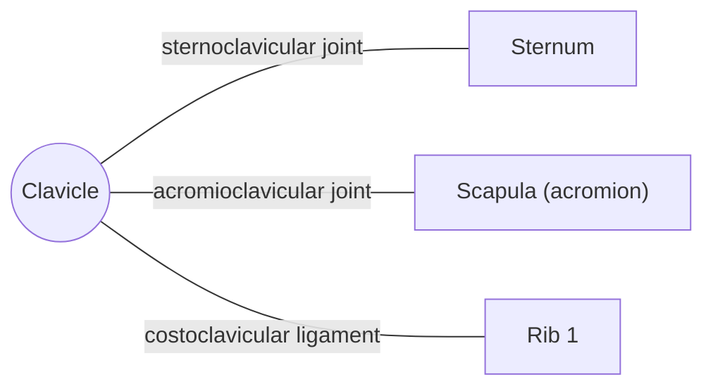

# Clavicle

## Summary

The clavicle (collarbone) is an S-shaped long bone that connects the arm to the trunk. It acts as a strut holding the shoulder away from the chest, so the arm can move freely. It is the only bony link between the upper limb and the axial skeleton and one of the most frequently broken bones.

## Prerequisites

- [Skeletal system overview](../skeletal-system-overview.md)

## Core concepts

### Definition

The *clavicle* is a paired long bone lying horizontally at the base of the neck, with a medial (sternal) end and a lateral (acromial) end. It is the first bone to start ossifying in the fetus. Latin: *clavicula*.

### Analogy

The clavicle is like the boom of a crane that holds the hook (the arm) away from the cabin (the chest). Without the boom, the hook would swing against the cabin. The analogy breaks because the boom rotates along its long axis when the arm is raised overhead.

### Mechanism

Forces from the arm pass through the clavicle to the sternum. When the arm is raised, the clavicle elevates and rotates backward at the sternoclavicular joint. The subclavian vessels and brachial plexus run beneath it.

The diagram shows the bones this bone meets and the joints it forms.

### Landmarks

| Landmark | Description |
| --- | --- |
| Sternal end | Rounded; sternoclavicular joint |
| Acromial end | Flat; acromioclavicular joint |
| Conoid tubercle and trapezoid line | Attachment of coracoclavicular ligaments |
| Shaft | Convex forward medially, concave laterally |

### Muscle attachments

Sternocleidomastoid (clavicular head), trapezius, deltoid, pectoralis major (clavicular head), subclavius, sternohyoid.

## Worked example

A fall on the outstretched hand or on the shoulder typically breaks the clavicle in its middle third, where the two curves meet. The outer fragment drops under the weight of the arm. Most such fractures heal with a sling within about 6 to 12 weeks.

## Trade offs and when to use it

The strut design gives the shoulder a wide range of motion but routes all arm loads through a thin bone.

## Common mistakes

- **Calling the acromioclavicular joint the shoulder joint.** The shoulder (glenohumeral) joint is between the humerus and the scapula.

## Practice

1. Which two joints does the clavicle form?
2. Where does the clavicle usually break?

### Answers

1. The sternoclavicular and acromioclavicular joints.
2. In its middle third.

## Further reading

- Standring, S. (Ed.) (2020). *Gray's Anatomy: The Anatomical Basis of Clinical Practice (42nd ed.)*. Elsevier. Reference text for attachments, innervation and relations.
- Betts, J. G., Young, K. A., Wise, J. A. et al. (2022). *Anatomy and Physiology 2e*. OpenStax, Rice University. [Link](https://openstax.org/details/books/anatomy-and-physiology-2e). Open textbook with illustrations of the skeletal and muscular systems.
