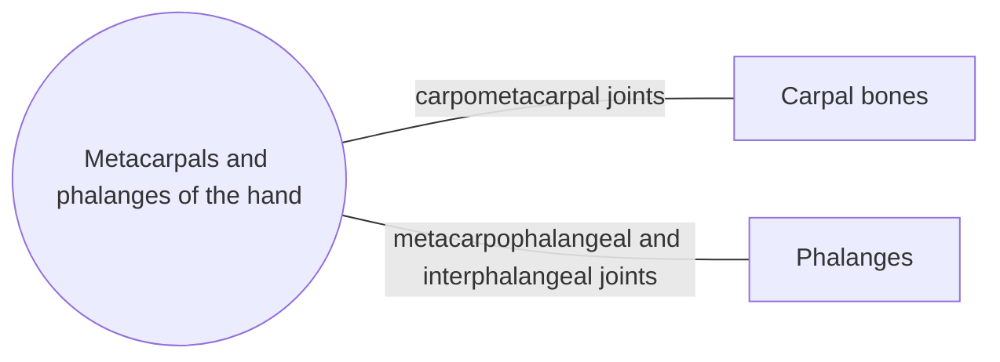

# Metacarpals and phalanges of the hand

## Summary

The hand has five metacarpals forming the palm and fourteen phalanges forming the fingers: three in each finger and two in the thumb. The thumb metacarpal sits on a saddle joint that lets the thumb oppose the other fingers, the basis of precision grip.

## Prerequisites

- [Skeletal system overview](../skeletal-system-overview.md)

## Core concepts

### Definition

The *metacarpals* are five short long bones (numbered I to V from thumb to little finger), each with a base, shaft and head. The *phalanges* are the finger bones: proximal, middle and distal in fingers II to V, and only proximal and distal in the thumb. Latin: *ossa metacarpi et phalanges manus*.

### Analogy

The hand skeleton is like a set of jointed antennas mounted on a slightly curved base plate. The thumb antenna sits on a swivel (saddle joint) and can swing across the plate to meet the others. The analogy breaks because the fingers are moved by tendons from forearm muscles, like puppet strings, as well as by small muscles in the hand.

### Mechanism

The heads of the metacarpals form the knuckles. The metacarpophalangeal joints allow flexion, extension, abduction and adduction; the interphalangeal joints are hinges. The carpometacarpal joint of the thumb (between trapezium and metacarpal I) is a saddle joint allowing opposition.

The diagram shows the bones this bone meets and the joints it forms.

### Landmarks

| Landmark | Description |
| --- | --- |
| Metacarpal base, shaft, head | Head forms the knuckle |
| Proximal phalanx | Longest phalanx |
| Middle phalanx | Absent in the thumb |
| Distal phalanx and tuberosity | Supports the fingertip and nail |

### Muscle attachments

Interossei, lumbricals (via extensor expansions), adductor pollicis, opponens muscles, long flexor and extensor tendons of the fingers and thumb.

## Worked example

A "boxer's fracture" is a break of the neck of the fifth metacarpal from punching with a closed fist. The knuckle of the little finger looks flattened. It usually heals well with splinting unless the finger is rotated.

## Trade offs and when to use it

The opposable thumb enables precision and power grips but concentrates wear at the thumb base, a common site of osteoarthritis.

## Common mistakes

- **Counting three phalanges in the thumb.** The thumb has two.

## Practice

1. How many phalanges does one hand have?
2. What type of joint allows thumb opposition?

### Answers

1. Fourteen.
2. The saddle-shaped carpometacarpal joint of the thumb.

## Further reading

- Standring, S. (Ed.) (2020). *Gray's Anatomy: The Anatomical Basis of Clinical Practice (42nd ed.)*. Elsevier. Reference text for attachments, innervation and relations.
- Betts, J. G., Young, K. A., Wise, J. A. et al. (2022). *Anatomy and Physiology 2e*. OpenStax, Rice University. [Link](https://openstax.org/details/books/anatomy-and-physiology-2e). Open textbook with illustrations of the skeletal and muscular systems.
