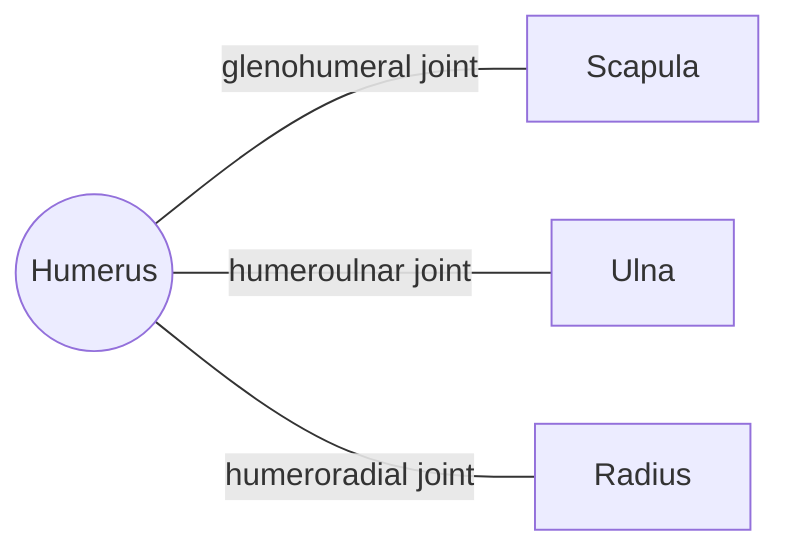

# Humerus

## Summary

The humerus is the long bone of the upper arm. Its rounded head forms the shoulder joint with the scapula, and its lower end forms the elbow with the radius and ulna. Important nerves (axillary, radial, ulnar) run close to the bone and can be injured in fractures.

## Prerequisites

- [Skeletal system overview](../skeletal-system-overview.md)

## Core concepts

### Definition

The *humerus* is a paired long bone with a proximal end (head, anatomical and surgical necks, greater and lesser tubercles), a shaft and a distal end (capitulum, trochlea and epicondyles). Latin: *humerus*.

### Analogy

The humerus is like the upper boom of an excavator: a single long beam with a ball joint at the top (shoulder) and a hinge at the bottom (elbow). The analogy breaks because the "ball" sits in a very shallow socket, held mainly by muscles.

### Mechanism

The head is about three times larger than the glenoid, which allows a wide range of motion. The intertubercular (bicipital) groove guides the tendon of the long head of the biceps. The radial nerve winds around the back of the shaft in the radial groove, and the ulnar nerve passes behind the medial epicondyle (the "funny bone").

The diagram shows the bones this bone meets and the joints it forms.

### Landmarks

| Landmark | Description |
| --- | --- |
| Head | Shoulder joint |
| Greater tubercle | Supraspinatus, infraspinatus, teres minor |
| Lesser tubercle | Subscapularis |
| Intertubercular groove | Long head of biceps tendon |
| Surgical neck | Common fracture site; axillary nerve |
| Deltoid tuberosity | Insertion of deltoid |
| Radial groove | Radial nerve |
| Capitulum and trochlea | Elbow joint surfaces for radius and ulna |
| Medial and lateral epicondyles | Origins of forearm flexors and extensors |

### Muscle attachments

Rotator cuff, deltoid, pectoralis major, latissimus dorsi, teres major, coracobrachialis, brachialis, triceps (lateral and medial heads), brachioradialis, forearm flexors (medial epicondyle) and extensors (lateral epicondyle).

## Worked example

A fracture of the shaft in the middle third can injure the radial nerve in its groove, causing "wrist drop": the person cannot extend the wrist and fingers. Checking wrist extension after such a fracture tests the nerve.

## Trade offs and when to use it

A large head on a shallow socket gives the shoulder the widest range of any joint but makes dislocation common.

## Common mistakes

- **Calling the medial epicondyle pain "tennis elbow".** Tennis elbow is lateral; golfer's elbow is medial.

## Practice

1. Which nerve is at risk in a fracture of the surgical neck?
2. What runs in the intertubercular groove?

### Answers

1. The axillary nerve.
2. The tendon of the long head of the biceps.

## Further reading

- Standring, S. (Ed.) (2020). *Gray's Anatomy: The Anatomical Basis of Clinical Practice (42nd ed.)*. Elsevier. Reference text for attachments, innervation and relations.
- Betts, J. G., Young, K. A., Wise, J. A. et al. (2022). *Anatomy and Physiology 2e*. OpenStax, Rice University. [Link](https://openstax.org/details/books/anatomy-and-physiology-2e). Open textbook with illustrations of the skeletal and muscular systems.
