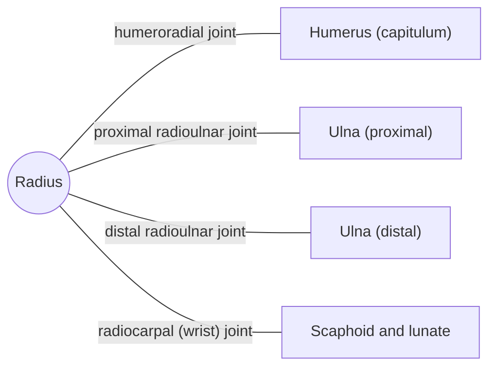

# Radius

## Summary

The radius is the forearm bone on the thumb side. Its small head turns against the ulna during pronation and supination, and its wide lower end forms most of the wrist joint. A fall on the outstretched hand often breaks its lower end (distal radius fracture), the most common fracture in adults.

## Prerequisites

- [Skeletal system overview](../skeletal-system-overview.md)

## Core concepts

### Definition

The *radius* is a paired long bone of the forearm, lateral in the anatomical position. Its proximal end is a disc-shaped head; its distal end is broad, with the styloid process on the outer side. Latin: *radius*.

### Analogy

The radius is like a door that swings around a fixed post (the ulna): at the elbow it spins in place, and at the wrist it sweeps around the end of the ulna, carrying the hand with it. That sweeping motion is pronation and supination. The analogy breaks because the post (ulna) also moves slightly.

### Mechanism

In pronation the radius crosses over the ulna; in supination they lie parallel. The biceps inserts on the radial tuberosity and is therefore a strong supinator as well as an elbow flexor. Most force from the hand passes through the radius to the elbow.

The diagram shows the bones this bone meets and the joints it forms.

### Landmarks

| Landmark | Description |
| --- | --- |
| Head | Rotates in the annular ligament against the ulna |
| Radial tuberosity | Insertion of biceps |
| Shaft | Interosseous border for the membrane |
| Styloid process | Lateral tip at the wrist; brachioradialis inserts |
| Ulnar notch | Distal radioulnar joint |
| Carpal surface | Wrist joint with scaphoid and lunate |

### Muscle attachments

Biceps brachii, supinator, pronator teres, pronator quadratus, brachioradialis, flexor digitorum superficialis (radial head), flexor pollicis longus, abductor pollicis longus, extensor pollicis brevis.

## Worked example

A distal radius fracture after a fall on the outstretched hand typically tilts the fragment backward (Colles fracture), giving a "dinner fork" shape. In older women it is often the first sign of osteoporosis and should prompt a bone density check.

## Trade offs and when to use it

The rotating design allows pronation and supination, a key ability of the human hand, at the cost of a complex joint system prone to injury.

## Common mistakes

- **Placing the radius on the little finger side.** In the anatomical position the radius is lateral, on the thumb side.

## Practice

1. On which side of the forearm is the radius?
2. Which muscle inserts on the radial tuberosity?

### Answers

1. The thumb (lateral) side.
2. Biceps brachii.

## Further reading

- Standring, S. (Ed.) (2020). *Gray's Anatomy: The Anatomical Basis of Clinical Practice (42nd ed.)*. Elsevier. Reference text for attachments, innervation and relations.
- Betts, J. G., Young, K. A., Wise, J. A. et al. (2022). *Anatomy and Physiology 2e*. OpenStax, Rice University. [Link](https://openstax.org/details/books/anatomy-and-physiology-2e). Open textbook with illustrations of the skeletal and muscular systems.
