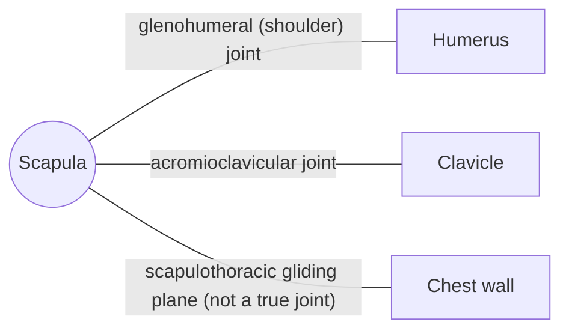

# Scapula

## Summary

The scapula (shoulder blade) is a flat triangular bone on the back of the chest wall. It carries the socket of the shoulder joint (glenoid cavity) and anchors 17 muscles. It glides over the ribs, so the socket can follow the arm, which is why shoulder health depends on scapular control.

## Prerequisites

- [Skeletal system overview](../skeletal-system-overview.md)

## Core concepts

### Definition

The *scapula* is a paired, flat, triangular bone lying over ribs 2 to 7 at the back. It has a spine across its back surface ending in the acromion, a coracoid process in front and a shallow glenoid cavity laterally. Latin: *scapula*.

### Analogy

The scapula is like a mobile base for a robotic arm: by sliding and tilting on the chest wall, it positions the socket so the arm keeps working in its strongest range. The analogy breaks because the base is held only by muscles, with no bony joint to the ribs.

### Mechanism

Movements of the scapula are elevation, depression, protraction, retraction and upward and downward rotation. During arm elevation, roughly 2 degrees of glenohumeral movement occur for every 1 degree of scapular upward rotation (scapulohumeral rhythm).

The diagram shows the bones this bone meets and the joints it forms.

### Landmarks

| Landmark | Description |
| --- | --- |
| Glenoid cavity | Shallow socket for the head of the humerus |
| Spine | Ridge on the back; trapezius and deltoid attach |
| Acromion | Tip of the shoulder; acromioclavicular joint |
| Coracoid process | Hook in front; pectoralis minor, biceps short head, coracobrachialis |
| Supraspinous and infraspinous fossae | Origins of supraspinatus and infraspinatus |
| Subscapular fossa | Origin of subscapularis |
| Inferior angle | Lower tip; teres major and latissimus dorsi pass |

### Muscle attachments

Rotator cuff (supraspinatus, infraspinatus, teres minor, subscapularis), deltoid, trapezius, rhomboids, levator scapulae, serratus anterior, pectoralis minor, biceps, triceps (long head), teres major, coracobrachialis, omohyoid, latissimus dorsi (in part).

## Worked example

"Scapular winging", where the inner border of the shoulder blade lifts off the ribs when pushing against a wall, usually means weakness of the serratus anterior, often from injury to the long thoracic nerve. It shows how the scapula depends on muscles to stay on the chest wall.

## Trade offs and when to use it

Muscular suspension allows great mobility of the shoulder but makes it depend on muscle balance; weak or poorly coordinated scapular muscles are linked to shoulder impingement.

## Common mistakes

- **Thinking the scapulothoracic joint is a true joint.** It is a gliding plane between muscles, without cartilage or capsule.

## Practice

1. What forms the socket of the shoulder joint?
2. Which muscle weakness causes scapular winging?

### Answers

1. The glenoid cavity of the scapula.
2. Serratus anterior (long thoracic nerve).

## Further reading

- Standring, S. (Ed.) (2020). *Gray's Anatomy: The Anatomical Basis of Clinical Practice (42nd ed.)*. Elsevier. Reference text for attachments, innervation and relations.
- Betts, J. G., Young, K. A., Wise, J. A. et al. (2022). *Anatomy and Physiology 2e*. OpenStax, Rice University. [Link](https://openstax.org/details/books/anatomy-and-physiology-2e). Open textbook with illustrations of the skeletal and muscular systems.
