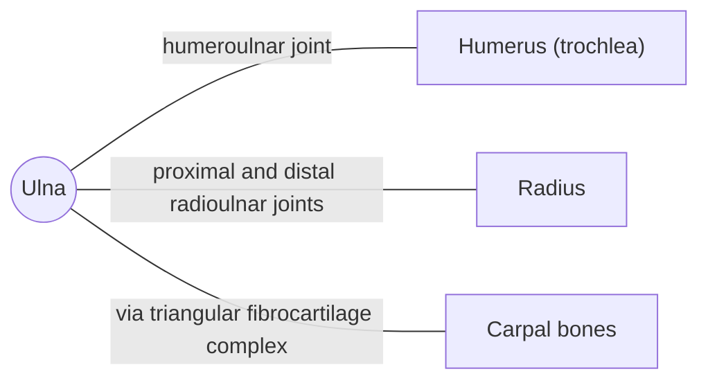

# Ulna

## Summary

The ulna is the forearm bone on the little finger side. Its upper end grips the trochlea of the humerus and forms the main hinge of the elbow; the olecranon is the point of the elbow. At the wrist it is small and does not touch the carpal bones directly.

## Prerequisites

- [Skeletal system overview](../skeletal-system-overview.md)

## Core concepts

### Definition

The *ulna* is a paired long bone of the forearm, medial in the anatomical position. Its proximal end has the olecranon and coronoid process around the trochlear notch; its distal end is a small head with a styloid process. Latin: *ulna*.

### Analogy

The upper end of the ulna is like a wrench gripping a bolt: the trochlear notch closes around the trochlea of the humerus, allowing only a hinge movement. The analogy breaks because the grip also forms a pivot point around which the radius turns.

### Mechanism

Elbow flexion and extension happen between the trochlear notch and the trochlea. The olecranon locks into the olecranon fossa in full extension. The triceps inserts on the olecranon, and the brachialis on the coronoid process and ulnar tuberosity. A triangular fibrocartilage separates the ulnar head from the carpal bones.

The diagram shows the bones this bone meets and the joints it forms.

### Landmarks

| Landmark | Description |
| --- | --- |
| Olecranon | Point of the elbow; triceps insertion |
| Coronoid process and ulnar tuberosity | Brachialis insertion |
| Trochlear notch | Hinge with the humerus |
| Radial notch | Proximal radioulnar joint |
| Head | Distal end; distal radioulnar joint |
| Styloid process | Medial tip at the wrist |

### Muscle attachments

Triceps brachii, brachialis, anconeus, flexor carpi ulnaris, flexor digitorum profundus, pronator quadratus, supinator, extensor carpi ulnaris, extensor pollicis longus, extensor indicis.

## Worked example

Hitting the "funny bone" compresses the ulnar nerve where it passes behind the medial epicondyle of the humerus next to the olecranon. The tingling in the ring and little fingers shows the nerve's supply area.

## Trade offs and when to use it

The ulna provides a stable hinge at the elbow, while the radius provides rotation; together they divide labor between stability and mobility.

## Common mistakes

- **Saying the ulna forms most of the wrist joint.** The radius forms most of the wrist joint.

## Practice

1. Which muscle inserts on the olecranon?
2. Is the ulna in direct contact with the carpal bones?

### Answers

1. Triceps brachii.
2. No, a triangular fibrocartilage lies between them.

## Further reading

- Standring, S. (Ed.) (2020). *Gray's Anatomy: The Anatomical Basis of Clinical Practice (42nd ed.)*. Elsevier. Reference text for attachments, innervation and relations.
- Betts, J. G., Young, K. A., Wise, J. A. et al. (2022). *Anatomy and Physiology 2e*. OpenStax, Rice University. [Link](https://openstax.org/details/books/anatomy-and-physiology-2e). Open textbook with illustrations of the skeletal and muscular systems.
