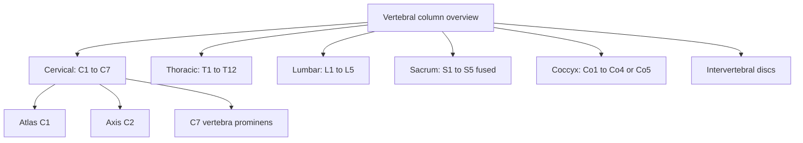

# Vertebral column

The vertebral column (spine) is the central axis of the skeleton. It carries the weight of the head and trunk, protects the spinal cord and allows the trunk to bend and twist. These notes cover the column as a whole, each region and the special vertebrae, and the discs between them.

## Map

## Reading order

1. [Vertebral column overview](vertebral-column-overview.md): regions, curves, the structure of a vertebra and the labels used on X-rays.
2. [Cervical vertebrae](cervical-vertebrae.md): the typical neck vertebrae C3 to C6.
3. [Atlas (C1)](atlas.md): C1, which carries the skull.
4. [Axis (C2)](axis.md): C2, the pivot for head rotation.
5. [Vertebra prominens (C7)](vertebra-prominens.md): C7, the transition to the thoracic spine.
6. [Thoracic vertebrae](thoracic-vertebrae.md): T1 to T12 and their joints with the ribs.
7. [Lumbar vertebrae](lumbar-vertebrae.md): L1 to L5, the weight-bearing segment.
8. [Sacrum](sacrum.md): five fused vertebrae in the pelvis.
9. [Coccyx](coccyx.md): the tailbone.
10. [Intervertebral discs](intervertebral-discs.md): the shock absorbers between vertebrae.
