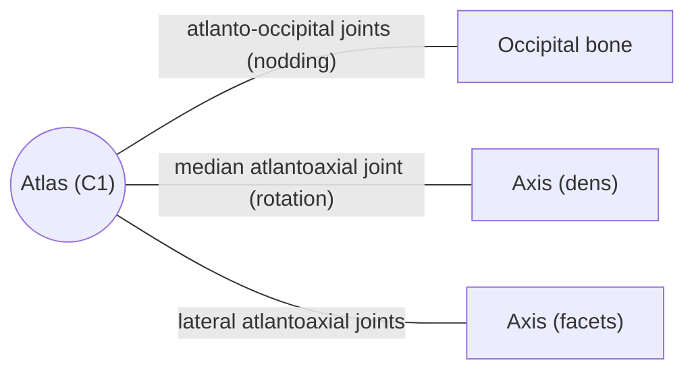

# Atlas (C1)

## Summary

The atlas is the first cervical vertebra, a ring of bone that carries the skull. It has no body and no true spinous process. With the occipital bone it forms the joint for nodding, and with the axis below it the joint for turning the head.

## Prerequisites

- [Vertebral column overview](vertebral-column-overview.md)

## Core concepts

### Definition

The *atlas* (C1) is named after the Greek titan who held up the sky, because it carries the head. Its body has fused during development with the upper surface of the body of the next vertebra (forming the dens of the axis), so the atlas has no body of its own. It also lacks a proper spinous process. It is ring-shaped, with an anterior arch, a posterior arch and two lateral masses. Latin: *atlas*.

### Analogy

The atlas is like a washer between the head (a bolt head) and the axis (the bolt): the dens of the axis passes through the front of the ring, and the ring turns around it. The analogy breaks because the washer is also the seat for the skull, which rocks on it for nodding.

### Mechanism

- The **lateral masses** carry the *superior articular facets*, concave and kidney-shaped, which hold the occipital condyles (atlanto-occipital joints: flexion and extension, "yes"), and the *inferior articular facets*, which rest on the axis (lateral atlantoaxial joints).
- The **anterior arch** has a facet on its inner surface for the dens of the axis (median atlantoaxial joint: rotation, "no"). The *transverse ligament of the atlas* holds the dens against this facet.
- The **transverse processes** are much longer, stronger and wider set than in other cervical vertebrae, because they anchor muscles that rotate the head. They lack the spinal nerve groove and the two tubercles. Their free ends can be felt in the hollow behind and below the earlobe, between the mastoid process and the angle of the mandible.
- The **posterior arch** has a groove on its upper surface for the vertebral artery and the first spinal nerve, and a small posterior tubercle in place of a spinous process.

The diagram shows the bones this bone meets and the joints it forms.

### Landmarks

| Landmark | Description |
| --- | --- |
| Anterior arch and anterior tubercle | Front of the ring; facet for the dens on its inner side |
| Posterior arch and posterior tubercle | Back of the ring; no true spinous process |
| Lateral masses | Carry the articular facets |
| Superior articular facets | Hold the occipital condyles |
| Inferior articular facets | Rest on the axis |
| Transverse processes | Long, palpable behind the earlobe; transverse foramen |
| Groove for vertebral artery | Upper surface of the posterior arch |

### Muscle attachments

Rectus capitis anterior and lateralis, longus colli (anterior tubercle), obliquus capitis superior and inferior, rectus capitis posterior minor (posterior tubercle), levator scapulae and splenius cervicis (transverse process).

## Worked example

About half of all head rotation, roughly 40 to 45 degrees to each side, happens at the atlantoaxial joints. A Jefferson fracture, a burst fracture of the atlas ring, typically results from an axial blow to the top of the head, for example diving into shallow water.

## Trade offs and when to use it

The ring design allows wide rotation but depends on the transverse ligament. In rheumatoid arthritis or Down syndrome this ligament can be lax, letting the dens move back toward the spinal cord.

## Common mistakes

- **Saying the atlas has a body.** Its body became the dens of the axis.

## Practice

1. Which joint allows nodding "yes"?
2. What holds the dens against the atlas?

### Answers

1. The atlanto-occipital joint between the occipital condyles and the atlas.
2. The transverse ligament of the atlas.

## Further reading

- Standring, S. (Ed.) (2020). *Gray's Anatomy: The Anatomical Basis of Clinical Practice (42nd ed.)*. Elsevier. Reference text for attachments, innervation and relations.
- Betts, J. G., Young, K. A., Wise, J. A. et al. (2022). *Anatomy and Physiology 2e*. OpenStax, Rice University. [Link](https://openstax.org/details/books/anatomy-and-physiology-2e). Open textbook with illustrations of the skeletal and muscular systems.
