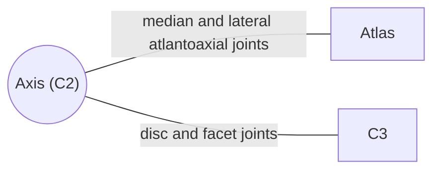

# Axis (C2)

## Summary

The axis is the second cervical vertebra. Its body extends upward into a peg, the dens, around which the atlas and the head rotate. It has a long, strong, split spinous process, the first that can easily be felt below the skull.

## Prerequisites

- [Vertebral column overview](vertebral-column-overview.md)

## Core concepts

### Definition

The *axis* (C2), also called the epistropheus, is named for the axis of rotation it forms for the atlas and head. Where the atlas lacks a body, the axis has an extended body that projects upward as the *dens* (odontoid process, "tooth"), ending in a blunt tip. Latin: *axis*.

### Analogy

The axis is like the pivot pin of a lazy Susan. The dens is the pin, the atlas is the turntable, and the head sits on top. The analogy breaks because the pin is held in place only by ligaments, not by a fixed housing.

### Mechanism

- The **dens** has an oval anterior articular facet that joins the anterior arch of the atlas and a posterior articular facet that joins the transverse ligament of the atlas.
- The **superior articular surfaces** are flat and lie beside the dens on the body, not on true superior articular processes, as in the atlas. They form the lateral atlantoaxial joints.
- The **spinous process** is long, strong and split at the end.
- The second spinal nerve runs behind the superior articular surface, as the first spinal nerve and the vertebral artery do on the atlas.

The diagram shows the bones this bone meets and the joints it forms.

### Landmarks

| Landmark | Description |
| --- | --- |
| Dens | Peg projecting upward; anterior and posterior facets |
| Body | Below the dens |
| Superior articular surfaces | Flat, on the body, for the atlas |
| Inferior articular processes | For C3 |
| Spinous process | Long, strong, bifid |
| Transverse foramen | Vertebral artery |

### Muscle attachments

Obliquus capitis inferior and rectus capitis posterior major (spinous process), longus colli (body), semispinalis cervicis, multifidus, interspinales, levator scapulae (transverse process).

## Worked example

Fractures of the dens are common in older adults after falls, because bone is weaker and the neck is stiff. They can be unstable, since the dens and atlas then move together over the cord; treatment ranges from a rigid collar to surgery.

## Trade offs and when to use it

The pivot design gives the largest single range of rotation in the spine at the cost of relying on ligaments for stability.

## Common mistakes

- **Calling the dens part of the atlas.** The dens belongs to the axis, although it developed from the body of the atlas.

## Practice

1. What is the dens?
2. Which joint is responsible for shaking the head "no"?

### Answers

1. The upward peg of the axis around which the atlas rotates.
2. The atlantoaxial joints, mainly the median one around the dens.

## Further reading

- Standring, S. (Ed.) (2020). *Gray's Anatomy: The Anatomical Basis of Clinical Practice (42nd ed.)*. Elsevier. Reference text for attachments, innervation and relations.
- Betts, J. G., Young, K. A., Wise, J. A. et al. (2022). *Anatomy and Physiology 2e*. OpenStax, Rice University. [Link](https://openstax.org/details/books/anatomy-and-physiology-2e). Open textbook with illustrations of the skeletal and muscular systems.
