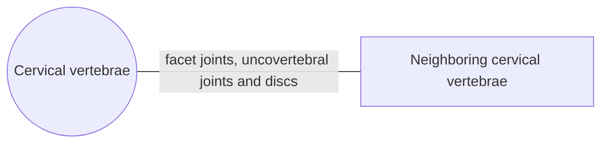

# Cervical vertebrae

## Summary

The seven cervical vertebrae form the neck, the most mobile part of the spine. Typical cervical vertebrae (C3 to C6) have small bodies, large triangular vertebral foramina, split spinous processes and a hole in each transverse process through which the vertebral artery runs. C1, C2 and C7 are special and have their own notes.

## Prerequisites

- [Vertebral column overview](vertebral-column-overview.md)

## Core concepts

### Definition

A *cervical vertebra* is one of the seven vertebrae between the skull and the thorax. The body is low, with upper and lower surfaces shaped like a transverse rectangle with rounded edges. The front and back of the body are about equally tall. The upper surface is concave from side to side and slightly convex from front to back; the lower surface is the opposite. The arches are thin and slope slightly down, enclosing a large triangular vertebral foramen. Latin: *vertebrae cervicales*.

### Analogy

The cervical spine is like the gimbal mount of a camera: many small joints, each with a little movement, add up to a wide range in every direction, so the head (the camera) can point anywhere. The analogy breaks because the mount also carries vital cables (the spinal cord and vertebral arteries) through its parts.

### Mechanism

The most characteristic feature is the *transverse process*. It is short and made of two bony bars (anterior and posterior) that join at the free end, which carries the anterior and posterior tubercles. The bars enclose the *transverse foramen*, sometimes split in two by a connective tissue or bony bridge. From C6 upward, the following run through these foramina: the vertebral artery and usually two vertebral veins, and a plexus of sympathetic nerves. A deep groove on the upper surface of each transverse process carries the anterior branch of the cervical spinal nerve.

The spinous process is not long and slopes slightly down. Up to and including C6, its tip usually splits into two, often asymmetric, knob-like parts. The spinous processes grow longer from top to bottom.

The superior and inferior articular processes carry round, nearly flat joint surfaces, tilted at about 45 degrees from top to bottom and from front to back. This orientation allows flexion, extension, side bending and rotation. Small hooks on the upper edges of the bodies (uncinate processes) form the uncovertebral joints.

The diagram shows the bones this bone meets and the joints it forms.

### Landmarks

| Landmark | Description |
| --- | --- |
| Body | Small, wider than deep, with uncinate processes on the upper edges |
| Vertebral foramen | Large and triangular |
| Transverse foramen | Vertebral artery, veins and sympathetic plexus (from C6 up) |
| Anterior and posterior tubercles | Ends of the transverse process; scalene and other neck muscles attach |
| Groove for spinal nerve | On the upper surface of the transverse process |
| Spinous process | Short, split (bifid) at C2 to C6 |
| Articular facets | Round, tilted about 45 degrees |

### Muscle attachments

Scalenes (anterior and posterior tubercles), longus colli and longus capitis, levator scapulae (C1 to C4 transverse processes), splenius cervicis, semispinalis and multifidus, interspinales.

## Worked example

The carotid tubercle (anterior tubercle of C6) is large and can be felt deep in the neck. Pressing the common carotid artery against it was used in first aid to stop bleeding, and it is a landmark for nerve blocks, showing how a bony landmark guides clinical procedures.

## Trade offs and when to use it

High mobility makes the neck vulnerable: whiplash injuries strain the soft tissues, and degeneration of the C5 to C7 segments is common with age.

## Common mistakes

- **Assuming the vertebral artery passes through C7.** It usually enters at C6; the C7 foramen usually carries only veins.

## Practice

1. What passes through the transverse foramina of cervical vertebrae?
2. Which cervical vertebrae usually have split spinous processes?

### Answers

1. The vertebral artery, vertebral veins and a sympathetic plexus.
2. C2 to C6.

## Further reading

- Standring, S. (Ed.) (2020). *Gray's Anatomy: The Anatomical Basis of Clinical Practice (42nd ed.)*. Elsevier. Reference text for attachments, innervation and relations.
- Betts, J. G., Young, K. A., Wise, J. A. et al. (2022). *Anatomy and Physiology 2e*. OpenStax, Rice University. [Link](https://openstax.org/details/books/anatomy-and-physiology-2e). Open textbook with illustrations of the skeletal and muscular systems.
