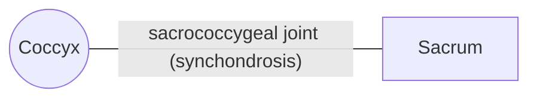

# Coccyx

## Summary

The coccyx, or tailbone, is the small triangular end of the spine, made of four or five rudimentary vertebrae, mostly just their bodies. It anchors pelvic floor muscles and ligaments and supports some weight when sitting leaning back.

## Prerequisites

- [Vertebral column overview](vertebral-column-overview.md)

## Core concepts

### Definition

The *coccyx* consists of four or five rudimentary vertebrae (the number varies), of which mainly the bodies remain. It is roughly triangular, with its base facing the sacrum and its tip ending the spine. The base is the upper surface of the first coccygeal vertebra, which besides the body has rudimentary transverse processes and superior articular processes forming the *coccygeal cornua*. These cornua join the matching cornua of the sacrum. Latin: *os coccygis*.

### Analogy

The coccyx is like the stub of a tail-light bracket left on a car after the light was removed: no longer serving its original purpose, but still used to fix other parts (muscles and ligaments of the pelvic floor). The analogy breaks because it does carry some load when we sit leaning back.

### Mechanism

Further coccygeal vertebrae are flattened or round little bones, only remnants of bodies. Sometimes small transverse processes can be seen on the second vertebra as low bumps on its sides.

The base joins the apex of the sacrum by a cartilaginous joint (synchondrosis), as do the first and second and the second and third coccygeal vertebrae; beyond that the joints are ossified. Later in life all these joints usually ossify, including the joint with the sacrum. The last two vertebrae tend to fuse asymmetrically, so the coccyx may be bent clearly to the side or forward, much less often backward.

The coccygeal nerve supplies the area, including the skin over the coccyx, the coccygeus muscle and the back part of the levator ani.

The diagram shows the bones this bone meets and the joints it forms.

### Landmarks

| Landmark | Description |
| --- | --- |
| Base | Upper surface of Co1; joins the sacrum |
| Coccygeal cornua | Rudimentary superior articular processes |
| Rudimentary transverse processes | On Co1, sometimes Co2 |
| Apex | End of the vertebral column |

### Muscle attachments

Gluteus maximus (in part), coccygeus, levator ani (iliococcygeus via the anococcygeal ligament), external anal sphincter (via the anococcygeal body).

## Worked example

Coccydynia, pain at the tailbone, often follows a fall onto the buttocks or childbirth. Sitting is painful, especially leaning back. Most cases settle within weeks to months with a cushion with a cut-out, and persistent cases may get injections.

## Trade offs and when to use it

A vestigial structure with a real role in anchoring the pelvic floor.

## Common mistakes

- **Thinking the coccyx has no function.** It anchors pelvic floor muscles and ligaments.

## Practice

1. How many vertebrae form the coccyx?
2. Which nerve supplies the coccyx region?

### Answers

1. Four or five.
2. The coccygeal nerve.

## Further reading

- Standring, S. (Ed.) (2020). *Gray's Anatomy: The Anatomical Basis of Clinical Practice (42nd ed.)*. Elsevier. Reference text for attachments, innervation and relations.
- Betts, J. G., Young, K. A., Wise, J. A. et al. (2022). *Anatomy and Physiology 2e*. OpenStax, Rice University. [Link](https://openstax.org/details/books/anatomy-and-physiology-2e). Open textbook with illustrations of the skeletal and muscular systems.
