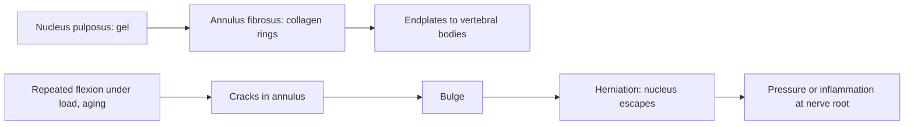
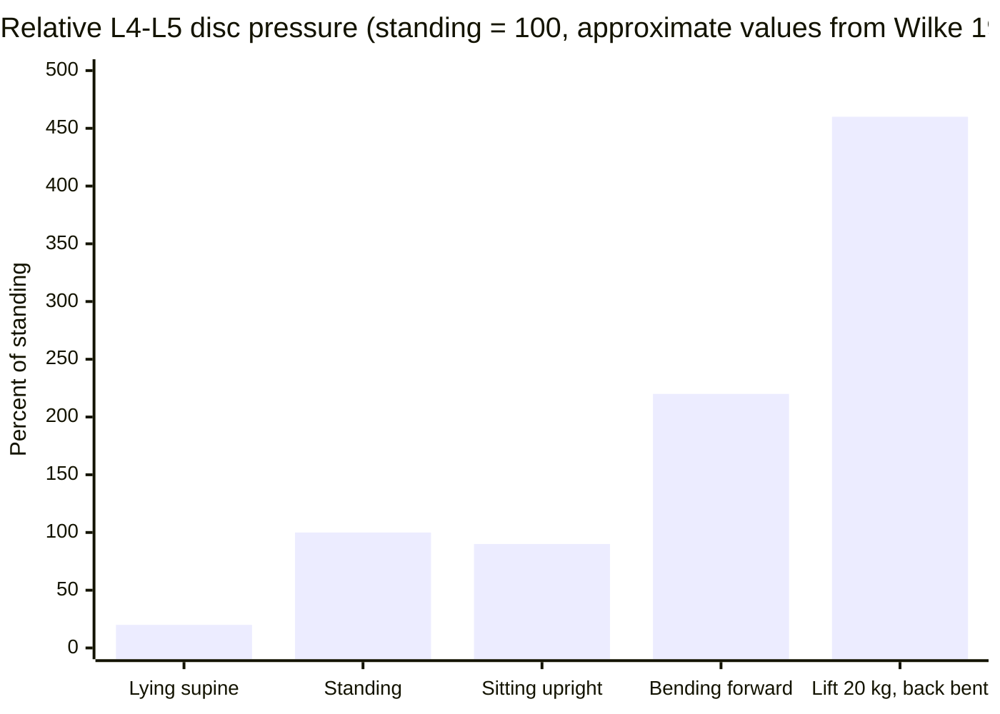

# Intervertebral discs

## Summary

Intervertebral discs are the fibrocartilage cushions between the bodies of neighboring vertebrae, from C2-C3 down to L5-S1. Each has a tough outer ring (annulus fibrosus) around a gel-like core (nucleus pulposus). Discs absorb shocks, spread load evenly and allow movement between vertebrae. They make up about a quarter of the length of the spine above the sacrum. With age they lose water, and the outer ring can crack, letting the core bulge or herniate and press on nerves.

## Prerequisites

- [Vertebral column overview](vertebral-column-overview.md)

## Core concepts

### Definition

An *intervertebral disc* (*discus intervertebralis*) is a symphysis, a cartilaginous joint, between two vertebral bodies. It consists of the *annulus fibrosus*, concentric layers (lamellae) of collagen fibers running at alternating angles of about 30 degrees, and the *nucleus pulposus*, a gel of water, proteoglycans and collagen in the center. Cartilaginous *endplates* attach the disc to the vertebral bodies. There is no disc between the skull and C1 or between C1 and C2.

### Analogy

A disc is like a car tire: the tread and plies (annulus fibrosus) contain the pressurized air (nucleus pulposus). Pressure inside the tire spreads the load across the whole ring. If the plies crack, the inner tube bulges through the weak spot. The analogy breaks because a disc is filled with gel that loses water during the day and regains it at night, and because it has almost no blood supply, so it heals poorly.

### Mechanism

1. Compression raises pressure in the nucleus, which pushes outward on the annulus. The collagen layers resist this tension and spread the load.
2. During bending, the nucleus shifts slightly toward the side that is opening (backward in forward bending).
3. Discs are nourished by diffusion through the endplates. Movement and loading cycles help this exchange.
4. Over a day, discs lose water under load, and a person is about 1 to 2 cm shorter in the evening than in the morning. At night they rehydrate.
5. With age, proteoglycans decrease and the nucleus dries out; small cracks form in the annulus. Most adults over 40 show signs of disc degeneration on MRI, often without pain.

The diagram shows the structure and the sequence of failure in a herniation.

### Disc pressure by posture

Classic measurements by Nachemson in the 1960s and later by Wilke and colleagues (1999) give relative pressures in the L4-L5 disc. Taking relaxed standing as 100 percent, lying on the back is about 20 percent, sitting upright about 90 to 140 percent depending on the study, bending forward while standing about 150 to 220 percent, and lifting a 20 kg weight with a bent back about 460 percent compared with about 340 percent with bent knees and a straight back (Wilke values, one subject). The exact numbers differ between studies, but the ranking is consistent.

## Worked example

A 35-year-old has back pain radiating below the knee into the big toe after lifting. Straight-leg raising on that side reproduces the leg pain at 40 degrees. This pattern suggests an L4-L5 disc herniation irritating the L5 root. Most such cases improve within 6 to 12 weeks without surgery, as the herniated material shrinks; surgery is considered for severe weakness, loss of bladder or bowel control (an emergency) or persistent pain.

## Trade offs and when to use it

- Discs allow motion and absorb load, but because they have little blood supply, damage repairs slowly.
- Degeneration on imaging is common in people without pain, so imaging findings must be matched to symptoms.

## Common mistakes

- **Calling a herniation a "slipped disc".** The disc does not slip; its core pushes through the ring.
- **Assuming all degenerated discs cause pain.** Many do not.
- **Avoiding all movement after a disc injury.** Gentle activity usually helps recovery more than bed rest.

## Practice

1. Name the two parts of a disc.
2. Why are people slightly taller in the morning?
3. Between which vertebrae is there no disc?

### Answers

1. The annulus fibrosus (outer ring) and the nucleus pulposus (gel core).
2. Discs regain water lying down at night and lose it under load during the day.
3. Between the skull and C1 and between C1 and C2.

## Further reading

- Standring, S. (Ed.) (2020). *Gray's Anatomy: The Anatomical Basis of Clinical Practice (42nd ed.)*. Elsevier. Reference text for attachments, innervation and relations.
- Betts, J. G., Young, K. A., Wise, J. A. et al. (2022). *Anatomy and Physiology 2e*. OpenStax, Rice University. [Link](https://openstax.org/details/books/anatomy-and-physiology-2e). Open textbook with illustrations of the skeletal and muscular systems.
- Wilke, H. J., Neef, P., Caimi, M. et al. (1999). New in vivo measurements of pressures in the intervertebral disc in daily life. Spine, 24(8), 755-762. [DOI](https://doi.org/10.1097/00007632-199904150-00005). In vivo disc pressure measurements in different postures.
