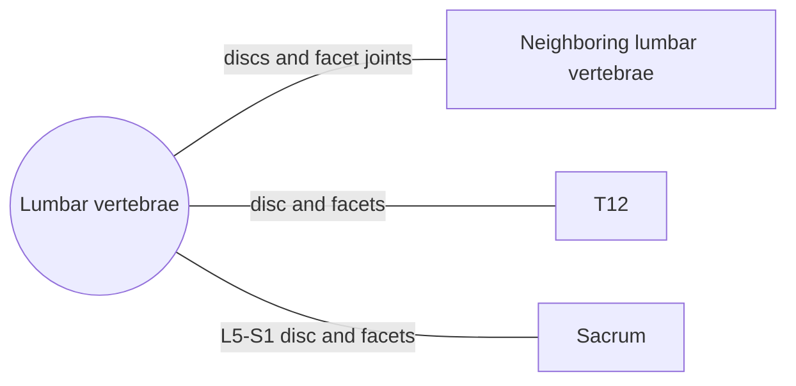

# Lumbar vertebrae

## Summary

The five lumbar vertebrae form the lower back. They are the largest, most massive vertebrae because they carry the weight of the upper body, and they have no facets for ribs. Their facet joints lie almost in the sagittal plane, which allows bending forward and back but limits twisting. The lumbar spine is the most loaded region and the most common site of back pain.

## Prerequisites

- [Vertebral column overview](vertebral-column-overview.md)

## Core concepts

### Definition

A *lumbar vertebra* is one of the five vertebrae (L1 to L5) between the thorax and the sacrum. Its body is large, with flat, kidney-shaped upper and lower surfaces and no costal facets. Lumbar vertebrae are easy to tell apart from all others. Latin: *vertebrae lumbales*.

### Analogy

The lumbar spine is like the base section of a crane: it carries the largest load and is built heavy, but it is designed to bend in one plane, not to twist. Twisting a loaded crane base is exactly what damages it. The analogy breaks because the lumbar spine also relies on muscles, not only on its own structure, to stay stable.

### Mechanism

Lumbar vertebrae have three kinds of processes:

- **Articular processes** (superior and inferior) are vertical. A small *mammillary process* sits on the outer side of each superior articular process. The joint surfaces lie almost in the sagittal plane: the superior ones are concave and face backward and inward, the inferior ones convex and face forward and outward.
- **Spinous processes** are plates lying in the midline. They project straight back from the arch, sometimes bent slightly down, with thickened ends.
- **Transverse processes** arise from the base of the arch and the body. They are mainly made of remnants of lumbar ribs and only partly of true transverse processes, so they are called *costal processes* (processus costales). An *accessory process* (processus accessorius) at their base is the remnant of the true transverse process; the separation is usually visible on L1.

The arches are strong, narrow at the root and wider behind. The vertebral foramina are usually triangular, sometimes oval.

The diagram shows the bones this bone meets and the joints it forms.

### Landmarks

| Landmark | Description |
| --- | --- |
| Body | Large, kidney-shaped, no rib facets |
| Costal (transverse) processes | Long, slender; remnants of ribs |
| Accessory process | At the base of the costal process |
| Mammillary process | On the superior articular process; multifidus attachment |
| Articular processes | Vertical; facets nearly in sagittal plane |
| Spinous process | Broad, horizontal plate |
| Vertebral foramen | Triangular |

### Muscle attachments

Psoas major (bodies and costal processes), quadratus lumborum (costal processes), diaphragm crura (L1 to L3 bodies), erector spinae, multifidus (mammillary processes), latissimus dorsi (via thoracolumbar fascia), transversus abdominis and internal oblique (via thoracolumbar fascia).

## Worked example

About 90 percent of lumbar disc herniations occur at L4-L5 or L5-S1. A herniation at L5-S1 usually compresses the S1 nerve root, causing pain down the back of the leg into the sole, weakness of plantar flexion and a reduced ankle reflex. The level can be inferred from the pattern of symptoms, which an MRI then confirms.

## Trade offs and when to use it

Large bodies carry load, and sagittal facets protect against twisting, but the large range of flexion and extension at L4 to S1 concentrates disc stress there.

## Common mistakes

- **Thinking the lumbar "transverse process" is the same as in thoracic vertebrae.** It is mostly a rib remnant (costal process).
- **Rounding the lower back under heavy load without training.** Learn to brace and hinge at the hips; see [Core stability](../../../exercise-and-fitness/mobility/core.md).

## Practice

1. Why do lumbar vertebrae have the largest bodies?
2. In which plane do lumbar facet joints lie, and what does this limit?
3. Which two disc levels are herniated most often?

### Answers

1. They carry the most body weight.
2. Nearly the sagittal plane, which limits rotation.
3. L4-L5 and L5-S1.

## Further reading

- Standring, S. (Ed.) (2020). *Gray's Anatomy: The Anatomical Basis of Clinical Practice (42nd ed.)*. Elsevier. Reference text for attachments, innervation and relations.
- Betts, J. G., Young, K. A., Wise, J. A. et al. (2022). *Anatomy and Physiology 2e*. OpenStax, Rice University. [Link](https://openstax.org/details/books/anatomy-and-physiology-2e). Open textbook with illustrations of the skeletal and muscular systems.
