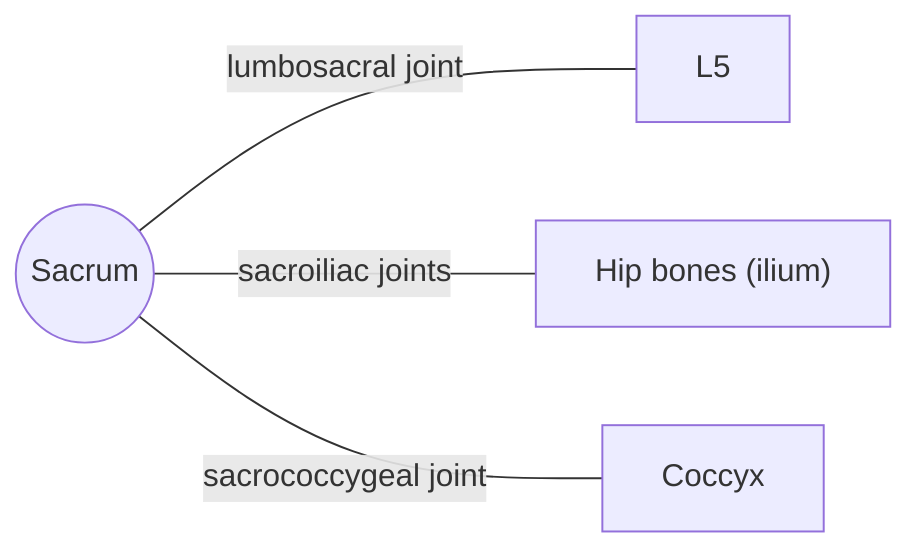

# Sacrum

## Summary

The sacrum is a triangular bone formed by five fused vertebrae. It is wedged between the two hip bones and, with them, forms the pelvic ring. It carries the weight of the trunk to the pelvis and legs and has openings through which the sacral nerves leave.

## Prerequisites

- [Vertebral column overview](vertebral-column-overview.md)

## Core concepts

### Definition

The *sacrum* is the fused sacral segment of the spine (S1 to S5). It is shaped like a wedge or a triangle pointing down, because the sacral vertebrae shrink rapidly from top to bottom. Its upper, wide part is the *base* and its lower tip the *apex*. Latin: *os sacrum*.

### Analogy

The sacrum is like the keystone of a Roman arch: wedged between the two hip bones, it locks the pelvic ring, and the weight above presses it tighter between them. The analogy breaks because the sacrum is held mostly by very strong ligaments, not only by its shape, and it can move slightly (nutation).

### Mechanism

Seen from the side, the sacrum bulges strongly backward (sacral kyphosis), which enlarges the lesser pelvis. Because the lumbar spine is convex forward and the sacrum convex backward, an angle pointing forward forms at the junction of L5 and the base of the sacrum, the *lumbosacral angle*. The front edge of the base, the *promontory*, is an obstetric landmark.

Two surfaces are described:

- The **pelvic surface** is usually smooth and concave. In its middle it is formed by the fused vertebral bodies, whose junctions are marked by rough transverse lines that reach sideways to the *anterior sacral foramina*. The anterior branches of the sacral nerves leave through these foramina, and spinal branches of the lateral sacral artery enter. The piriformis muscle originates lateral to the foramina.
- The **dorsal surface** is convex and very uneven, with crests formed by fused spinous, articular and transverse processes and posterior sacral foramina for the posterior nerve branches.

On each side, the *auricular surface* (ear-shaped) forms the sacroiliac joint with the ilium.

The diagram shows the bones this bone meets and the joints it forms.

### Landmarks

| Landmark | Description |
| --- | --- |
| Base and promontory | Upper surface; front edge projects into the pelvis |
| Ala (wings) | Lateral parts of the base |
| Anterior sacral foramina | Anterior branches of sacral nerves |
| Posterior sacral foramina | Posterior branches |
| Median sacral crest | Fused spinous processes |
| Auricular surface | Sacroiliac joint |
| Sacral canal and hiatus | End of the vertebral canal; site for caudal epidural injection |
| Apex | Joins the coccyx |

### Muscle attachments

Piriformis (pelvic surface), gluteus maximus (dorsal surface and edge), erector spinae and multifidus (dorsal surface), iliacus (ala, in part), coccygeus.

## Worked example

Because the sacrum is wedge-shaped and held by strong ligaments, the weight of the trunk presses it between the hip bones. During pregnancy the hormone relaxin loosens these ligaments, which allows the pelvis to widen at birth but can also cause sacroiliac pain in late pregnancy.

## Trade offs and when to use it

The fused design gives a stable base for the spine but transfers large loads through the sacroiliac joints.

## Common mistakes

- **Counting the sacrum as five bones in adults.** It is one bone from five fused vertebrae.

## Practice

1. How many vertebrae fuse to form the sacrum?
2. Which muscle originates on the pelvic surface of the sacrum lateral to the foramina?
3. What is the promontory?

### Answers

1. Five.
2. Piriformis.
3. The forward-projecting front edge of the base of the sacrum.

## Further reading

- Standring, S. (Ed.) (2020). *Gray's Anatomy: The Anatomical Basis of Clinical Practice (42nd ed.)*. Elsevier. Reference text for attachments, innervation and relations.
- Betts, J. G., Young, K. A., Wise, J. A. et al. (2022). *Anatomy and Physiology 2e*. OpenStax, Rice University. [Link](https://openstax.org/details/books/anatomy-and-physiology-2e). Open textbook with illustrations of the skeletal and muscular systems.
