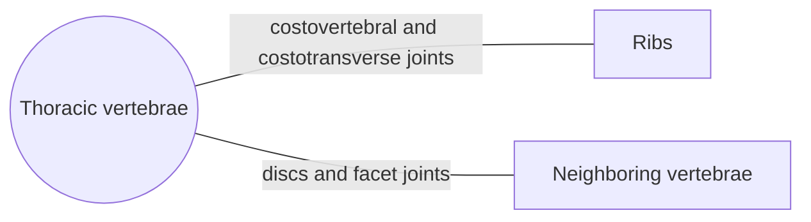

# Thoracic vertebrae

## Summary

The twelve thoracic vertebrae form the back of the chest. Each articulates with a pair of ribs, which limits movement but builds a protective cage for the heart and lungs. They have heart-shaped bodies, small round vertebral foramina and long spinous processes that slope steeply down.

## Prerequisites

- [Vertebral column overview](vertebral-column-overview.md)

## Core concepts

### Definition

A *thoracic vertebra* is one of the twelve vertebrae between the neck and the lumbar region. The arches narrow sharply at their roots and are flat, broad plates behind. The vertebral foramen is round and relatively small. The two lowest thoracic vertebrae, especially T12, have several features of lumbar vertebrae, so T12 is a transition vertebra. Latin: *vertebrae thoracicae*.

### Analogy

The thoracic spine is like the keel of a ship with ribs attached on each side. The rib attachments make it stiff but very strong. The analogy breaks because the keel still rotates and flexes a little, especially in its lower part.

### Mechanism

**Bodies.** The bodies grow larger from top to bottom. Matching the thoracic curve, they are wedge-shaped, slightly lower in front than behind. The upper and lower surfaces are flat; in the upper and lower thoracic vertebrae they are bean-shaped, in the middle ones heart-shaped. T1 has a body elongated from side to side; further down the side-to-side width shrinks, so T6 and T7 have roughly equal width and depth, and the lower bodies widen again toward the lumbar shape. Typical features are the *costal facets*, which form joints with the heads of the ribs.

**Costal facets on the body.** The upper nine vertebrae have two facets on each side of the body, at the upper and lower edges near the root of the arch; the upper facet is always larger than the lower. The lower facet of one vertebra, the upper facet of the next and the disc between them form one shared socket for the head of a rib. Only on T1 does the upper facet lie below the upper edge and usually form a complete joint with the head of the first rib by itself.

**Transverse processes.** They arise from the arch between the superior and inferior articular processes, are very strong and have thickened ends, except for the last two or three. In the upper vertebrae they point sideways, then increasingly backward. Small, cartilage-covered *transverse costal facets* on the front of their ends join the tubercles of the ribs. These facets are absent on T11 and T12 and inconsistent on T10.

**Articular processes.** They lie in the frontal plane. Their joint surfaces are slightly curved, forming segments of a cylinder whose axis lies in front of the vertebral foramen, which favors rotation.

**Spinous processes.** From T1 to T8 they grow longer, are pointed and slope steeply down, overlapping like roof tiles. From T8 down they become shorter and more horizontal again. The spinous process of T1 can be felt just below that of C7.

The diagram shows the bones this bone meets and the joints it forms.

### Landmarks

| Landmark | Description |
| --- | --- |
| Body | Heart-shaped in the middle, wedge-shaped (lower in front) |
| Costal facets on body | For the heads of the ribs (T1 to T9 have two pairs) |
| Transverse costal facets | For the rib tubercles (absent on T11, T12) |
| Vertebral foramen | Small, round |
| Articular processes | In the frontal plane, allow rotation |
| Spinous processes | Long, sloping down, overlapping (T1 to T8) |

### Muscle attachments

Trapezius, rhomboids, latissimus dorsi (lower six), serratus posterior, erector spinae, multifidus, rotatores, levatores costarum.

## Worked example

Rotation of the trunk occurs mostly in the thoracic spine. In golf or throwing, limited thoracic rotation is often compensated by twisting the lumbar spine or overloading the shoulder. This is why mobility programs target the thoracic spine (see [Joint-by-joint approach](../../../exercise-and-fitness/mobility/joint-by-joint-approach.md)).

## Trade offs and when to use it

The rib cage protects organs and supports breathing but limits flexion and side bending. With age and osteoporosis, wedge fractures of thoracic bodies increase the kyphosis.

## Common mistakes

- **Assuming the thoracic spine should be stiff in every direction.** It is the main region for trunk rotation.

## Practice

1. What forms the socket for the head of a typical rib?
2. Which thoracic vertebrae lack transverse costal facets?

### Answers

1. The lower costal facet of the vertebra above, the upper costal facet of the vertebra below and the disc between them.
2. T11 and T12 (and sometimes T10).

## Further reading

- Standring, S. (Ed.) (2020). *Gray's Anatomy: The Anatomical Basis of Clinical Practice (42nd ed.)*. Elsevier. Reference text for attachments, innervation and relations.
- Betts, J. G., Young, K. A., Wise, J. A. et al. (2022). *Anatomy and Physiology 2e*. OpenStax, Rice University. [Link](https://openstax.org/details/books/anatomy-and-physiology-2e). Open textbook with illustrations of the skeletal and muscular systems.
