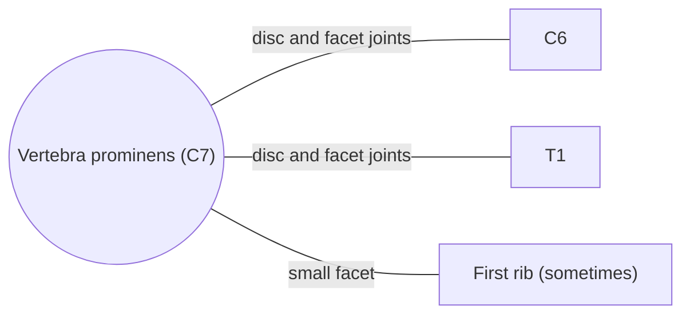

# Vertebra prominens (C7)

## Summary

The seventh cervical vertebra is called the vertebra prominens because its long spinous process sticks out at the base of the neck. It is a transition vertebra: it has lost some features of cervical vertebrae and gained some of thoracic vertebrae.

## Prerequisites

- [Vertebral column overview](vertebral-column-overview.md)

## Core concepts

### Definition

The *vertebra prominens* (C7) is the last cervical vertebra. Its body is clearly larger than in the other cervical vertebrae and sometimes carries a small, incomplete facet on its lower side edge for the head of the first rib. Latin: *vertebra prominens*.

### Analogy

C7 is like the last coach of one train coupled to the first coach of another: built partly to the design of each. The analogy breaks because the "coupling" is a flexible junction where the mobile neck meets the stiff chest, a common site of strain.

### Mechanism

- Its **spinous process** is long and not split. When the head is bent forward (flexion), it can be felt and usually seen; it is the standard landmark for counting vertebrae.
- The **transverse processes** are large. Their posterior bar is big, the anterior bar small and weak.
- The **transverse foramen** is usually smaller than in other cervical vertebrae, though it can be the same size. Only rarely does the vertebral artery pass through it (more often a vein), because the artery usually runs in front of the transverse process and enters the foramen of C6.
- A *cervical rib* sometimes develops from the C7 transverse process; it can press on nerves and vessels to the arm (thoracic outlet syndrome).

The diagram shows the bones this bone meets and the joints it forms.

### Landmarks

| Landmark | Description |
| --- | --- |
| Spinous process | Long, single, palpable at the base of the neck |
| Body | Larger than other cervical bodies |
| Transverse processes | Large, small anterior bar |
| Transverse foramen | Small, usually only veins |

### Muscle attachments

Trapezius and rhomboid minor (via the nuchal ligament and spinous process), splenius, serratus posterior superior, interspinales, semispinalis.

## Worked example

To count vertebrae on a patient, a clinician asks them to bend the head forward and finds the most prominent spinous process at the base of the neck, usually C7. The next one below, which can be felt just under it, is T1. In some people T1 is more prominent, so moving the head back and forth helps: C7 moves with the neck, T1 hardly does.

## Trade offs and when to use it

The junction between mobile and stiff segments concentrates stress, which is why the C6 and C7 levels degenerate often.

## Common mistakes

- **Assuming the most prominent bump is always C7.** In some people T1 is more prominent; check with neck movement.

## Practice

1. Why is C7 called the vertebra prominens?
2. Through which cervical transverse foramen does the vertebral artery usually enter?

### Answers

1. Its long spinous process sticks out at the base of the neck.
2. C6.

## Further reading

- Standring, S. (Ed.) (2020). *Gray's Anatomy: The Anatomical Basis of Clinical Practice (42nd ed.)*. Elsevier. Reference text for attachments, innervation and relations.
- Betts, J. G., Young, K. A., Wise, J. A. et al. (2022). *Anatomy and Physiology 2e*. OpenStax, Rice University. [Link](https://openstax.org/details/books/anatomy-and-physiology-2e). Open textbook with illustrations of the skeletal and muscular systems.
