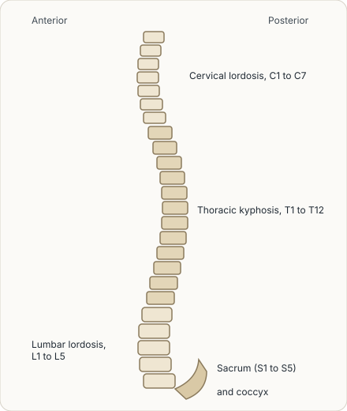
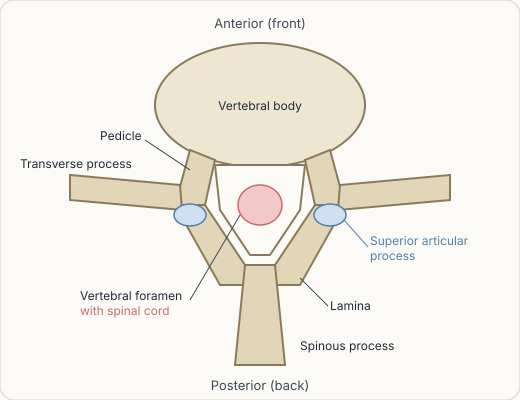
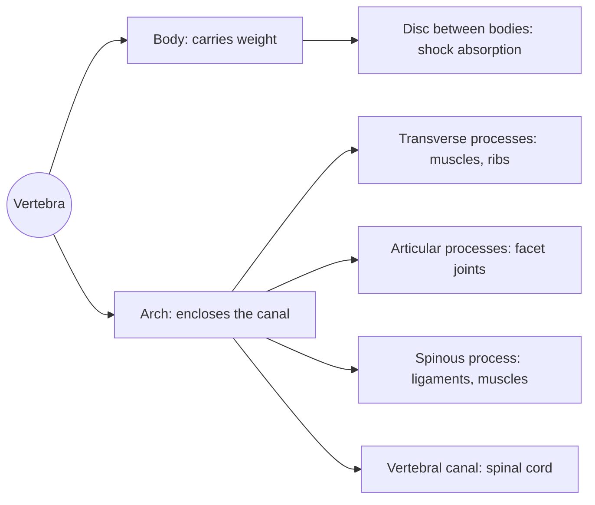

# Vertebral column overview

## Summary

The vertebral column (*columna vertebralis*) is the axis of the skeleton, built from 33 to 34 vertebrae that form 26 separate bones in adults. It has five regions: cervical (7), thoracic (12), lumbar (5), sacral (5 fused) and coccygeal (4 to 5 fused). Seen from the side, it forms an S-shaped double curve that absorbs shocks and keeps the body balanced upright. Each vertebra has a body in front and an arch behind, and together the arches form the vertebral canal that protects the spinal cord.

## Prerequisites

- [Skeletal system overview](../skeletal-system-overview.md)

## Core concepts

### Definition

The *vertebral column* is the part of the axial skeleton of vertebrates (except jawless fish) made of vertebrae, each a separate bone, joined by intervertebral discs, small joints and ligaments. In an adult it makes up about 40 percent of body height (sources give roughly 35 to 45 percent). The cervical spine is the most mobile, which lets us move the head. The thoracic vertebrae connect to the ribs and, with them, protect the organs of the chest. The lumbar vertebrae are the most massive, because they carry the most weight, and the lumbar spine is the most loaded and most often injured and degenerated region. The sacrum and pelvis protect the bladder and reproductive organs. The coccyx is an evolutionary remnant of a tail.

### Analogy

The spine can be pictured as a flexible tube made of stacked rings protecting the spinal cord. Each ring (vertebra) is a separate bone with a hole in the middle, and the holes line up to form a continuous channel for the cord. Between the rings sit rubber washers (discs), and ropes (ligaments) hold the stack together. The analogy breaks because the stack is not straight: its curves act like a spring, and the rings change size and shape from top to bottom.

### Mechanism

**Regions and labels.** On X-rays and in reports, vertebrae are labeled by letter and number:

| Region | Vertebrae | Label | Curve |
| --- | --- | --- | --- |
| Cervical | 7 | C1 to C7 | Lordosis (convex forward) |
| Thoracic | 12 | T1 to T12 (also Th1 to Th12) | Kyphosis (convex backward) |
| Lumbar | 5 | L1 to L5 | Lordosis |
| Sacral | 5 fused into the sacrum | S1 to S5 | Kyphosis |
| Coccygeal | 4 to 5 fused into the coccyx | Co1 to Co4 or Co5 | Continues the sacral curve |

**Curves.** The cervical lordosis, thoracic kyphosis and lumbar lordosis give the column its S shape from the side. The curves absorb shocks like a spring and keep the center of gravity over the feet. Exaggerated curves can be pathological (hyperkyphosis, hyperlordosis). Sideways curvature is called *scoliosis*.

The figure shows the curves from the side.

**Structure of a vertebra.** Every vertebra has the same basic plan:

- The *body* (*corpus vertebrae*) at the front carries weight. Bodies grow larger from top to bottom, matching the increasing load. Their upper and lower surfaces are covered by hyaline cartilage (endplates), and neighboring bodies are separated by a fibrocartilaginous *intervertebral disc*.
- The *vertebral arch* (*arcus vertebrae*) forms the sides and back. With the body it encloses the *vertebral foramen*. The foramina of all vertebrae line up to form the *vertebral canal* (*canalis vertebralis*), which surrounds the spinal cord.
- *Processes* project from the arch: *transverse processes* to the sides (in the thoracic region they articulate with the ribs), *articular processes* above and below, which form the facet joints between vertebrae, and a *spinous process* backward, an attachment for ligaments and muscles.
- Between the arches of neighboring vertebrae, the *intervertebral foramina* let spinal nerves exit.

The figure shows a lumbar vertebra from above.

**Stabilization.** Ligaments hold the column together: the anterior and posterior longitudinal ligaments along the bodies, the ligamenta flava between the laminae, and the interspinous and supraspinous ligaments between the spinous processes. Deep muscles of the back and the abdominal wall add active stability ([Core stability](../../../exercise-and-fitness/mobility/core.md)).

The diagram summarizes the parts of a vertebra and their roles.

### Regional differences

| Feature | Cervical | Thoracic | Lumbar |
| --- | --- | --- | --- |
| Body | Small, wider than deep | Heart-shaped, medium | Large, kidney-shaped |
| Vertebral foramen | Large, triangular | Small, round | Triangular |
| Transverse processes | With foramen for vertebral artery | Facets for ribs | Long, slender (costal processes) |
| Spinous process | Short, often split (C2 to C6) | Long, pointing down | Short, broad, horizontal |
| Facet joint orientation | About 45 degrees, allows rotation and flexion | Frontal plane, allows rotation | Sagittal plane, limits rotation |

## Worked example

Why do lumbar facet joints limit rotation? Their joint surfaces lie almost in the sagittal plane, so they slide easily during flexion and extension but block twisting. The whole lumbar spine rotates only about 10 to 15 degrees in total, compared with roughly 35 degrees in the thoracic spine and 80 to 90 degrees to each side in the cervical spine. Twisting under load, for example lifting a heavy box while turning, therefore stresses the lumbar discs, which is why lifting advice says to turn with the feet.

## Trade offs and when to use it

- The curves add spring-like shock absorption but put shear forces on the junctions between regions, such as L5 and S1, a common site of disc problems and slipped vertebrae (spondylolisthesis).
- Many segments give flexibility, but each segment is a potential source of pain.

## Common mistakes

- **Counting 33 bones.** Adults have 26 bones because the sacral and coccygeal vertebrae fuse.
- **Calling every curve abnormal.** Lordosis and kyphosis are normal curves; only exaggerated or sideways curves are problems.
- **Writing "T" and "Th" as different vertebrae.** Both label the thoracic region.

## Practice

1. How many cervical, thoracic and lumbar vertebrae are there?
2. Which parts form the vertebral foramen?
3. Why do lumbar vertebrae have the largest bodies?

### Answers

1. 7 cervical, 12 thoracic and 5 lumbar.
2. The vertebral body in front and the vertebral arch behind.
3. They carry the largest share of body weight.

## Further reading

- Standring, S. (Ed.) (2020). *Gray's Anatomy: The Anatomical Basis of Clinical Practice (42nd ed.)*. Elsevier. Reference text for attachments, innervation and relations.
- Betts, J. G., Young, K. A., Wise, J. A. et al. (2022). *Anatomy and Physiology 2e*. OpenStax, Rice University. [Link](https://openstax.org/details/books/anatomy-and-physiology-2e). Open textbook with illustrations of the skeletal and muscular systems.
