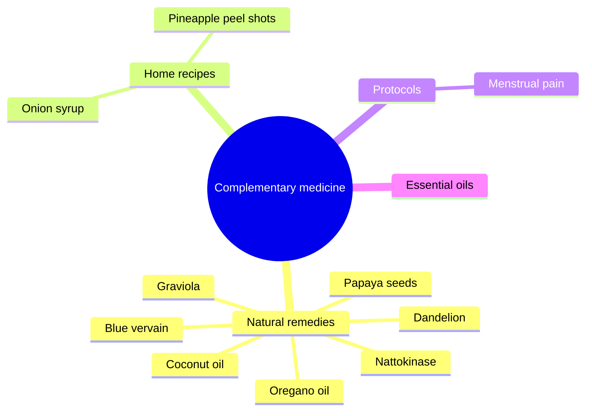

# Complementary medicine

Complementary medicine covers natural remedies, herbal preparations and practices used alongside conventional medicine. These notes describe natural remedies for specific problems, home recipes (onion syrup, pineapple peel shots), a supplement protocol for menstrual pain, coconut oil, and essential oils. Each claim is graded with the scale in [Evidence grades](../nutrition/evidence-grades.md). Natural does not mean safe: several remedies interact with medicines or are toxic in some forms.

## Map

## Reading order

1. [Natural remedies overview](natural-remedies.md)
2. [Nattokinase](nattokinase.md)
3. [Oregano oil](oregano-oil.md)
4. [Coconut oil](coconut-oil.md)
5. [Graviola (soursop)](graviola.md)
6. [Papaya seeds](papaya-seeds.md)
7. [Blue vervain](blue-vervain.md)
8. [Dandelion](dandelion.md)
9. [Onion syrup](onion-syrup.md)
10. [Pineapple peel shots](pineapple-peel-shots.md)
11. [Menstrual pain protocol](menstrual-pain-protocol.md)
12. [Essential oils](essential-oils/README.md)
