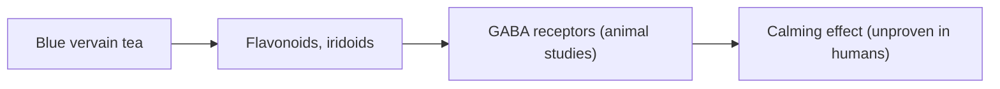

# Blue vervain

## Summary

Blue vervain (Verbena hastata) is a North American plant used in traditional herbal medicine as a calming agent and mild remedy for anxiety and low mood. Related European vervain (Verbena officinalis) contains iridoid glycosides (verbenalin) and flavonoids. Research on its calming or antidepressant effects in humans is essentially absent.

*This note is educational. It is not medical advice and does not replace a doctor, dietitian or pharmacist, especially during pregnancy, illness or when taking medicines.*

## Prerequisites

- [Natural remedies overview](natural-remedies.md)

## Core concepts

### Definition

*Blue vervain* is Verbena hastata. *Verbenalin* is an iridoid glycoside found in Verbena species, studied mainly in animals.

### Analogy

Blue vervain is like an old family recipe for calm: used for generations, but never tested in a proper trial. The analogy breaks because recipes can be tested easily, while the effect of a mild herbal tea on mood is hard to separate from the calming ritual of drinking tea.

### Mechanism

Animal studies of Verbena officinalis extracts show sedative and anticonvulsant effects, possibly through flavonoids and iridoids acting on GABA receptors. No mechanism has been confirmed in humans.

The flowchart shows the proposed action.

### Proposed effects and evidence

Each entry states the proposed effect and how strong the human evidence is, using the grades defined in the [Evidence grades](../nutrition/evidence-grades.md) note.

- **Calming, mild antidepressant and anti-anxiety effects.** No meaningful human research; based on tradition and animal studies. Evidence: very limited.

## Worked example

A person drinks a cup of blue vervain tea in the evening to relax. Any calming effect may come from the routine and warmth of tea itself; there are no trials of blue vervain for anxiety. Better-studied options include [Progressive muscle relaxation (Jacobson)](../physiotherapy/progressive-muscle-relaxation.md) and, for clinical anxiety, professional treatment.

## Trade offs and when to use it

Blue vervain tea is probably safe in moderate amounts but may cause nausea in large doses and should be avoided in pregnancy because of possible uterine effects.

## Common mistakes

- **Using it to treat depression.** There is no evidence; seek professional help.

## Practice

1. What is the Latin name of blue vervain?
2. What is its traditional use?
3. How strong is the evidence?

### Answers

1. Verbena hastata.
2. Calming and mild mood support.
3. Very limited.

## Further reading

- Wichtl, M. (Ed.) (2004). *Herbal Drugs and Phytopharmaceuticals (3rd ed.)*. Medpharm and CRC Press. Reference on herbal drugs including Verbena.
