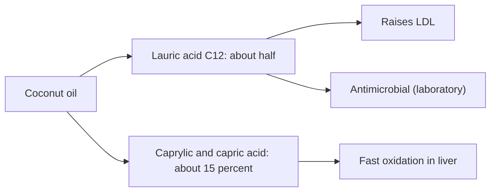

# Coconut oil

## Summary

Coconut oil is a fat pressed from coconut meat, about 90 percent saturated, rich in lauric acid (C12) and smaller amounts of caprylic (C8) and capric (C10) acids, which are medium-chain fatty acids. These acids have antifungal and antibacterial activity in the laboratory, including against Candida. Coconut oil is used in cooking, cosmetics, oil pulling and as a carrier oil. Despite marketing as a healthy fat, a meta-analysis found it raises LDL cholesterol more than non-tropical vegetable oils. Medium-chain triglycerides are oxidized faster, but coconut oil is mostly lauric acid, which behaves partly like a long-chain fat.

*This note is educational. It is not medical advice and does not replace a doctor, dietitian or pharmacist, especially during pregnancy, illness or when taking medicines.*

## Prerequisites

- [Natural remedies overview](natural-remedies.md)

## Core concepts

### Definition

*Coconut oil* is the oil of Cocos nucifera kernels. *Lauric acid* (12 carbons) is its main fatty acid (about 45 to 50 percent). *Medium-chain triglycerides* (MCT oil) contain mainly caprylic and capric acid and are a different product. *Monolaurin* is the monoglyceride of lauric acid.

### Analogy

Coconut oil is like a fuel marketed as clean because part of it burns fast. Most of it, however, is lauric acid, which the body handles more like ordinary saturated fat, raising LDL. The analogy breaks because coconut oil also has useful non-food uses, such as hair care.

### Mechanism

- **Antimicrobial.** Lauric acid, monolaurin and caprylic acid disrupt the membranes of fungi and bacteria in the laboratory, the basis for antifungal claims.
- **Metabolism.** Caprylic and capric acids are absorbed into the portal vein and oxidized quickly in the liver, and are stored less in fat tissue. Lauric acid is partly absorbed this way and partly in chylomicrons.
- **Cholesterol.** Lauric acid raises LDL (and HDL). Saturated fat replacement with unsaturated fats lowers cardiovascular risk ([Saturated fatty acids](../../../natural-sciences/chemistry/biochemistry/lipids/saturated-fatty-acids.md)).
- **Hair.** Lauric acid penetrates the hair shaft and reduces protein loss (see [Scalp oil blend](../personal-care/scalp-oil-blend.md)).

The flowchart summarizes the composition and effects.

### Proposed effects and evidence

Each entry states the proposed effect and how strong the human evidence is, using the grades defined in the [Evidence grades](../nutrition/evidence-grades.md) note.

- **Antifungal action against yeasts such as Candida.** Laboratory studies show activity. Evidence: very limited.
- **Less storage in fat tissue thanks to medium-chain fatty acids.** True for MCT oil; coconut oil is mostly lauric acid; it adds energy like any fat. Evidence: limited.
- **Heart-healthy fat.** Meta-analysis: raises LDL more than non-tropical vegetable oils. Evidence: not supported.
- **Oral health through oil pulling.** Small trials show reduced plaque and bacteria; no whitening. Evidence: limited.

## Worked example

Replacing 30 g of olive oil daily with coconut oil for several weeks raised LDL by about 0.3 to 0.4 mmol/L in trials summarized by Neelakantan and colleagues (2020). For cooking, olive or rapeseed oil are better choices; coconut oil can be used occasionally for flavor or on skin and hair.

## Trade offs and when to use it

Coconut oil is useful for cosmetics and as a carrier oil. As a main dietary fat, it raises LDL cholesterol.

## Common mistakes

- **Treating coconut oil as a heart-healthy fat.** It raises LDL.
- **Confusing coconut oil and MCT oil.** They have different fatty acid profiles.

## Practice

1. What is the main fatty acid in coconut oil?
2. How does coconut oil affect LDL?
3. What evidence supports antifungal claims?

### Answers

1. Lauric acid.
2. It raises LDL more than non-tropical vegetable oils.
3. Laboratory studies.

## Further reading

- Neelakantan, N., Seah, J. Y. H., van Dam, R. M. (2020). The effect of coconut oil consumption on cardiovascular risk factors: a systematic review and meta-analysis of clinical trials. Circulation, 141(10), 803-814. [DOI](https://doi.org/10.1161/CIRCULATIONAHA.119.043052). Meta-analysis of coconut oil and cardiovascular risk factors.
- Ogbolu, D. O., Oni, A. A., Daini, O. A. et al. (2007). In vitro antimicrobial properties of coconut oil on Candida species in Ibadan, Nigeria. Journal of Medicinal Food, 10(2), 384-387. [DOI](https://doi.org/10.1089/jmf.2006.1209). In vitro activity of coconut oil against Candida.
