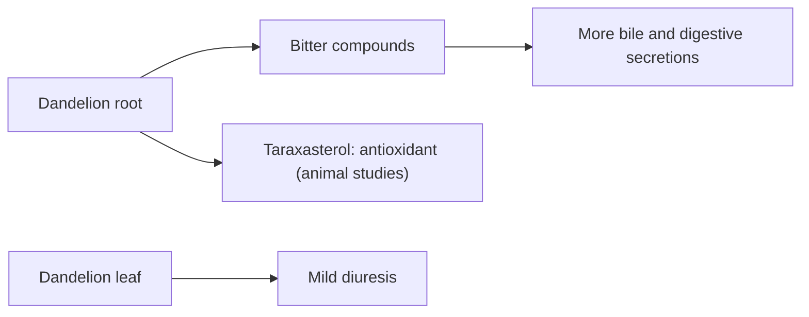

# Dandelion

## Summary

Dandelion (Taraxacum officinale) root and leaf are traditional remedies for the liver and digestion. They contain bitter sesquiterpene lactones, triterpenes such as taraxasterol, inulin and potassium. The European Medicines Agency recognizes dandelion as a traditional herbal medicine to relieve mild digestive disorders and to increase urine output, based on long-standing use rather than clinical trials. Liver-protective effects come from animal studies.

*This note is educational. It is not medical advice and does not replace a doctor, dietitian or pharmacist, especially during pregnancy, illness or when taking medicines.*

## Prerequisites

- [Natural remedies overview](natural-remedies.md)

## Core concepts

### Definition

*Dandelion* is Taraxacum officinale. *Taraxasterol* is a triterpene; *taraxacin* refers to its bitter compounds. A *cholagogue* promotes bile flow; a *diuretic* increases urine output.

### Analogy

Dandelion is like a bitter aperitif: bitter taste receptors in the mouth and gut trigger digestive secretions and bile flow. The analogy breaks because the leaves also act as a diuretic, which an aperitif does not.

### Mechanism

Bitter compounds stimulate digestive secretions and bile flow (choleretic and cholagogue effects). Leaves are rich in potassium and have a mild diuretic effect. Taraxasterol and polyphenols are antioxidant and anti-inflammatory in laboratory and animal studies, including protection against liver injury in rodents.

The flowchart shows the traditional uses.

### Proposed effects and evidence

Each entry states the proposed effect and how strong the human evidence is, using the grades defined in the [Evidence grades](../nutrition/evidence-grades.md) note.

- **Liver protection and regeneration.** Animal studies. Evidence: very limited.
- **Bile flow and digestion.** Traditional use recognized by EMA; few trials. Evidence: limited.
- **Mild diuretic effect.** One small human study and traditional use. Evidence: limited.

## Worked example

A person with occasional bloating after fatty meals drinks dandelion root tea before meals. The EMA allows this as a traditional use for mild digestive complaints. If symptoms persist, involve pain or occur with jaundice, medical assessment is needed.

## Trade offs and when to use it

Dandelion is generally safe but should be avoided with bile duct obstruction or gallstones, and can cause allergic reactions in people allergic to the daisy family. It may interact with diuretics and lithium.

## Common mistakes

- **Using dandelion with gallstones.** Increased bile flow can trigger pain.
- **Expecting liver regeneration.** Evidence comes from animals.

## Practice

1. What is the main traditional use of dandelion root?
2. What effect do the leaves have?
3. What is taraxasterol?

### Answers

1. Supporting bile flow and digestion.
2. A mild diuretic effect.
3. A triterpene of dandelion.

## Further reading

- European Medicines Agency, Committee on Herbal Medicinal Products (2009). Community herbal monograph on Taraxacum officinale Weber ex Wigg., radix cum herba. [Link](https://www.ema.europa.eu/en/medicines/herbal/taraxaci-radix-cum-herba). EMA herbal monograph on dandelion.
