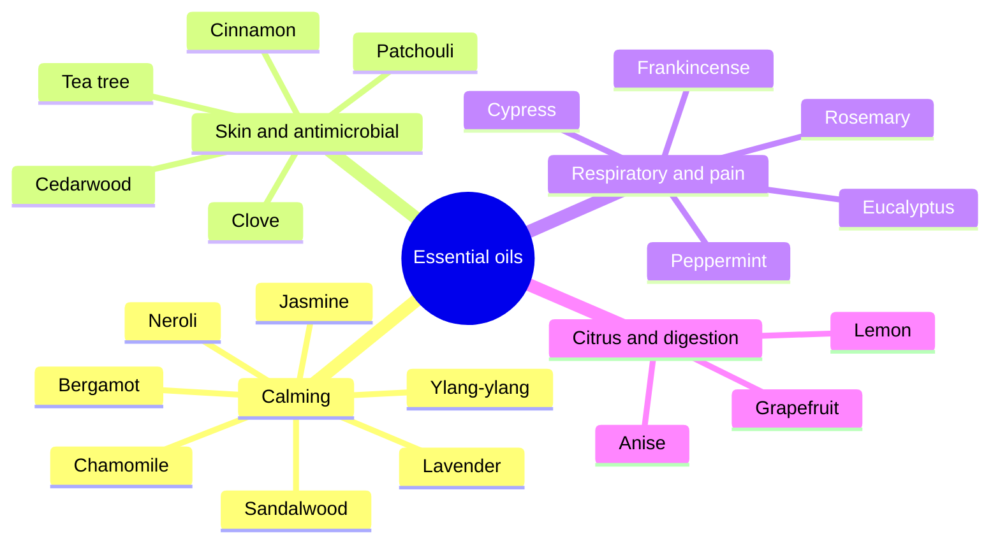

# Essential oils

Essential oils are concentrated volatile oils distilled or pressed from plants. They are used in aromatherapy, massage, skin care and household products. Start with the overview, which covers how essential oils work, how they are used and their safety, then read individual oils. Most claims rest on laboratory studies and small trials; a few uses (oral lavender oil for anxiety, peppermint oil for irritable bowel syndrome and headache, tea tree oil for acne, clove oil for tooth pain) have better support.

## Map

## Reading order

1. [Essential oils overview](essential-oils-overview.md)
2. [Lavender oil](lavender.md)
3. [Tea tree oil](tea-tree.md)
4. [Peppermint oil](peppermint.md)
5. [Eucalyptus oil](eucalyptus.md)
6. [Lemon oil](lemon.md)
7. [Chamomile oil](chamomile.md)
8. [Rosemary oil](rosemary.md)
9. [Bergamot oil](bergamot.md)
10. [Sandalwood oil](sandalwood.md)
11. [Frankincense oil](frankincense.md)
12. [Jasmine oil](jasmine.md)
13. [Ylang-ylang oil](ylang-ylang.md)
14. [Grapefruit oil](grapefruit.md)
15. [Cypress oil](cypress.md)
16. [Patchouli oil](patchouli.md)
17. [Neroli oil](neroli.md)
18. [Cedarwood oil](cedarwood.md)
19. [Cinnamon oil](cinnamon.md)
20. [Clove oil](clove.md)
21. [Anise oil](anise.md)
