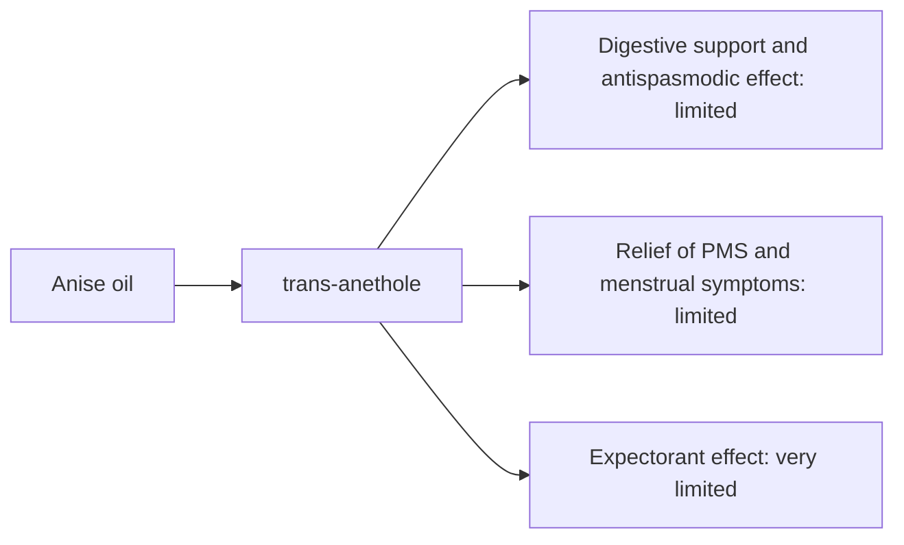

# Anise oil

## Summary

Anise essential oil comes from Pimpinella anisum. It is used for digestion, relief of spasms, PMS symptoms and an expectorant effect. Its main compounds are trans-anethole. Anethole has expectorant and antispasmodic effects, which is the basis for its use for digestive complaints and menstrual symptoms. Human evidence is summarized below; most claims rest on laboratory or small studies.

*This note is educational. It is not medical advice and does not replace a doctor, dietitian or pharmacist, especially during pregnancy, illness or when taking medicines.*

## Prerequisites

- [Essential oils overview](essential-oils-overview.md)

## Core concepts

### Definition

*Anise oil* is the essential oil of *Pimpinella anisum*. Its characteristic compounds are trans-anethole.

### Analogy

Anise oil is like the flavor of licorice candy (anethole is also in fennel and star anise) with a traditional reputation for calming the stomach. The analogy breaks because anethole also has weak estrogen-like effects.

### Mechanism

**Uses described in the notes:** digestion, relief of spasms, PMS symptoms and an expectorant effect.

**Why it is thought to work:** Anethole has expectorant and antispasmodic effects, which is the basis for its use for digestive complaints and menstrual symptoms.

Like other essential oils, it acts through smell (olfactory and limbic pathways) when inhaled and through local effects on skin and microbes when applied diluted ([Essential oils overview](essential-oils-overview.md)).

The flowchart links the main compound to each claimed effect, with its evidence grade.

### Claimed effects and evidence

Each entry states the proposed effect and how strong the human evidence is, using the grades defined in the [Evidence grades](../../nutrition/evidence-grades.md) note.

- **Digestive support and antispasmodic effect.** Traditional use; small trials of anise in dyspepsia. Evidence: limited.
- **Relief of PMS and menstrual symptoms.** Small trials of anise or fennel extracts. Evidence: limited.
- **Expectorant effect.** Traditional use. Evidence: very limited.

## Worked example

Anise is a traditional ingredient in cough sweets and digestive teas. A person uses anise tea after a heavy meal; the aromatic, warm drink may ease bloating. Concentrated oil is not taken by mouth.

## Trade offs and when to use it

Anethole has weak estrogenic activity; avoid concentrated oil in pregnancy and with estrogen-dependent cancers. It can cause skin sensitization when oxidized.

## Common mistakes

- **Using concentrated anise oil in pregnancy.** Anethole is weakly estrogenic.

## Practice

1. What is the main compound of anise oil?
2. Which other plants contain anethole?

### Answers

1. Trans-anethole.
2. Fennel and star anise.

## Further reading

- Tisserand, R., Young, R. (2014). *Essential Oil Safety: A Guide for Health Care Professionals (2nd ed.)*. Churchill Livingstone. Composition and safety data.
