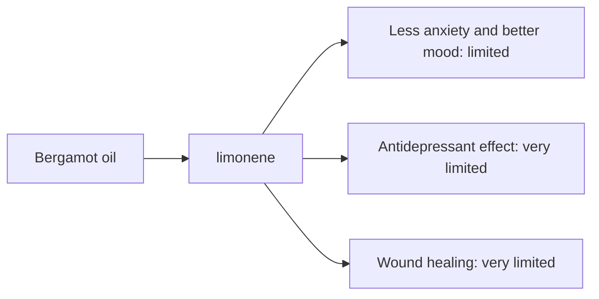

# Bergamot oil

## Summary

Bergamot essential oil comes from Citrus bergamia. It is used for less anxiety, better mood, antidepressant effects and wound healing. Its main compounds are limonene, linalool and linalyl acetate. Limonene and linalool are calming and anti-inflammatory; studies report that bergamot aroma lowers cortisol and reduces stress and anxiety. Human evidence is summarized below; most claims rest on laboratory or small studies.

*This note is educational. It is not medical advice and does not replace a doctor, dietitian or pharmacist, especially during pregnancy, illness or when taking medicines.*

## Prerequisites

- [Essential oils overview](essential-oils-overview.md)

## Core concepts

### Definition

*Bergamot oil* is the essential oil of *Citrus bergamia*. Its characteristic compounds are limonene, linalool and linalyl acetate.

### Analogy

Bergamot oil is like the calming scent of Earl Grey tea, which is flavored with it. The analogy breaks because cold-pressed bergamot oil contains bergapten, which can cause severe sunburn-like reactions.

### Mechanism

**Uses described in the notes:** less anxiety, better mood, antidepressant effects and wound healing.

**Why it is thought to work:** Limonene and linalool are calming and anti-inflammatory; studies report that bergamot aroma lowers cortisol and reduces stress and anxiety.

Like other essential oils, it acts through smell (olfactory and limbic pathways) when inhaled and through local effects on skin and microbes when applied diluted ([Essential oils overview](essential-oils-overview.md)).

The flowchart links the main compound to each claimed effect, with its evidence grade.

### Claimed effects and evidence

Each entry states the proposed effect and how strong the human evidence is, using the grades defined in the [Evidence grades](../../nutrition/evidence-grades.md) note.

- **Less anxiety and better mood.** Small trials show reduced anxiety and cortisol in some settings. Evidence: limited.
- **Antidepressant effect.** No good clinical evidence. Evidence: very limited.
- **Wound healing.** Laboratory studies. Evidence: very limited.

## Worked example

In a small study, women who inhaled bergamot vapor for 15 minutes had lower salivary cortisol than with water vapor alone. Such short studies show acute changes, not lasting effects on anxiety disorders.

## Trade offs and when to use it

Cold-pressed bergamot oil is strongly phototoxic because of bergapten; use bergapten-free (FCF) oil on skin or avoid sun.

## Common mistakes

- **Using cold-pressed bergamot on skin before sun.** Choose FCF oil or avoid sunlight.

## Practice

1. Which compound makes bergamot oil phototoxic?
2. Which tea is flavored with bergamot?

### Answers

1. Bergapten.
2. Earl Grey.

## Further reading

- Tisserand, R., Young, R. (2014). *Essential Oil Safety: A Guide for Health Care Professionals (2nd ed.)*. Churchill Livingstone. Phototoxicity and composition.
