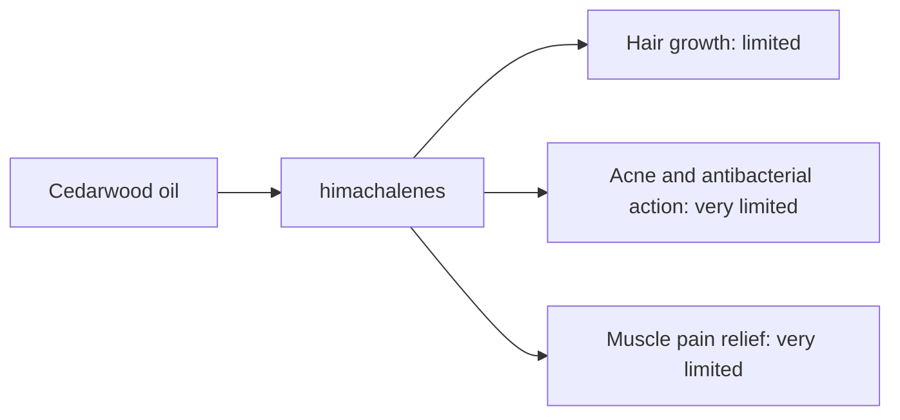

# Cedarwood oil

## Summary

Cedarwood essential oil comes from Cedrus atlantica. It is used for acne, muscle pain and stimulation of hair growth. Its main compounds are himachalenes and atlantone (cedrol is typical of Juniperus "cedarwood" oils). Its compounds are described as antibacterial and as stimulating blood circulation, which may support hair growth and wound healing. Human evidence is summarized below; most claims rest on laboratory or small studies.

*This note is educational. It is not medical advice and does not replace a doctor, dietitian or pharmacist, especially during pregnancy, illness or when taking medicines.*

## Prerequisites

- [Essential oils overview](essential-oils-overview.md)

## Core concepts

### Definition

*Cedarwood oil* is the essential oil of *Cedrus atlantica*. Its characteristic compounds are himachalenes and atlantone (cedrol is typical of Juniperus "cedarwood" oils).

### Analogy

Cedarwood oil is like the scent of a wooden chest that keeps moths away. The analogy breaks because its effects on human hair have only been tested as part of a blend.

### Mechanism

**Uses described in the notes:** acne, muscle pain and stimulation of hair growth.

**Why it is thought to work:** Its compounds are described as antibacterial and as stimulating blood circulation, which may support hair growth and wound healing.

Like other essential oils, it acts through smell (olfactory and limbic pathways) when inhaled and through local effects on skin and microbes when applied diluted ([Essential oils overview](essential-oils-overview.md)).

The flowchart links the main compound to each claimed effect, with its evidence grade.

### Claimed effects and evidence

Each entry states the proposed effect and how strong the human evidence is, using the grades defined in the [Evidence grades](../../nutrition/evidence-grades.md) note.

- **Hair growth.** A trial of a blend with thyme, rosemary, lavender and cedarwood improved alopecia areata; the contribution of cedarwood alone is unknown. Evidence: limited.
- **Acne and antibacterial action.** Laboratory studies. Evidence: very limited.
- **Muscle pain relief.** No meaningful evidence. Evidence: very limited.

## Worked example

In a trial (Hay and colleagues, 1998), 86 people with alopecia areata massaged a blend of thyme, rosemary, lavender and cedarwood oils in carrier oils into the scalp daily for 7 months. Hair regrowth improved in 44 percent versus 15 percent with carrier oils alone.

## Trade offs and when to use it

Generally well tolerated when diluted.

## Common mistakes

- **Attributing blend results to one oil.** The study tested four oils together.

## Practice

1. Which condition improved in the aromatherapy trial?
2. Which oils were in the blend?

### Answers

1. Alopecia areata.
2. Thyme, rosemary, lavender and cedarwood.

## Further reading

- Hay, I. C., Jamieson, M., Ormerod, A. D. (1998). Randomized trial of aromatherapy: successful treatment for alopecia areata. Archives of Dermatology, 134(11), 1349-1352. [DOI](https://doi.org/10.1001/archderm.134.11.1349). Aromatherapy trial for alopecia areata.
