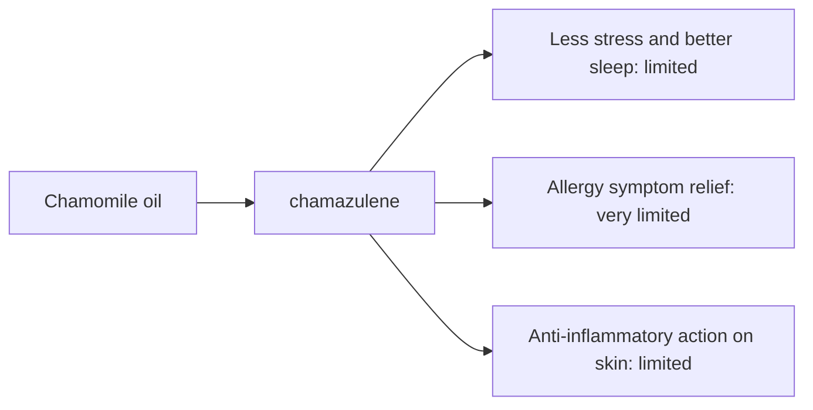

# Chamomile oil

## Summary

Chamomile essential oil comes from Matricaria chamomilla. It is used for less stress, better sleep, relief of allergy symptoms and inflammation. Its main compounds are chamazulene and alpha-bisabolol. Chamazulene and bisabolol are anti-inflammatory, calming and antihistaminic in laboratory studies. Human evidence is summarized below; most claims rest on laboratory or small studies.

*This note is educational. It is not medical advice and does not replace a doctor, dietitian or pharmacist, especially during pregnancy, illness or when taking medicines.*

## Prerequisites

- [Essential oils overview](essential-oils-overview.md)

## Core concepts

### Definition

*Chamomile oil* is the essential oil of *Matricaria chamomilla*. Its characteristic compounds are chamazulene and alpha-bisabolol.

### Analogy

Chamomile oil is like a soothing balm for irritated skin and nerves. The analogy breaks because people allergic to the daisy family can react to it.

### Mechanism

**Uses described in the notes:** less stress, better sleep, relief of allergy symptoms and inflammation.

**Why it is thought to work:** Chamazulene and bisabolol are anti-inflammatory, calming and antihistaminic in laboratory studies.

Like other essential oils, it acts through smell (olfactory and limbic pathways) when inhaled and through local effects on skin and microbes when applied diluted ([Essential oils overview](essential-oils-overview.md)).

The flowchart links the main compound to each claimed effect, with its evidence grade.

### Claimed effects and evidence

Each entry states the proposed effect and how strong the human evidence is, using the grades defined in the [Evidence grades](../../nutrition/evidence-grades.md) note.

- **Less stress and better sleep.** Chamomile tea and extracts show small benefits in anxiety trials; oil inhalation less studied. Evidence: limited.
- **Allergy symptom relief.** No meaningful evidence; can itself cause allergy. Evidence: very limited.
- **Anti-inflammatory action on skin.** Small studies of chamomile creams. Evidence: limited.

## Worked example

A person adds diluted German chamomile oil (blue because of chamazulene) to a cream for irritated skin. Small studies suggest a mild soothing effect. If they are allergic to ragweed or daisies, they patch-test first.

## Trade offs and when to use it

Chamomile can cause allergic reactions in people sensitive to the Asteraceae family.

## Common mistakes

- **Using it with daisy family allergy.** Patch-test or avoid.

## Practice

1. Why is German chamomile oil blue?
2. Which compounds are anti-inflammatory?

### Answers

1. Because of chamazulene.
2. Chamazulene and alpha-bisabolol.

## Further reading

- Tisserand, R., Young, R. (2014). *Essential Oil Safety: A Guide for Health Care Professionals (2nd ed.)*. Churchill Livingstone. Composition and safety data.
