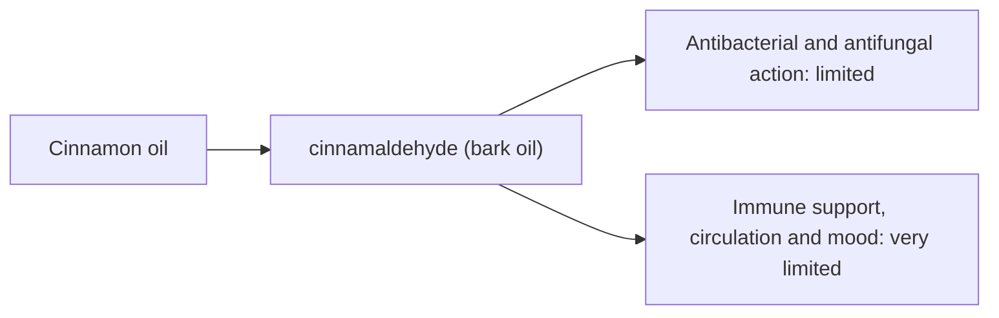

# Cinnamon oil

## Summary

Cinnamon essential oil comes from Cinnamomum zeylanicum (Cinnamomum verum). It is used for antibacterial action, immune support, stimulating circulation and better mood. Its main compounds are cinnamaldehyde (bark oil) and eugenol (leaf oil). Cinnamaldehyde is strongly antibacterial and antifungal in the laboratory and is described as stimulating circulation and energy. Human evidence is summarized below; most claims rest on laboratory or small studies.

*This note is educational. It is not medical advice and does not replace a doctor, dietitian or pharmacist, especially during pregnancy, illness or when taking medicines.*

## Prerequisites

- [Essential oils overview](essential-oils-overview.md)

## Core concepts

### Definition

*Cinnamon oil* is the essential oil of *Cinnamomum zeylanicum (Cinnamomum verum)*. Its characteristic compounds are cinnamaldehyde (bark oil) and eugenol (leaf oil).

### Analogy

Cinnamon bark oil is like a fiery spice concentrate: strong against microbes in a dish, but harsh on skin. The analogy breaks because leaf oil, rich in eugenol, behaves differently.

### Mechanism

**Uses described in the notes:** antibacterial action, immune support, stimulating circulation and better mood.

**Why it is thought to work:** Cinnamaldehyde is strongly antibacterial and antifungal in the laboratory and is described as stimulating circulation and energy.

Like other essential oils, it acts through smell (olfactory and limbic pathways) when inhaled and through local effects on skin and microbes when applied diluted ([Essential oils overview](essential-oils-overview.md)).

The flowchart links the main compound to each claimed effect, with its evidence grade.

### Claimed effects and evidence

Each entry states the proposed effect and how strong the human evidence is, using the grades defined in the [Evidence grades](../../nutrition/evidence-grades.md) note.

- **Antibacterial and antifungal action.** Strong laboratory activity. Evidence: limited.
- **Immune support, circulation and mood.** No meaningful human evidence. Evidence: very limited.

## Worked example

Cinnamaldehyde is one of the most common causes of fragrance contact allergy. A person adding cinnamon bark oil to a massage blend at 3 percent may develop a rash; safety guidance recommends no more than about 0.05 percent on skin.

## Trade offs and when to use it

Cinnamon bark oil is a strong skin sensitizer and irritant; avoid skin use or use at very low dilution.

## Common mistakes

- **Using cinnamon bark oil in massage blends.** It is a strong sensitizer.

## Practice

1. What is the main compound of cinnamon bark oil?
2. What is the main safety concern?

### Answers

1. Cinnamaldehyde.
2. Skin sensitization and irritation.

## Further reading

- Tisserand, R., Young, R. (2014). *Essential Oil Safety: A Guide for Health Care Professionals (2nd ed.)*. Churchill Livingstone. Safety limits for cinnamon bark oil.
