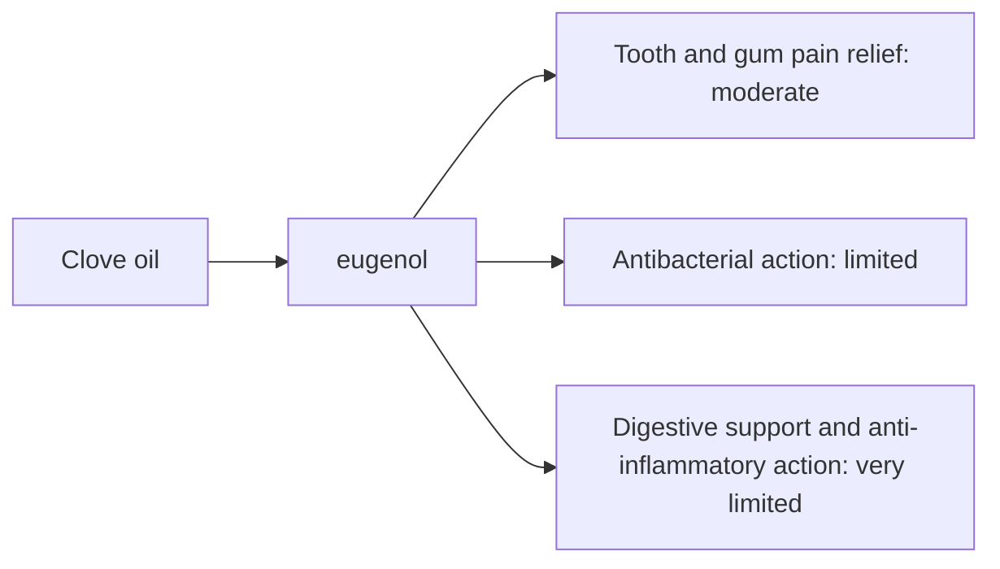

# Clove oil

## Summary

Clove essential oil comes from Syzygium aromaticum. It is used for tooth and gum pain relief, antibacterial action, digestion and anti-inflammatory action. Its main compounds are eugenol. Eugenol is a natural local anesthetic and antibacterial agent; it is used in dentistry to ease tooth and gum pain. Human evidence is summarized below; most claims rest on laboratory or small studies.

*This note is educational. It is not medical advice and does not replace a doctor, dietitian or pharmacist, especially during pregnancy, illness or when taking medicines.*

## Prerequisites

- [Essential oils overview](essential-oils-overview.md)

## Core concepts

### Definition

*Clove oil* is the essential oil of *Syzygium aromaticum*. Its characteristic compounds are eugenol.

### Analogy

Clove oil is like a natural dental numbing gel: eugenol blocks nerve signals at the site of pain. The analogy breaks because, unlike a dentist's treatment, it does not fix the cause of the pain.

### Mechanism

**Uses described in the notes:** tooth and gum pain relief, antibacterial action, digestion and anti-inflammatory action.

**Why it is thought to work:** Eugenol is a natural local anesthetic and antibacterial agent; it is used in dentistry to ease tooth and gum pain.

Like other essential oils, it acts through smell (olfactory and limbic pathways) when inhaled and through local effects on skin and microbes when applied diluted ([Essential oils overview](essential-oils-overview.md)).

The flowchart links the main compound to each claimed effect, with its evidence grade.

### Claimed effects and evidence

Each entry states the proposed effect and how strong the human evidence is, using the grades defined in the [Evidence grades](../../nutrition/evidence-grades.md) note.

- **Tooth and gum pain relief.** Clove gel reduced pain from needle insertion similarly to benzocaine gel in a trial; eugenol is used in dental materials. Evidence: moderate.
- **Antibacterial action.** Laboratory evidence. Evidence: limited.
- **Digestive support and anti-inflammatory action.** Little human evidence. Evidence: very limited.

## Worked example

In a trial (Alqareer and colleagues, 2006), volunteers received clove gel, benzocaine gel or placebo before a needle prick in the gum. Clove gel and benzocaine reduced pain similarly compared with placebo. Home use for toothache is described in [Clove oil for toothache](../../personal-care/toothache-clove-oil.md).

## Trade offs and when to use it

Undiluted clove oil irritates and can damage gums; it is toxic if swallowed by children. Eugenol may increase bleeding risk.

## Common mistakes

- **Using undiluted oil repeatedly.** It can burn the gums.

## Practice

1. What is the active compound of clove oil?
2. What did a dental trial compare clove gel with?

### Answers

1. Eugenol.
2. Benzocaine gel.

## Further reading

- Alqareer, A., Alyahya, A., Andersson, L. (2006). The effect of clove and benzocaine versus placebo as topical anesthetics. Journal of Dentistry, 34(10), 747-750. [DOI](https://doi.org/10.1016/j.jdent.2006.01.009). Trial of clove gel as topical anesthetic.
- Tisserand, R., Young, R. (2014). *Essential Oil Safety: A Guide for Health Care Professionals (2nd ed.)*. Churchill Livingstone. Safety data.
