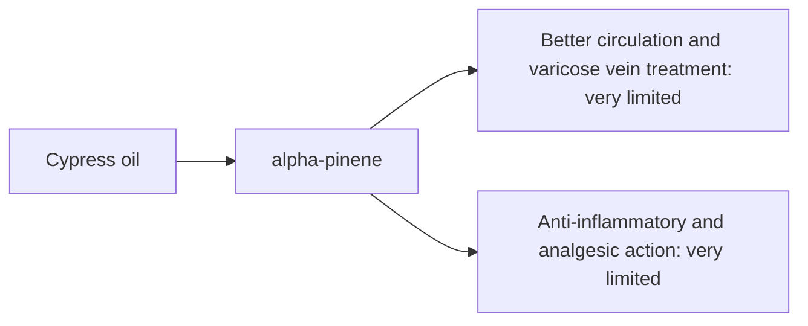

# Cypress oil

## Summary

Cypress essential oil comes from Cupressus sempervirens. It is used for better circulation, less inflammation, pain relief and treatment of varicose veins. Its main compounds are alpha-pinene and delta-3-carene. Alpha-pinene is anti-inflammatory and is claimed to improve blood circulation, making the oil popular for varicose veins and swelling. Human evidence is summarized below; most claims rest on laboratory or small studies.

*This note is educational. It is not medical advice and does not replace a doctor, dietitian or pharmacist, especially during pregnancy, illness or when taking medicines.*

## Prerequisites

- [Essential oils overview](essential-oils-overview.md)

## Core concepts

### Definition

*Cypress oil* is the essential oil of *Cupressus sempervirens*. Its characteristic compounds are alpha-pinene and delta-3-carene.

### Analogy

Cypress oil is marketed like a tonic for veins. The analogy breaks because there are no trials showing that massaging the oil changes varicose veins.

### Mechanism

**Uses described in the notes:** better circulation, less inflammation, pain relief and treatment of varicose veins.

**Why it is thought to work:** Alpha-pinene is anti-inflammatory and is claimed to improve blood circulation, making the oil popular for varicose veins and swelling.

Like other essential oils, it acts through smell (olfactory and limbic pathways) when inhaled and through local effects on skin and microbes when applied diluted ([Essential oils overview](essential-oils-overview.md)).

The flowchart links the main compound to each claimed effect, with its evidence grade.

### Claimed effects and evidence

Each entry states the proposed effect and how strong the human evidence is, using the grades defined in the [Evidence grades](../../nutrition/evidence-grades.md) note.

- **Better circulation and varicose vein treatment.** No clinical evidence. Evidence: very limited.
- **Anti-inflammatory and analgesic action.** Laboratory studies of alpha-pinene. Evidence: very limited.

## Worked example

A person with varicose veins massages diluted cypress oil into their legs. The massage itself, leg elevation and compression stockings are what reduce swelling; for symptomatic varicose veins, medical treatments exist.

## Trade offs and when to use it

Generally well tolerated diluted; oxidized oil may irritate skin.

## Common mistakes

- **Relying on oils for varicose veins.** Use compression and seek medical advice.

## Practice

1. What is the main compound of cypress oil?
2. Is there evidence that cypress oil treats varicose veins?

### Answers

1. Alpha-pinene.
2. No.

## Further reading

- Tisserand, R., Young, R. (2014). *Essential Oil Safety: A Guide for Health Care Professionals (2nd ed.)*. Churchill Livingstone. Composition and safety data.
