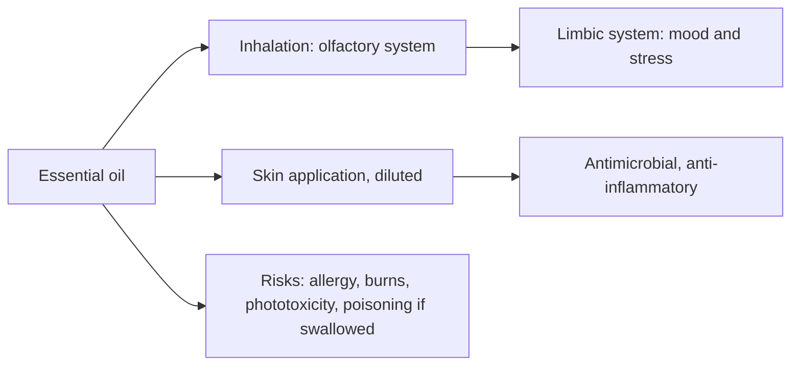

# Essential oils overview

## Summary

Essential oils are concentrated mixtures of volatile compounds, mostly terpenes and phenylpropanoids, obtained from plants by steam distillation or cold pressing. They are used in aromatherapy (inhalation), massage, baths and skin care. Inhaled scents act on the olfactory system and limbic brain areas involved in emotion, which may explain calming or alerting effects; some compounds also have antimicrobial or anti-inflammatory activity. Essential oils are potent: they must be diluted for skin use, can cause allergy, burns and photosensitivity, and many are toxic if swallowed, especially for children and pets.

*This note is educational. It is not medical advice and does not replace a doctor, dietitian or pharmacist, especially during pregnancy, illness or when taking medicines.*

## Prerequisites

- [Terpenoids](../../nutrition/phytonutrients/terpenoids.md)

## Core concepts

### Definition

An *essential oil* is a volatile oil obtained from a plant by distillation (steam or dry) or mechanical pressing (citrus peels). *Aromatherapy* is the use of essential oils for health or well-being. A *carrier oil* (coconut, jojoba, almond) dilutes essential oils for skin use. Main compound classes: monoterpenes (limonene), monoterpene alcohols (linalool, menthol), phenols (eugenol, carvacrol), oxides (1,8-cineole), esters (linalyl acetate) and aldehydes (cinnamaldehyde) ([Terpenoids](../../nutrition/phytonutrients/terpenoids.md)).

### Analogy

An essential oil is like a concentrated perfume of a plant's chemical defenses: a few drops contain the volatile compounds of a whole handful of leaves or flowers. Like any concentrate, it needs dilution. The analogy breaks because, unlike a perfume, some of these compounds have measurable effects on microbes and on the body.

### Mechanism

- **Inhalation.** Odor molecules activate olfactory receptors; signals reach the limbic system (amygdala, hippocampus), which affects mood, stress responses and autonomic activity. Expectation and pleasant smell contribute strongly, which makes blinded trials difficult.
- **Skin.** Small lipophilic molecules penetrate the skin; antimicrobial phenols and alcohols disrupt microbial membranes; some compounds are anti-inflammatory.
- **Oral.** Only specific preparations (enteric-coated peppermint oil, oral lavender oil Silexan) have been tested; swallowing other essential oils is unsafe.

**How to use.**

- *Diffuser*: a few drops scent a room and may affect mood.
- *Bath*: oils mixed with a dispersant (bath oil, full-fat milk, salt) for relaxation; oils float on water and can irritate skin undiluted.
- *Massage*: diluted in a carrier oil (coconut, jojoba) for local or relaxing effects; typical dilution 1 to 3 percent for adults (6 to 18 drops per 30 mL carrier).
- *Inhalation*: from a tissue or the bottle for a quick effect.
- *Topical application*: diluted oils for skin problems, muscle pain or scalp care.

**Safety.** Dilute for skin use; patch-test; keep out of reach of children (eucalyptus, camphor and wintergreen oils cause severe poisoning); avoid peppermint and eucalyptus oils near the face of infants (risk of breathing problems); citrus oils (bergamot, cold-pressed lemon and grapefruit) cause phototoxic burns in sunlight; many oils are toxic to cats; use caution in pregnancy and with asthma.

The flowchart shows how essential oils act.

### Proposed effects and evidence

Each entry states the proposed effect and how strong the human evidence is, using the grades defined in the [Evidence grades](../../nutrition/evidence-grades.md) note.

- **Mood and stress effects of aromatherapy.** Small trials show modest effects on anxiety; expectation plays a large role. Evidence: limited.
- **Antimicrobial action of some oils.** Strong in the laboratory; clinical trials few. Evidence: limited.
- **Safety risks of undiluted or swallowed oils.** Well documented poisonings and skin reactions. Evidence: strong.

## Worked example

A person makes a massage oil for tense shoulders: 30 mL jojoba oil with 9 drops of lavender oil, a 1.5 percent dilution. They patch-test on the inner arm for 24 hours before using it. They keep the bottle locked away because their toddler could be poisoned by swallowing concentrated oils.

## Trade offs and when to use it

Essential oils are pleasant and some have evidence for specific uses, but they are not substitutes for medical treatment. Quality varies, and adulteration is common.

## Common mistakes

- **Applying undiluted oils to skin.** Dilute to 1 to 3 percent in a carrier oil.
- **Swallowing essential oils.** Most are toxic orally; only specific tested products are taken by mouth.
- **Using citrus oils before sun exposure.** Bergamot and cold-pressed citrus oils cause phototoxic burns.

## Practice

1. How are essential oils obtained?
2. What is a typical skin dilution for adults?
3. Why are some citrus oils risky in sunlight?

### Answers

1. By steam distillation or cold pressing.
2. About 1 to 3 percent in a carrier oil.
3. They contain furocoumarins that cause phototoxic burns.

## Further reading

- Tisserand, R., Young, R. (2014). *Essential Oil Safety: A Guide for Health Care Professionals (2nd ed.)*. Churchill Livingstone. Reference on essential oil safety and composition.
