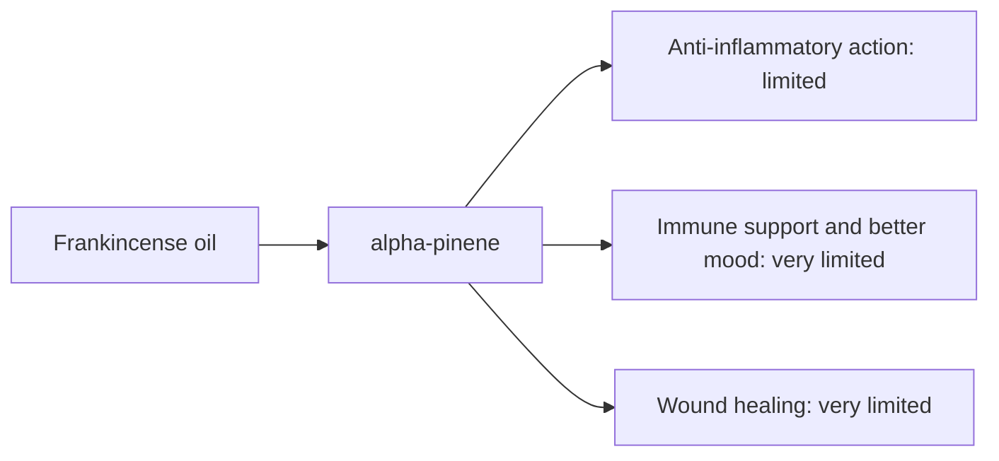

# Frankincense oil

## Summary

Frankincense essential oil comes from Boswellia carteri (Boswellia sacra). It is used for anti-inflammatory action, immune support, better mood and wound healing. Its main compounds are alpha-pinene, limonene and other monoterpenes. The notes attribute its effects to boswellic acids, which are strongly anti-inflammatory; however, boswellic acids are non-volatile and are found in the resin and its extracts, not in meaningful amounts in the distilled essential oil. Human evidence is summarized below; most claims rest on laboratory or small studies.

*This note is educational. It is not medical advice and does not replace a doctor, dietitian or pharmacist, especially during pregnancy, illness or when taking medicines.*

## Prerequisites

- [Essential oils overview](essential-oils-overview.md)

## Core concepts

### Definition

*Frankincense oil* is the essential oil of *Boswellia carteri (Boswellia sacra)*. Its characteristic compounds are alpha-pinene, limonene and other monoterpenes.

### Analogy

Frankincense essential oil and frankincense resin extract are like the aroma and the substance of a dish: the oil carries the scent, while the anti-inflammatory boswellic acids stay in the resin. The analogy breaks because both come from the same tree resin but are used very differently.

### Mechanism

**Uses described in the notes:** anti-inflammatory action, immune support, better mood and wound healing.

**Why it is thought to work:** The notes attribute its effects to boswellic acids, which are strongly anti-inflammatory; however, boswellic acids are non-volatile and are found in the resin and its extracts, not in meaningful amounts in the distilled essential oil.

Like other essential oils, it acts through smell (olfactory and limbic pathways) when inhaled and through local effects on skin and microbes when applied diluted ([Essential oils overview](essential-oils-overview.md)).

The flowchart links the main compound to each claimed effect, with its evidence grade.

### Claimed effects and evidence

Each entry states the proposed effect and how strong the human evidence is, using the grades defined in the [Evidence grades](../../nutrition/evidence-grades.md) note.

- **Anti-inflammatory action.** Oral Boswellia serrata resin extracts reduce osteoarthritis pain in small trials; the essential oil lacks boswellic acids. Evidence: limited.
- **Immune support and better mood.** No meaningful evidence for the oil. Evidence: very limited.
- **Wound healing.** Laboratory studies. Evidence: very limited.

## Worked example

A person wants frankincense for knee osteoarthritis. A standardized Boswellia serrata extract capsule (with boswellic acids) has some trial evidence; massaging frankincense essential oil onto the knee does not deliver boswellic acids.

## Trade offs and when to use it

The oil is generally well tolerated when diluted; oxidized oil may sensitize skin.

## Common mistakes

- **Expecting boswellic acids from the essential oil.** They are in resin extracts, not the oil.

## Practice

1. Where are boswellic acids found?
2. Which product has evidence for osteoarthritis?

### Answers

1. In the resin and its extracts, not in the essential oil.
2. Oral Boswellia serrata extract.

## Further reading

- Tisserand, R., Young, R. (2014). *Essential Oil Safety: A Guide for Health Care Professionals (2nd ed.)*. Churchill Livingstone. Composition data.
