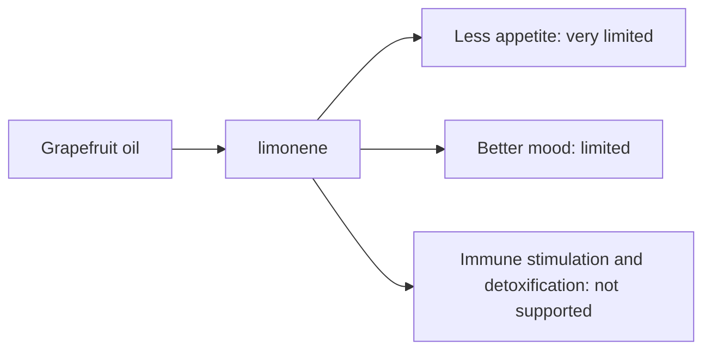

# Grapefruit oil

## Summary

Grapefruit essential oil comes from Citrus paradisi. It is used for stimulating immunity, reducing appetite, better mood and detoxification. Its main compounds are limonene. Limonene is antibacterial and the fresh scent is stimulating; animal studies suggested grapefruit scent affects appetite through the nervous system. Human evidence is summarized below; most claims rest on laboratory or small studies.

*This note is educational. It is not medical advice and does not replace a doctor, dietitian or pharmacist, especially during pregnancy, illness or when taking medicines.*

## Prerequisites

- [Essential oils overview](essential-oils-overview.md)

## Core concepts

### Definition

*Grapefruit oil* is the essential oil of *Citrus paradisi*. Its characteristic compounds are limonene.

### Analogy

Grapefruit oil is like a bright citrus wake-up. The analogy breaks because, unlike the fruit or juice, the oil does not cause the famous grapefruit-drug interaction.

### Mechanism

**Uses described in the notes:** stimulating immunity, reducing appetite, better mood and detoxification.

**Why it is thought to work:** Limonene is antibacterial and the fresh scent is stimulating; animal studies suggested grapefruit scent affects appetite through the nervous system.

Like other essential oils, it acts through smell (olfactory and limbic pathways) when inhaled and through local effects on skin and microbes when applied diluted ([Essential oils overview](essential-oils-overview.md)).

The flowchart links the main compound to each claimed effect, with its evidence grade.

### Claimed effects and evidence

Each entry states the proposed effect and how strong the human evidence is, using the grades defined in the [Evidence grades](../../nutrition/evidence-grades.md) note.

- **Less appetite.** Rat studies of grapefruit scent and sympathetic nerve activity. Evidence: very limited.
- **Better mood.** Small aromatherapy studies. Evidence: limited.
- **Immune stimulation and detoxification.** No evidence. Evidence: not supported.

## Worked example

A person hoping to lose weight diffuses grapefruit oil before meals. The only evidence comes from rats; diet changes with fiber and protein are far more effective ([Foods and satiety](../../nutrition/foundations/foods-and-satiety.md)).

## Trade offs and when to use it

Cold-pressed grapefruit oil can be mildly phototoxic. Grapefruit juice (not the oil) inhibits CYP3A4 and interacts with many drugs.

## Common mistakes

- **Expecting appetite suppression.** Evidence comes from animal studies.

## Practice

1. What is the main compound of grapefruit oil?
2. Does grapefruit oil cause the grapefruit-drug interaction?

### Answers

1. Limonene.
2. No, that is caused by compounds in the juice.

## Further reading

- Tisserand, R., Young, R. (2014). *Essential Oil Safety: A Guide for Health Care Professionals (2nd ed.)*. Churchill Livingstone. Composition and phototoxicity data.
