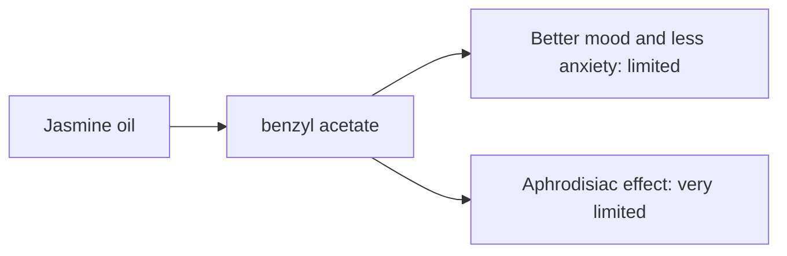

# Jasmine oil

## Summary

Jasmine essential oil comes from Jasminum officinale (Jasminum grandiflorum). It is used for better mood, aphrodisiac effects and less anxiety. Its main compounds are benzyl acetate, linalool and benzyl benzoate. The notes state that benzyl acetate and linalool act on serotonin receptors to lift mood; this mechanism has not been shown in humans. Human evidence is summarized below; most claims rest on laboratory or small studies.

*This note is educational. It is not medical advice and does not replace a doctor, dietitian or pharmacist, especially during pregnancy, illness or when taking medicines.*

## Prerequisites

- [Essential oils overview](essential-oils-overview.md)

## Core concepts

### Definition

*Jasmine oil* is the essential oil of *Jasminum officinale (Jasminum grandiflorum)*. Its characteristic compounds are benzyl acetate, linalool and benzyl benzoate.

### Analogy

Jasmine oil is like the scent of a summer evening garden, associated with romance. The analogy breaks because the association, not a proven chemical action, may explain much of its reputation.

### Mechanism

**Uses described in the notes:** better mood, aphrodisiac effects and less anxiety.

**Why it is thought to work:** The notes state that benzyl acetate and linalool act on serotonin receptors to lift mood; this mechanism has not been shown in humans.

Like other essential oils, it acts through smell (olfactory and limbic pathways) when inhaled and through local effects on skin and microbes when applied diluted ([Essential oils overview](essential-oils-overview.md)).

The flowchart links the main compound to each claimed effect, with its evidence grade.

### Claimed effects and evidence

Each entry states the proposed effect and how strong the human evidence is, using the grades defined in the [Evidence grades](../../nutrition/evidence-grades.md) note.

- **Better mood and less anxiety.** Small studies show increased alertness or positive mood ratings. Evidence: limited.
- **Aphrodisiac effect.** No meaningful evidence. Evidence: very limited.

## Worked example

Jasmine "absolute" is extracted with solvents rather than distilled, because flowers are too delicate; it is one of the most expensive aromatic products. Most cheap jasmine scents are synthetic.

## Trade offs and when to use it

Jasmine absolute can cause skin sensitization; use in low dilution.

## Common mistakes

- **Assuming jasmine oil is distilled.** It is usually a solvent-extracted absolute.

## Practice

1. How is jasmine aroma usually extracted?
2. Is the serotonin mechanism proven?

### Answers

1. With solvents, as an absolute.
2. No.

## Further reading

- Tisserand, R., Young, R. (2014). *Essential Oil Safety: A Guide for Health Care Professionals (2nd ed.)*. Churchill Livingstone. Composition and safety data.
