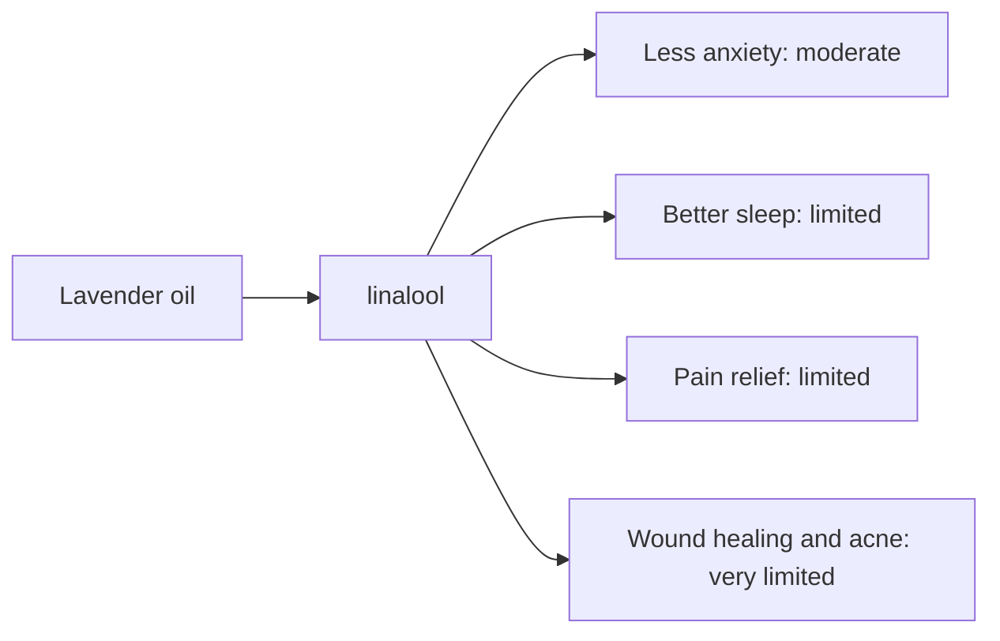

# Lavender oil

## Summary

Lavender essential oil comes from Lavandula angustifolia. It is used for better sleep, less anxiety, pain relief, wound healing and acne. Its main compounds are linalool and linalyl acetate. Linalool and linalyl acetate calm the nervous system, may lower cortisol and are anti-inflammatory and antiseptic; inhaled lavender is thought to act on the limbic system involved in emotion and relaxation. Human evidence is summarized below; most claims rest on laboratory or small studies.

*This note is educational. It is not medical advice and does not replace a doctor, dietitian or pharmacist, especially during pregnancy, illness or when taking medicines.*

## Prerequisites

- [Essential oils overview](essential-oils-overview.md)

## Core concepts

### Definition

*Lavender oil* is the essential oil of *Lavandula angustifolia*. Its characteristic compounds are linalool and linalyl acetate.

### Analogy

Lavender oil is like a lullaby in scent form: it signals the brain to wind down. The analogy breaks because an oral lavender oil preparation (Silexan) also works without smell, through effects on calcium channels in nerves.

### Mechanism

**Uses described in the notes:** better sleep, less anxiety, pain relief, wound healing and acne.

**Why it is thought to work:** Linalool and linalyl acetate calm the nervous system, may lower cortisol and are anti-inflammatory and antiseptic; inhaled lavender is thought to act on the limbic system involved in emotion and relaxation.

Like other essential oils, it acts through smell (olfactory and limbic pathways) when inhaled and through local effects on skin and microbes when applied diluted ([Essential oils overview](essential-oils-overview.md)).

The flowchart links the main compound to each claimed effect, with its evidence grade.

### Claimed effects and evidence

Each entry states the proposed effect and how strong the human evidence is, using the grades defined in the [Evidence grades](../../nutrition/evidence-grades.md) note.

- **Less anxiety.** Oral lavender oil (Silexan, 80 mg) reduced anxiety in several randomized trials; inhalation has weaker evidence. Evidence: moderate.
- **Better sleep.** Small trials of inhalation show improved sleep quality. Evidence: limited.
- **Pain relief.** Small trials after surgery and in dysmenorrhea. Evidence: limited.
- **Wound healing and acne.** Laboratory and animal studies. Evidence: very limited.

## Worked example

In a 10-week trial (Kasper and colleagues, 2010), 221 adults with subsyndromal anxiety took 80 mg Silexan capsules or placebo daily. Anxiety scores fell more with Silexan, with few side effects. This oral, standardized product differs from essential oil used for inhalation, which must not be swallowed.

## Trade offs and when to use it

Lavender is one of the gentler oils but can cause contact allergy. Topical products have rarely been linked to breast growth in boys (possible estrogenic effects), a link that is debated.

## Common mistakes

- **Swallowing ordinary lavender essential oil.** Only tested oral products should be taken by mouth.

## Practice

1. What are the main compounds of lavender oil?
2. Which lavender use has the best evidence?

### Answers

1. Linalool and linalyl acetate.
2. Oral Silexan for anxiety.

## Further reading

- Kasper, S., Gastpar, M., Müller, W. E. et al. (2010). Silexan, an orally administered Lavandula oil preparation, is effective in the treatment of subsyndromal anxiety disorder: a randomized, double-blind, placebo controlled trial. International Clinical Psychopharmacology, 25(5), 277-287. [DOI](https://doi.org/10.1097/YIC.0b013e32833b3242). Trial of oral lavender oil for anxiety.
- Tisserand, R., Young, R. (2014). *Essential Oil Safety: A Guide for Health Care Professionals (2nd ed.)*. Churchill Livingstone. Safety data.
