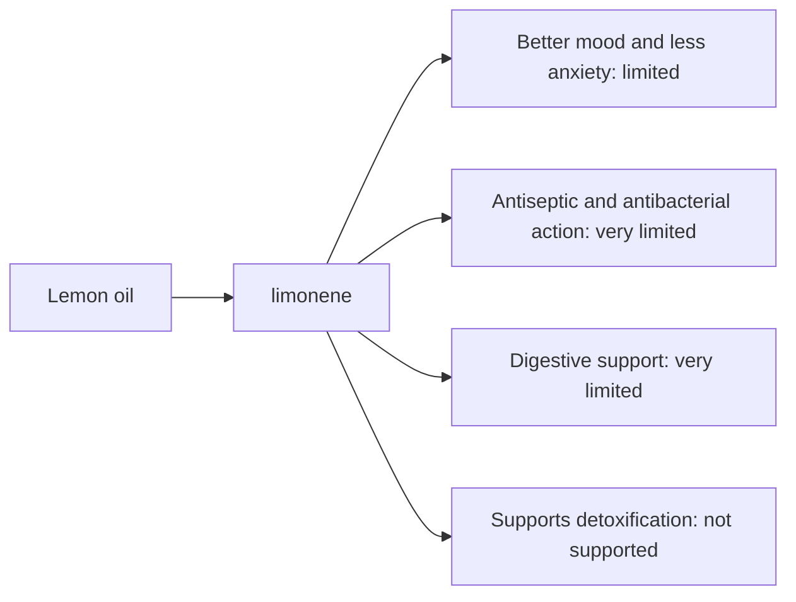

# Lemon oil

## Summary

Lemon essential oil comes from Citrus limon. It is used for better mood, less anxiety, antiseptic action and digestion. Its main compounds are limonene. Limonene is antioxidant and antibacterial in the laboratory, and the fresh scent is perceived as stimulating and mood-lifting. Human evidence is summarized below; most claims rest on laboratory or small studies.

*This note is educational. It is not medical advice and does not replace a doctor, dietitian or pharmacist, especially during pregnancy, illness or when taking medicines.*

## Prerequisites

- [Essential oils overview](essential-oils-overview.md)

## Core concepts

### Definition

*Lemon oil* is the essential oil of *Citrus limon*. Its characteristic compounds are limonene.

### Analogy

Lemon oil is like a burst of fresh citrus air: the scent feels clean and energizing. The analogy breaks because cold-pressed lemon oil can burn skin in sunlight.

### Mechanism

**Uses described in the notes:** better mood, less anxiety, antiseptic action and digestion.

**Why it is thought to work:** Limonene is antioxidant and antibacterial in the laboratory, and the fresh scent is perceived as stimulating and mood-lifting.

Like other essential oils, it acts through smell (olfactory and limbic pathways) when inhaled and through local effects on skin and microbes when applied diluted ([Essential oils overview](essential-oils-overview.md)).

The flowchart links the main compound to each claimed effect, with its evidence grade.

### Claimed effects and evidence

Each entry states the proposed effect and how strong the human evidence is, using the grades defined in the [Evidence grades](../../nutrition/evidence-grades.md) note.

- **Better mood and less anxiety.** Small aromatherapy studies. Evidence: limited.
- **Antiseptic and antibacterial action.** Laboratory evidence. Evidence: very limited.
- **Digestive support.** No meaningful evidence. Evidence: very limited.
- **Supports detoxification.** No evidence. Evidence: not supported.

## Worked example

A person diffuses lemon oil in a home office in the afternoon. Any mood effect is mild and partly expectation. Lemon oil added to a homemade surface cleaner contributes scent; vinegar and soap do most of the cleaning.

## Trade offs and when to use it

Cold-pressed lemon oil is phototoxic; avoid sun on treated skin for 12 hours. Distilled lemon oil is not phototoxic. Oxidized limonene can cause skin allergy.

## Common mistakes

- **Applying cold-pressed lemon oil before sun exposure.** It can cause burns and pigmentation.

## Practice

1. What is the main compound of lemon oil?
2. What risk do cold-pressed citrus oils carry?

### Answers

1. Limonene.
2. Phototoxic skin burns.

## Further reading

- Tisserand, R., Young, R. (2014). *Essential Oil Safety: A Guide for Health Care Professionals (2nd ed.)*. Churchill Livingstone. Composition and phototoxicity data.
