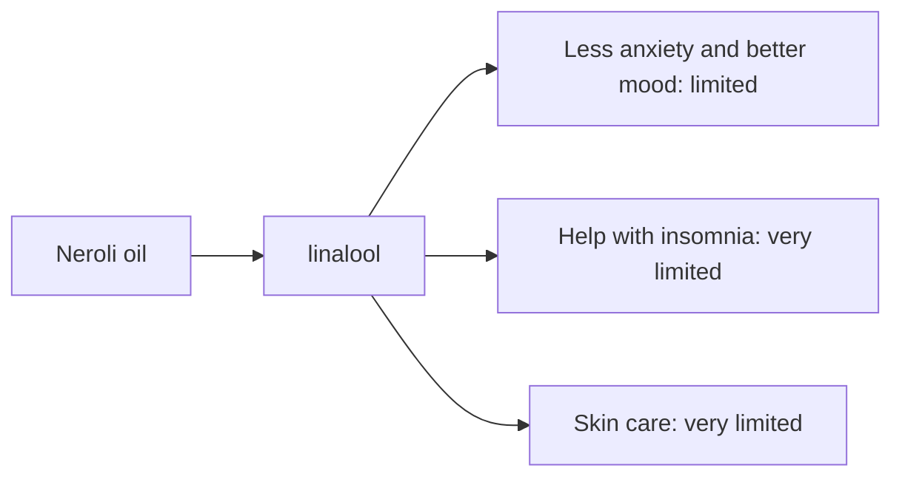

# Neroli oil

## Summary

Neroli essential oil comes from Citrus aurantium (flowers). It is used for less anxiety, better mood, help with insomnia and skin care. Its main compounds are linalool, limonene and linalyl acetate. Linalool and limonene are calming and anxiolytic; studies report that inhaling neroli improves mood and reduces stress. Human evidence is summarized below; most claims rest on laboratory or small studies.

*This note is educational. It is not medical advice and does not replace a doctor, dietitian or pharmacist, especially during pregnancy, illness or when taking medicines.*

## Prerequisites

- [Essential oils overview](essential-oils-overview.md)

## Core concepts

### Definition

*Neroli oil* is the essential oil of *Citrus aurantium (flowers)*. Its characteristic compounds are linalool, limonene and linalyl acetate.

### Analogy

Neroli is the scent of bitter orange blossom, like a gentler, floral cousin of citrus oils. The analogy breaks because, unlike cold-pressed citrus peel oils, distilled neroli is not phototoxic.

### Mechanism

**Uses described in the notes:** less anxiety, better mood, help with insomnia and skin care.

**Why it is thought to work:** Linalool and limonene are calming and anxiolytic; studies report that inhaling neroli improves mood and reduces stress.

Like other essential oils, it acts through smell (olfactory and limbic pathways) when inhaled and through local effects on skin and microbes when applied diluted ([Essential oils overview](essential-oils-overview.md)).

The flowchart links the main compound to each claimed effect, with its evidence grade.

### Claimed effects and evidence

Each entry states the proposed effect and how strong the human evidence is, using the grades defined in the [Evidence grades](../../nutrition/evidence-grades.md) note.

- **Less anxiety and better mood.** Small trials, for example before colonoscopy and in menopausal women. Evidence: limited.
- **Help with insomnia.** Small studies. Evidence: very limited.
- **Skin care.** No meaningful evidence. Evidence: very limited.

## Worked example

In a small trial, postmenopausal women inhaling neroli oil twice daily for 5 days reported better quality of life and lower blood pressure than with almond oil. The effects were modest and short-term.

## Trade offs and when to use it

Neroli is generally well tolerated and not phototoxic.

## Common mistakes

- **Confusing neroli with bitter orange peel oil.** Neroli comes from blossoms; peel oil differs.

## Practice

1. Which part of the bitter orange gives neroli?
2. Is neroli phototoxic?

### Answers

1. The flowers.
2. No.

## Further reading

- Tisserand, R., Young, R. (2014). *Essential Oil Safety: A Guide for Health Care Professionals (2nd ed.)*. Churchill Livingstone. Composition and safety data.
