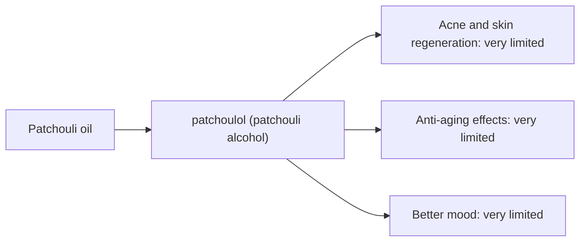

# Patchouli oil

## Summary

Patchouli essential oil comes from Pogostemon cablin. It is used for acne, anti-aging skin effects, skin regeneration and better mood. Its main compounds are patchoulol (patchouli alcohol). Patchoulol is anti-inflammatory and antimicrobial in laboratory studies, which is the basis for skin claims. Human evidence is summarized below; most claims rest on laboratory or small studies.

*This note is educational. It is not medical advice and does not replace a doctor, dietitian or pharmacist, especially during pregnancy, illness or when taking medicines.*

## Prerequisites

- [Essential oils overview](essential-oils-overview.md)

## Core concepts

### Definition

*Patchouli oil* is the essential oil of *Pogostemon cablin*. Its characteristic compounds are patchoulol (patchouli alcohol).

### Analogy

Patchouli oil is like an earthy base note in perfume that lasts for hours. The analogy breaks because its skin benefits have not been tested in people.

### Mechanism

**Uses described in the notes:** acne, anti-aging skin effects, skin regeneration and better mood.

**Why it is thought to work:** Patchoulol is anti-inflammatory and antimicrobial in laboratory studies, which is the basis for skin claims.

Like other essential oils, it acts through smell (olfactory and limbic pathways) when inhaled and through local effects on skin and microbes when applied diluted ([Essential oils overview](essential-oils-overview.md)).

The flowchart links the main compound to each claimed effect, with its evidence grade.

### Claimed effects and evidence

Each entry states the proposed effect and how strong the human evidence is, using the grades defined in the [Evidence grades](../../nutrition/evidence-grades.md) note.

- **Acne and skin regeneration.** Laboratory and animal studies. Evidence: very limited.
- **Anti-aging effects.** Animal studies of UV damage. Evidence: very limited.
- **Better mood.** No meaningful evidence. Evidence: very limited.

## Worked example

Patchouli improves with age, unlike most essential oils, which oxidize; it is used as a fixative in perfumes. For acne, tea tree oil has better evidence.

## Trade offs and when to use it

Generally low irritation potential; may interact with anticoagulants in theory.

## Common mistakes

- **Choosing patchouli for acne over better-studied options.** Tea tree oil has trial evidence.

## Practice

1. What is the main compound of patchouli oil?
2. How does patchouli change with age?

### Answers

1. Patchoulol.
2. Its scent improves rather than degrading.

## Further reading

- Tisserand, R., Young, R. (2014). *Essential Oil Safety: A Guide for Health Care Professionals (2nd ed.)*. Churchill Livingstone. Composition and safety data.
