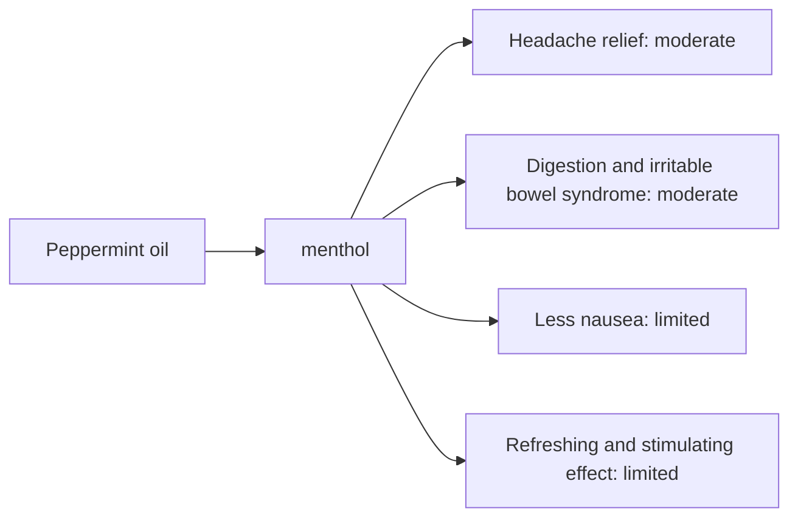

# Peppermint oil

## Summary

Peppermint essential oil comes from Mentha piperita. It is used for headache relief, digestion, less nausea, and a refreshing, stimulating effect. Its main compounds are menthol and menthone. Menthol activates cold receptors (TRPM8) in skin and mucosa, giving a cooling feeling, reduces pain and relaxes smooth muscle by blocking calcium channels. Human evidence is summarized below; most claims rest on laboratory or small studies.

*This note is educational. It is not medical advice and does not replace a doctor, dietitian or pharmacist, especially during pregnancy, illness or when taking medicines.*

## Prerequisites

- [Essential oils overview](essential-oils-overview.md)

## Core concepts

### Definition

*Peppermint oil* is the essential oil of *Mentha piperita*. Its characteristic compounds are menthol and menthone.

### Analogy

Peppermint oil is like a cooling switch: menthol tricks cold receptors into firing, which distracts from pain and relaxes muscles. The analogy breaks because the relaxing effect on gut muscle also relaxes the esophageal sphincter, which can worsen heartburn.

### Mechanism

**Uses described in the notes:** headache relief, digestion, less nausea, and a refreshing, stimulating effect.

**Why it is thought to work:** Menthol activates cold receptors (TRPM8) in skin and mucosa, giving a cooling feeling, reduces pain and relaxes smooth muscle by blocking calcium channels.

Like other essential oils, it acts through smell (olfactory and limbic pathways) when inhaled and through local effects on skin and microbes when applied diluted ([Essential oils overview](essential-oils-overview.md)).

The flowchart links the main compound to each claimed effect, with its evidence grade.

### Claimed effects and evidence

Each entry states the proposed effect and how strong the human evidence is, using the grades defined in the [Evidence grades](../../nutrition/evidence-grades.md) note.

- **Headache relief.** 10 percent peppermint oil on the temples relieved tension headache similarly to paracetamol in trials. Evidence: moderate.
- **Digestion and irritable bowel syndrome.** Enteric-coated peppermint oil capsules improve IBS symptoms in meta-analyses. Evidence: moderate.
- **Less nausea.** Small trials of inhalation after surgery show mixed results. Evidence: limited.
- **Refreshing and stimulating effect.** Subjective effects in small studies. Evidence: limited.

## Worked example

A person with a tension headache applies a 10 percent peppermint oil solution in ethanol to the forehead and temples, as studied in German trials summarized by Göbel and colleagues. Pain relief within 15 minutes was comparable to 1 g paracetamol.

## Trade offs and when to use it

Do not use near the face of infants and young children (risk of breathing problems). Peppermint oil can worsen reflux. Keep away from eyes.

## Common mistakes

- **Applying near infants' faces.** Menthol can trigger breathing problems.

## Practice

1. Which receptor does menthol activate?
2. Which peppermint preparation helps IBS?

### Answers

1. TRPM8, the cold receptor.
2. Enteric-coated peppermint oil capsules.

## Further reading

- Göbel, H., Heinze, A., Heinze-Kuhn, K. et al. (2016). Peppermint oil in the acute treatment of tension-type headache. Schmerz, 30(3), 295-310. [DOI](https://doi.org/10.1007/s00482-016-0109-6). Review of peppermint oil for tension headache.
- Khanna, R., MacDonald, J. K., Levesque, B. G. (2014). Peppermint oil for the treatment of irritable bowel syndrome: a systematic review and meta-analysis. Journal of Clinical Gastroenterology, 48(6), 505-512. [DOI](https://doi.org/10.1097/MCG.0b013e3182a88357). Meta-analysis for IBS.
