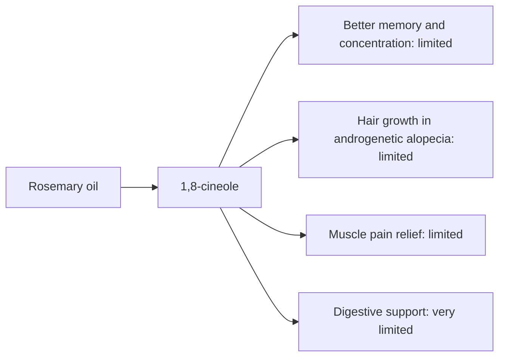

# Rosemary oil

## Summary

Rosemary essential oil comes from Rosmarinus officinalis. It is used for better memory, hair growth, muscle pain and digestion. Its main compounds are 1,8-cineole, camphor and alpha-pinene. Camphor and cineole improve local blood circulation, which may support hair growth, and the scent is stimulating, which may improve alertness and memory. Human evidence is summarized below; most claims rest on laboratory or small studies.

*This note is educational. It is not medical advice and does not replace a doctor, dietitian or pharmacist, especially during pregnancy, illness or when taking medicines.*

## Prerequisites

- [Essential oils overview](essential-oils-overview.md)

## Core concepts

### Definition

*Rosemary oil* is the essential oil of *Rosmarinus officinalis*. Its characteristic compounds are 1,8-cineole, camphor and alpha-pinene.

### Analogy

Rosemary oil on the scalp is like a gentle wake-up call to hair follicles through increased circulation. The analogy breaks because the mechanism of hair growth is not established.

### Mechanism

**Uses described in the notes:** better memory, hair growth, muscle pain and digestion.

**Why it is thought to work:** Camphor and cineole improve local blood circulation, which may support hair growth, and the scent is stimulating, which may improve alertness and memory.

Like other essential oils, it acts through smell (olfactory and limbic pathways) when inhaled and through local effects on skin and microbes when applied diluted ([Essential oils overview](essential-oils-overview.md)).

The flowchart links the main compound to each claimed effect, with its evidence grade.

### Claimed effects and evidence

Each entry states the proposed effect and how strong the human evidence is, using the grades defined in the [Evidence grades](../../nutrition/evidence-grades.md) note.

- **Better memory and concentration.** Small studies found modest effects of rosemary aroma on memory tasks. Evidence: limited.
- **Hair growth in androgenetic alopecia.** One trial found rosemary oil similar to 2 percent minoxidil after 6 months, with less scalp itching. Evidence: limited.
- **Muscle pain relief.** Small studies. Evidence: limited.
- **Digestive support.** Traditional use. Evidence: very limited.

## Worked example

In a 6-month trial (Panahi and colleagues, 2015), 100 men with androgenetic alopecia applied rosemary oil or 2 percent minoxidil. Hair counts increased similarly in both groups at 6 months. The trial was single-blind and small, and minoxidil 5 percent, the standard, was not used.

## Trade offs and when to use it

Rosemary oil can trigger seizures at high doses in susceptible people (camphor) and should be avoided in epilepsy and pregnancy.

## Common mistakes

- **Using rosemary oil with epilepsy.** Camphor may lower seizure threshold.

## Practice

1. Which hair condition was studied with rosemary oil?
2. Which compound requires caution in epilepsy?

### Answers

1. Androgenetic alopecia.
2. Camphor.

## Further reading

- Panahi, Y., Taghizadeh, M., Marzony, E. T. et al. (2015). Rosemary oil vs minoxidil 2% for the treatment of androgenetic alopecia: a randomized comparative trial. Skinmed, 13(1), 15-21. Trial of rosemary oil versus minoxidil.
- Tisserand, R., Young, R. (2014). *Essential Oil Safety: A Guide for Health Care Professionals (2nd ed.)*. Churchill Livingstone. Safety data.
