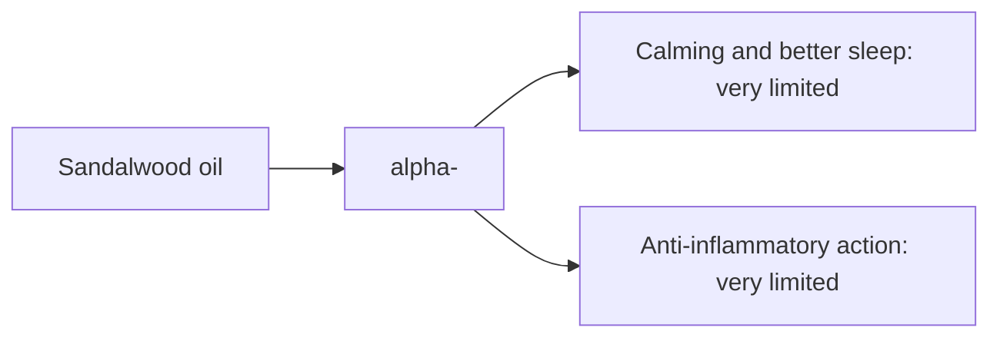

# Sandalwood oil

## Summary

Sandalwood essential oil comes from Santalum album. It is used for calming the mind, meditation, anti-inflammatory action and better sleep. Its main compounds are alpha- and beta-santalol. Santalol is thought to calm the nervous system, which makes the oil popular for meditation and stress reduction. Human evidence is summarized below; most claims rest on laboratory or small studies.

*This note is educational. It is not medical advice and does not replace a doctor, dietitian or pharmacist, especially during pregnancy, illness or when taking medicines.*

## Prerequisites

- [Essential oils overview](essential-oils-overview.md)

## Core concepts

### Definition

*Sandalwood oil* is the essential oil of *Santalum album*. Its characteristic compounds are alpha- and beta-santalol.

### Analogy

Sandalwood oil is like incense for meditation: a warm, woody scent associated with calm. The analogy breaks because studies of santalol show both calming and alerting effects depending on the measure.

### Mechanism

**Uses described in the notes:** calming the mind, meditation, anti-inflammatory action and better sleep.

**Why it is thought to work:** Santalol is thought to calm the nervous system, which makes the oil popular for meditation and stress reduction.

Like other essential oils, it acts through smell (olfactory and limbic pathways) when inhaled and through local effects on skin and microbes when applied diluted ([Essential oils overview](essential-oils-overview.md)).

The flowchart links the main compound to each claimed effect, with its evidence grade.

### Claimed effects and evidence

Each entry states the proposed effect and how strong the human evidence is, using the grades defined in the [Evidence grades](../../nutrition/evidence-grades.md) note.

- **Calming and better sleep.** Small studies; inhaled santalol had mixed effects on physiological arousal. Evidence: very limited.
- **Anti-inflammatory action.** Laboratory studies; topical studies in skin conditions. Evidence: very limited.

## Worked example

Indian sandalwood is over-harvested; true Santalum album oil is expensive and often adulterated. A person buying cheap "sandalwood" oil may receive synthetic fragrance or another species.

## Trade offs and when to use it

Generally well tolerated on skin when diluted; adulteration is common.

## Common mistakes

- **Buying cheap oil assuming authenticity.** Sandalwood is often adulterated.

## Practice

1. What are the main compounds of sandalwood oil?
2. Why is authenticity a problem?

### Answers

1. Alpha- and beta-santalol.
2. Sandalwood is scarce and expensive.

## Further reading

- Tisserand, R., Young, R. (2014). *Essential Oil Safety: A Guide for Health Care Professionals (2nd ed.)*. Churchill Livingstone. Composition and safety data.
