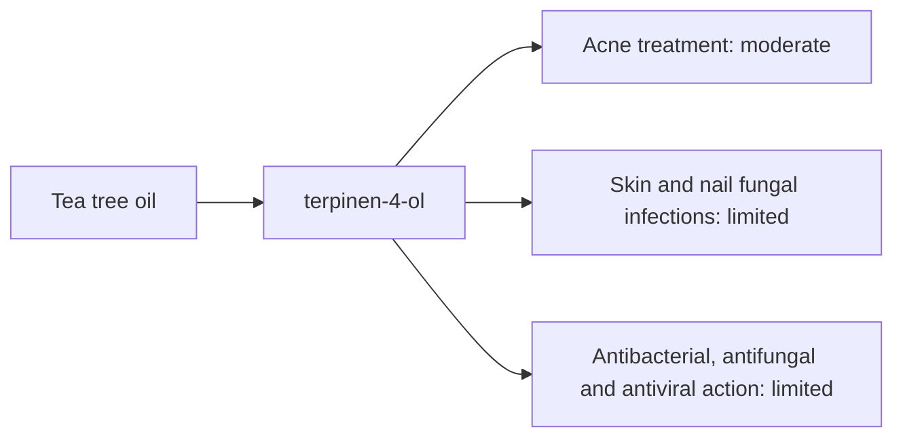

# Tea tree oil

## Summary

Tea tree essential oil comes from Melaleuca alternifolia. It is used for acne, skin infections, and antibacterial, antifungal and antiviral action. Its main compounds are terpinen-4-ol. Terpinen-4-ol damages microbial cell membranes, which makes the oil active against bacteria and fungi involved in skin infections and inflammation. Human evidence is summarized below; most claims rest on laboratory or small studies.

*This note is educational. It is not medical advice and does not replace a doctor, dietitian or pharmacist, especially during pregnancy, illness or when taking medicines.*

## Prerequisites

- [Essential oils overview](essential-oils-overview.md)

## Core concepts

### Definition

*Tea tree oil* is the essential oil of *Melaleuca alternifolia*. Its characteristic compounds are terpinen-4-ol.

### Analogy

Tea tree oil is like a mild antiseptic made by a tree. It is weaker than benzoyl peroxide for acne but gentler. The analogy breaks because oxidized tea tree oil becomes a strong skin allergen.

### Mechanism

**Uses described in the notes:** acne, skin infections, and antibacterial, antifungal and antiviral action.

**Why it is thought to work:** Terpinen-4-ol damages microbial cell membranes, which makes the oil active against bacteria and fungi involved in skin infections and inflammation.

Like other essential oils, it acts through smell (olfactory and limbic pathways) when inhaled and through local effects on skin and microbes when applied diluted ([Essential oils overview](essential-oils-overview.md)).

The flowchart links the main compound to each claimed effect, with its evidence grade.

### Claimed effects and evidence

Each entry states the proposed effect and how strong the human evidence is, using the grades defined in the [Evidence grades](../../nutrition/evidence-grades.md) note.

- **Acne treatment.** 5 percent tea tree gel reduced acne lesions compared with placebo; slower but better tolerated than benzoyl peroxide. Evidence: moderate.
- **Skin and nail fungal infections.** Small trials in athlete's foot and nail fungus show modest effects. Evidence: limited.
- **Antibacterial, antifungal and antiviral action.** Strong in the laboratory. Evidence: limited.

## Worked example

In a randomized trial (Enshaieh and colleagues, 2007), 60 people with mild to moderate acne used 5 percent tea tree oil gel or placebo gel for 45 days. Total lesion counts fell about 3.5 times more with tea tree gel.

## Trade offs and when to use it

Use diluted (5 percent for acne). Old, oxidized oil increases allergy risk; store tightly closed and away from light. It is toxic if swallowed and to cats.

## Common mistakes

- **Using undiluted or oxidized oil.** Both raise irritation and allergy risk.

## Practice

1. What is the main active compound of tea tree oil?
2. Which use has moderate evidence?

### Answers

1. Terpinen-4-ol.
2. Acne at 5 percent concentration.

## Further reading

- Enshaieh, S., Jooya, A., Siadat, A. H. et al. (2007). The efficacy of 5% topical tea tree oil gel in mild to moderate acne vulgaris: a randomized, double-blind placebo-controlled study. Indian Journal of Dermatology, Venereology and Leprology, 73(1), 22-25. [DOI](https://doi.org/10.4103/0378-6323.30646). Trial of tea tree oil gel for acne.
- Tisserand, R., Young, R. (2014). *Essential Oil Safety: A Guide for Health Care Professionals (2nd ed.)*. Churchill Livingstone. Safety data.
