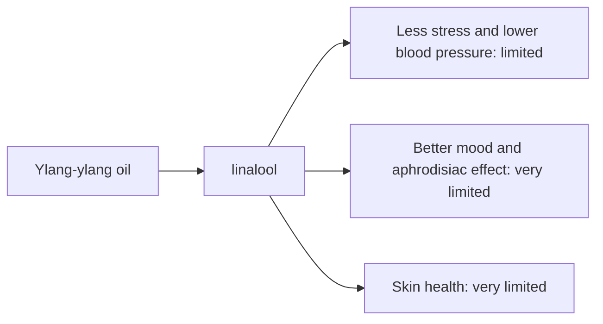

# Ylang-ylang oil

## Summary

Ylang-ylang essential oil comes from Cananga odorata. It is used for less stress, better mood, aphrodisiac effects and skin health. Its main compounds are linalool, germacrene D and benzyl acetate. Ylang-ylang is thought to calm by lowering blood pressure and improving blood flow, and linalool has relaxing effects. Human evidence is summarized below; most claims rest on laboratory or small studies.

*This note is educational. It is not medical advice and does not replace a doctor, dietitian or pharmacist, especially during pregnancy, illness or when taking medicines.*

## Prerequisites

- [Essential oils overview](essential-oils-overview.md)

## Core concepts

### Definition

*Ylang-ylang oil* is the essential oil of *Cananga odorata*. Its characteristic compounds are linalool, germacrene D and benzyl acetate.

### Analogy

Ylang-ylang oil is like a slow, sweet floral melody that tells the body to slow down. The analogy breaks because effects on blood pressure in studies were small and short-lived.

### Mechanism

**Uses described in the notes:** less stress, better mood, aphrodisiac effects and skin health.

**Why it is thought to work:** Ylang-ylang is thought to calm by lowering blood pressure and improving blood flow, and linalool has relaxing effects.

Like other essential oils, it acts through smell (olfactory and limbic pathways) when inhaled and through local effects on skin and microbes when applied diluted ([Essential oils overview](essential-oils-overview.md)).

The flowchart links the main compound to each claimed effect, with its evidence grade.

### Claimed effects and evidence

Each entry states the proposed effect and how strong the human evidence is, using the grades defined in the [Evidence grades](../../nutrition/evidence-grades.md) note.

- **Less stress and lower blood pressure.** Small studies show short-term reductions in blood pressure and heart rate after inhalation. Evidence: limited.
- **Better mood and aphrodisiac effect.** No meaningful evidence. Evidence: very limited.
- **Skin health.** No meaningful evidence. Evidence: very limited.

## Worked example

In a small study, inhaling ylang-ylang oil lowered blood pressure and heart rate compared with a control scent in healthy volunteers for the duration of exposure. This does not show a treatment effect for hypertension.

## Trade offs and when to use it

Ylang-ylang can sensitize skin; use low dilutions. Strong scent may cause headaches.

## Common mistakes

- **Using it to treat hypertension.** Effects are small and temporary.

## Practice

1. What is the Latin name of ylang-ylang?
2. What short-term effect was reported in studies?

### Answers

1. Cananga odorata.
2. Lower blood pressure and heart rate during inhalation.

## Further reading

- Tisserand, R., Young, R. (2014). *Essential Oil Safety: A Guide for Health Care Professionals (2nd ed.)*. Churchill Livingstone. Composition and safety data.
