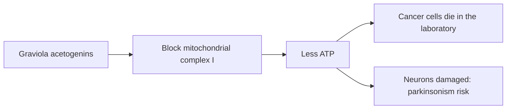

# Graviola (soursop)

## Summary

Graviola (Annona muricata, soursop) is a tropical tree whose leaves, seeds and fruit are promoted as natural cancer treatments. It contains annonaceous acetogenins such as annonacin, which kill cancer cells in laboratory studies by inhibiting mitochondrial complex I. There are no human trials showing benefit against cancer. Annonacin is neurotoxic: regular consumption has been linked to atypical parkinsonism in Guadeloupe. Regulators have acted against cancer claims for graviola products.

*This note is educational. It is not medical advice and does not replace a doctor, dietitian or pharmacist, especially during pregnancy, illness or when taking medicines.*

## Prerequisites

- [Natural remedies overview](natural-remedies.md)

## Core concepts

### Definition

*Graviola* is Annona muricata. *Annonaceous acetogenins* are fatty acid-derived compounds that inhibit mitochondrial complex I (NADH:ubiquinone oxidoreductase).

### Analogy

Annonacin is like a wrench thrown into the first gear of the cell's power plant (complex I). Cancer cells, which need lots of energy, stall in the laboratory, but so do nerve cells, which also depend heavily on mitochondria. The analogy breaks because the body is far more complex than a dish of cells.

### Mechanism

Acetogenins block complex I of the electron transport chain ([Oxidative phosphorylation](../../../natural-sciences/chemistry/biochemistry/oxidative-phosphorylation.md)), reducing ATP production and inducing cell death. In rats, annonacin caused degeneration of neurons in brain areas affected in Parkinson disease. In Guadeloupe, high consumption of soursop fruit and tea was associated with atypical parkinsonism.

The flowchart shows why graviola is both cytotoxic and neurotoxic.

### Proposed effects and evidence

Each entry states the proposed effect and how strong the human evidence is, using the grades defined in the [Evidence grades](../nutrition/evidence-grades.md) note.

- **Slowing the growth of cancer cells.** Laboratory studies only; no human trials. Evidence: very limited.
- **Effective cancer treatment in humans.** No evidence; using it instead of treatment can be fatal. Evidence: not supported.
- **Neurotoxicity.** Animal data and an association with atypical parkinsonism. Evidence: moderate.

## Worked example

A person with cancer is offered graviola capsules online with claims of being "10,000 times stronger than chemotherapy". This claim came from a laboratory study of isolated cells. No human trials support it, and long-term use carries a risk of nerve damage. Discussing any supplement with the oncologist is essential.

## Trade offs and when to use it

Graviola fruit as an occasional food is likely low risk, but concentrated leaf or seed products and regular tea consumption carry neurotoxic risk and have no proven benefit.

## Common mistakes

- **Using graviola as cancer treatment.** No evidence and real harm.
- **Drinking graviola tea daily.** Linked to parkinsonism.

## Practice

1. Which compounds in graviola kill cancer cells in the laboratory?
2. What do they inhibit?
3. What harm is associated with regular consumption?

### Answers

1. Annonaceous acetogenins such as annonacin.
2. Mitochondrial complex I.
3. Atypical parkinsonism.

## Further reading

- Champy, P., Höglinger, G. U., Féger, J. et al. (2004). Annonacin, a lipophilic inhibitor of mitochondrial complex I, induces nigral and striatal neurodegeneration in rats: possible relevance for atypical parkinsonism in Guadeloupe. Journal of Neurochemistry, 88(1), 63-69. [DOI](https://doi.org/10.1046/j.1471-4159.2003.02138.x). Study of annonacin neurotoxicity.
