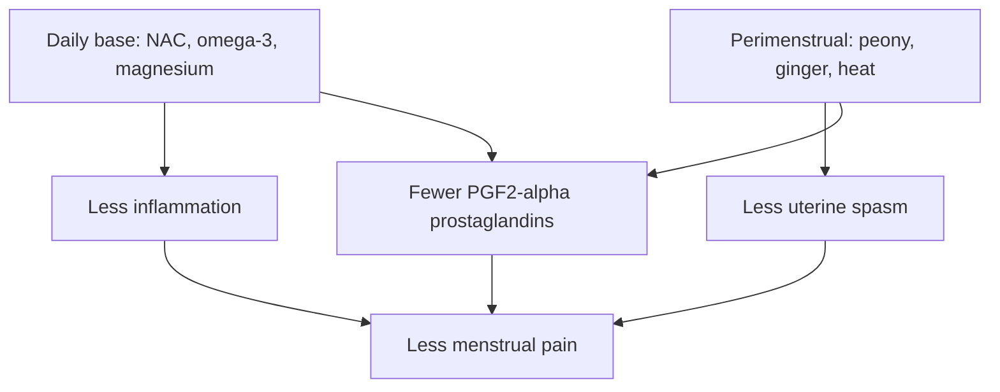

# Menstrual pain protocol

## Summary

This protocol aims to reduce cramping menstrual pain (primary dysmenorrhea) by lowering pro-inflammatory prostaglandins (PGF2-alpha), reducing uterine smooth muscle contractions, reducing inflammation and oxidative stress, and stabilizing the cycle and premenstrual symptoms. It has two layers: a daily base of N-acetylcysteine (NAC), omega-3 fatty acids and magnesium glycinate, and a perimenstrual layer of white peony and ginger, with heat, light movement and herbal teas. Each element has some supporting evidence, mostly small trials; NSAIDs and hormonal contraception remain the best-proven treatments.

*This note is educational. It is not medical advice and does not replace a doctor, dietitian or pharmacist, especially during pregnancy, illness or when taking medicines.*

## Prerequisites

- [Natural remedies overview](natural-remedies.md)

## Core concepts

### Definition

*Primary dysmenorrhea* is painful menstruation without underlying disease, caused mainly by excess *prostaglandin F2-alpha* (PGF2-alpha) from the endometrium, which causes strong uterine contractions and reduced blood flow. *Secondary dysmenorrhea* is pain caused by a condition such as endometriosis, fibroids or polyps.

### Analogy

The protocol is like managing a river that floods every month. The daily base lowers the water level all month (less inflammation, fewer prostaglandins); the perimenstrual layer adds sandbags at the time of the flood (peony and ginger at peak pain). The analogy breaks because, unlike a river, the "flood" is a hormonal process that can be strongly affected by medicines when needed.

### Mechanism

**Layer 1: daily base (whole cycle).** A model scheme, to be adjusted individually with a doctor:

- *NAC*: for example 300 mg daily;
- *omega-3*: for example about 1,500 mg EPA and 500 mg DHA daily;
- *magnesium glycinate*: 200 to 400 mg at night.

Aims: lower inflammation, modulate prostaglandins, improve muscle and nerve tone, support hormone metabolism.

**Layer 2: before and during the first days of bleeding.** Pain usually peaks from 1 to 3 days before the period to the first 1 to 2 days of bleeding. Add:

- *white peony* (Paeonia lactiflora): for example 500 to 1,000 mg extract daily;
- *ginger*: for example 1,000 to 2,000 mg extract daily, or 3 to 4 g fresh root.

Start 2 to 3 days before the expected period and continue for the first 2 days of bleeding (or as needed).

**Non-drug support.** A hot water bottle or warm compress on the lower abdomen or lower back; gentle movement (walking, light stretching, yoga); chamomile or lemon balm tea; less caffeine and sugar on peak days.

**Components and their properties.**

- *NAC* (base, [N-acetylcysteine](../../../natural-sciences/chemistry/biochemistry/amino-acids/n-acetylcysteine.md)): reduces pro-inflammatory cytokines and oxidative stress; raises glutathione, which protects tissues including the endometrium; may improve uterine microcirculation; is used in some protocols for heavy menstrual bleeding; may ease premenstrual irritability and tension through effects on oxidative stress and neurotransmitters; may support estrogen metabolism through liver detoxification; and is studied in PCOS and endometriosis.
- *Omega-3, EPA and DHA* (anti-inflammatory foundation, [Omega-3 fatty acids](../../../natural-sciences/chemistry/biochemistry/lipids/omega-3-fatty-acids.md)): shift prostaglandin production away from PGF2-alpha toward less inflammatory forms, lower systemic inflammation over time, improve vessel function and may stabilize mood in premenstrual syndrome.
- *Magnesium glycinate* ([Magnesium](../nutrition/minerals/magnesium.md)): relaxes smooth muscle (deficiency is linked to cramps), may influence prostaglandin synthesis, calms the nervous system and helps sleep, and is widely used for premenstrual irritability, tension, headaches and cravings.
- *White peony*: its main compound, paeoniflorin, reduces smooth muscle contractility of the uterus and gut, modulates pain mediators including prostaglandins, reduces inflammation and is a classic traditional herb for irritability, emotional tension and cramping pain. At sensible doses it is considered one of the safer gynecological herbs, especially compared with licorice.
- *Ginger* ([Ginger (Zingiber officinale)](../nutrition/herbal-extracts/ginger.md)): gingerols and shogaols reduce inflammation and prostaglandin synthesis; several trials found ginger comparable to ibuprofen for menstrual cramps; it warms and improves blood flow; and it can give noticeable relief within a short time.

The flowchart shows the two layers and their targets.

### Proposed effects and evidence

Each entry states the proposed effect and how strong the human evidence is, using the grades defined in the [Evidence grades](../nutrition/evidence-grades.md) note.

- **Omega-3 reduces menstrual pain.** Several small trials show reduced pain and analgesic use. Evidence: limited.
- **Ginger relieves menstrual pain like ibuprofen.** Meta-analysis of small trials found ginger better than placebo, similar to NSAIDs in some trials. Evidence: moderate.
- **Magnesium reduces menstrual cramps.** Cochrane review found magnesium more effective than placebo in small trials. Evidence: limited.
- **NAC reduces pain and endometriosis.** One observational study in endometriosis; no trials in primary dysmenorrhea. Evidence: very limited.
- **White peony relaxes the uterus.** Mainly traditional use and studies of peony with licorice (shakuyakukanzoto). Evidence: very limited.
- **Heat relieves menstrual pain.** Heat patches were as effective as ibuprofen in some trials. Evidence: moderate.
- **NSAIDs reduce menstrual pain.** First-line treatment with strong evidence. Evidence: strong.

## Worked example

A 25-year-old with painful periods follows the base layer for 3 months and adds ginger and a hot water bottle from 2 days before her period. She tracks pain on a 0 to 10 scale: peak pain falls from 8 to 6. Because guidelines recommend NSAIDs as first-line treatment, she discusses using ibuprofen on the first day with her doctor if pain still limits daily life.

## Trade offs and when to use it

**Cautions.**

- *Medicines and chronic disease.* Consult a doctor before starting, especially with anticoagulants or high-dose NSAIDs (omega-3, ginger and NAC can affect clotting); medicines for blood pressure, heart disease or diabetes; drugs affecting the liver or kidneys; clotting disorders; kidney or liver disease; or very heavy, unusual bleeding (which needs diagnosis, not only pain relief).
- *Dose and duration.* NAC is relatively safe but should not be taken at high doses indefinitely without review; about 300 mg daily is moderate. High-dose omega-3 with anticoagulants raises bleeding risk. Ginger can irritate the gut and affect clotting at very high doses. Peony may theoretically increase bleeding risk with anticoagulants. High magnesium doses cause diarrhea (especially oxide); glycinate, citrate or chelates are better tolerated and doses can be split.
- *Pregnancy and breastfeeding.* Only under medical supervision.
- *What to avoid.* Adding licorice on your own, despite its synergy with peony, because it raises blood pressure, lowers potassium and causes swelling; mixing many herbs and supplements without understanding interactions; replacing diagnosis: severe, sudden or unusual pain, very heavy bleeding, or pain that starts after years of painless periods need assessment for endometriosis, fibroids or polyps.

## Common mistakes

- **Using supplements instead of diagnosis.** New, severe or unusual pain needs assessment.
- **Adding licorice.** It raises blood pressure and lowers potassium.
- **Combining with anticoagulants without advice.** Several components affect clotting.

## Practice

1. Which prostaglandin drives menstrual cramps?
2. Which components form the daily base?
3. When should the perimenstrual layer start?

### Answers

1. PGF2-alpha.
2. NAC, omega-3 and magnesium glycinate.
3. About 2 to 3 days before the expected period.

## Further reading

- American College of Obstetricians and Gynecologists (2018). Dysmenorrhea and endometriosis in the adolescent. ACOG Committee Opinion No. 760. Obstetrics and Gynecology, 132(6), e249-e258. [DOI](https://doi.org/10.1097/AOG.0000000000002978). Guidance on dysmenorrhea and endometriosis.
- Daily, J. W., Zhang, X., Kim, D. S. et al. (2015). Efficacy of ginger for alleviating the symptoms of primary dysmenorrhea: a systematic review and meta-analysis of randomized clinical trials. Pain Medicine, 16(12), 2243-2255. [DOI](https://doi.org/10.1111/pme.12853). Meta-analysis of ginger for dysmenorrhea.
- Rahbar, N., Asgharzadeh, N., Ghorbani, R. (2012). Effect of omega-3 fatty acids on intensity of primary dysmenorrhea. International Journal of Gynecology and Obstetrics, 117(1), 45-47. [DOI](https://doi.org/10.1016/j.ijgo.2011.11.019). Trial of omega-3 for dysmenorrhea.
- Proctor, M. L., Murphy, P. A. (2001). Herbal and dietary therapies for primary and secondary dysmenorrhoea. Cochrane Database of Systematic Reviews, CD002124. [DOI](https://doi.org/10.1002/14651858.CD002124). Cochrane review of herbal and dietary therapies including magnesium.
- Porpora, M. G., Brunelli, R., Costa, G. et al. (2013). A promise in the treatment of endometriosis: an observational cohort study on ovarian endometrioma reduction by N-acetylcysteine. Evidence-Based Complementary and Alternative Medicine, 2013, 240702. [DOI](https://doi.org/10.1155/2013/240702). Study of NAC in endometriosis.
