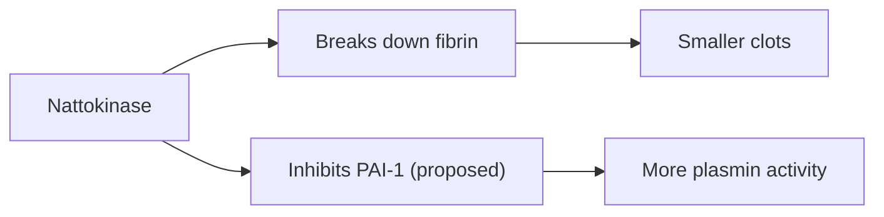

# Nattokinase

## Summary

Nattokinase is an enzyme produced by Bacillus subtilis var. natto during fermentation of soybeans into natto, a traditional Japanese food. It breaks down fibrin, the main protein of blood clots, in laboratory studies, and a single oral dose increased markers of fibrinolysis in a small human study. It is sold as a capsule supplement for preventing clots. It has not been shown to prevent heart attacks or strokes, and it can increase bleeding risk, especially with anticoagulants.

*This note is educational. It is not medical advice and does not replace a doctor, dietitian or pharmacist, especially during pregnancy, illness or when taking medicines.*

## Prerequisites

- [Natural remedies overview](natural-remedies.md)

## Core concepts

### Definition

*Nattokinase* is a serine protease of about 27.7 kDa. *Fibrin* is the protein mesh of a blood clot; *fibrinolysis* is its breakdown.

### Analogy

Nattokinase is like a pair of scissors that cuts the mesh of a clot. In a test tube the scissors work well; whether enough of them get through the gut into the blood to cut real clots is uncertain. The analogy breaks because the body has its own, tightly regulated scissors (plasmin).

### Mechanism

Nattokinase degrades fibrin directly and may activate plasminogen and inactivate plasminogen activator inhibitor 1. Absorption of an intact enzyme from the gut is limited, but some activity in blood has been measured after oral doses.

Natto is also the richest source of vitamin K2 (MK-7), which promotes clotting factor activation; supplements are usually K2-free ([Vitamin K2](../nutrition/vitamins/vitamin-k2.md)).

The flowchart shows the proposed effect of nattokinase.

### Proposed effects and evidence

Each entry states the proposed effect and how strong the human evidence is, using the grades defined in the [Evidence grades](../nutrition/evidence-grades.md) note.

- **Clot prevention by breaking down fibrin.** Laboratory and a small human study of fibrinolytic markers. Evidence: limited.
- **Lower blood pressure.** Small trials show modest reductions. Evidence: limited.
- **Prevention of heart attacks and strokes.** No outcome trials. Evidence: very limited.

## Worked example

In a crossover study (Kurosawa and colleagues, 2015), 12 healthy men took a single 2,000 fibrinolytic unit capsule of nattokinase. Over 8 hours, D-dimer and fibrin degradation products rose and factor VIII fell, suggesting enhanced fibrinolysis. This shows a biological effect, not prevention of disease.

## Trade offs and when to use it

Nattokinase must not replace prescribed anticoagulants. It should be stopped before surgery and avoided with bleeding disorders.

## Common mistakes

- **Replacing anticoagulants with nattokinase.** This is dangerous; no outcome evidence exists.
- **Combining it with aspirin or warfarin without advice.** Bleeding risk rises.

## Practice

1. What does nattokinase break down?
2. What food is nattokinase from?
3. Is there evidence that nattokinase prevents strokes?

### Answers

1. Fibrin.
2. Natto, fermented soybeans.
3. No outcome trials.

## Further reading

- Kurosawa, Y., Nirengi, S., Homma, T. et al. (2015). A single-dose of oral nattokinase potentiates thrombolysis and anti-coagulation profiles. Scientific Reports, 5, 11601. [DOI](https://doi.org/10.1038/srep11601). Human study of a single dose of nattokinase.
