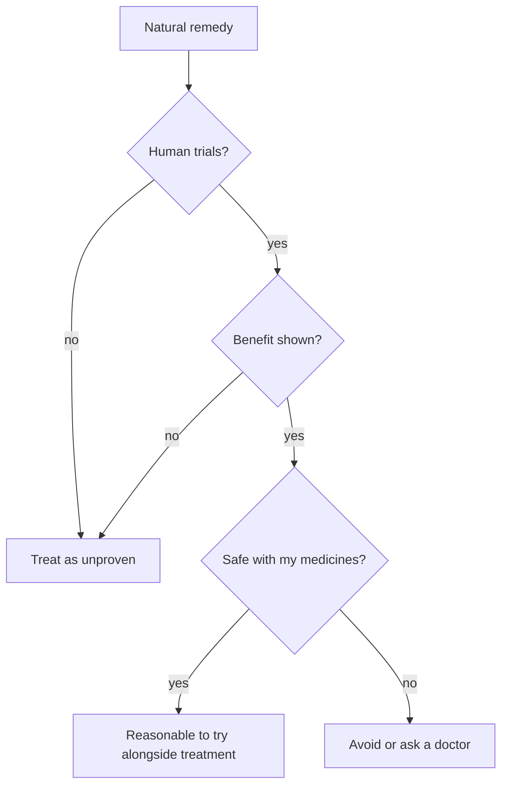

# Natural remedies overview

## Summary

Natural remedies are plant, food or animal-derived products used to prevent or treat health problems. This note maps the remedies in this library to the problems they are used for: blood clots (nattokinase), cold sores (lysine), fungal infections (coconut oil, oregano oil), cancer (graviola), intestinal parasites (papaya seeds), mood (blue vervain), the liver (dandelion), colds (onion syrup), menstrual pain (a supplement protocol) and general wellness (pineapple peel shots). For most of them, human evidence is limited; a few have potential for harm.

*This note is educational. It is not medical advice and does not replace a doctor, dietitian or pharmacist, especially during pregnancy, illness or when taking medicines.*

## Prerequisites

[Evidence grades](../nutrition/evidence-grades.md) explains how evidence is graded.

## Core concepts

### Definition

A *natural remedy* is a product of natural origin used for health purposes, often based on traditional use. *Complementary* use means alongside conventional treatment; *alternative* use means instead of it.

### Analogy

Natural remedies are like a toolbox inherited from grandparents: some tools are excellent (honey for cough), some are worn out (graviola for cancer), and some can hurt you if used wrongly. Each tool must be tested before relying on it. The analogy breaks because, unlike tools, remedies also interact with each other and with medicines.

### Mechanism

The table maps each remedy to its use, its claimed mechanism and the strength of human evidence.

| Problem | Remedy | Claimed mechanism | Evidence |
| --- | --- | --- | --- |
| Blood clots | [Nattokinase](nattokinase.md) | Enzyme from natto that breaks down fibrin | Limited |
| Cold sores (herpes) | [Lysine](../../../natural-sciences/chemistry/biochemistry/amino-acids/lysine.md) | Competes with arginine needed by the herpes virus | Limited |
| Fungal infections | [Coconut oil](coconut-oil.md) | Lauric and caprylic acid damage fungal membranes | Very limited |
| Fungal infections | [Oregano oil](oregano-oil.md) | Carvacrol and thymol damage fungal membranes | Very limited |
| Cancer | [Graviola](graviola.md) | Annonaceous acetogenins kill cancer cells in the laboratory | Not supported; neurotoxic |
| Intestinal parasites | [Papaya seeds](papaya-seeds.md) | Carpaine and benzyl isothiocyanate are toxic to parasites | Limited |
| Mood | [Blue vervain](blue-vervain.md) | Flavonoids and iridoids may be calming | Very limited |
| Liver | [Dandelion](dandelion.md) | Bitter compounds stimulate bile; taraxasterol is antioxidant | Very limited |
| Cold and cough | [Onion syrup](onion-syrup.md) | Honey coats the throat; onion and olive oil add compounds | Limited (honey moderate) |
| Menstrual pain | [Menstrual pain protocol](menstrual-pain-protocol.md) | Omega-3, magnesium, NAC, peony and ginger lower prostaglandins | Limited to moderate |

The flowchart shows how to evaluate a natural remedy.

## Worked example

A person with a recurrent cold sore takes 1 g of lysine daily during stressful periods. Small trials suggest fewer outbreaks with at least 1 g daily, but results are inconsistent. They continue using antiviral cream at the first tingle, the treatment with the best evidence, and see lysine as an optional addition.

## Trade offs and when to use it

- Natural remedies can relieve mild symptoms and give a sense of control, but they must not delay effective treatment for serious disease.
- Products vary in content and purity; some are contaminated or adulterated.

## Common mistakes

- **Using a remedy instead of treatment for serious disease.** Graviola for cancer is an example of harm.
- **Ignoring interactions.** Nattokinase with anticoagulants increases bleeding risk.

## Practice

1. What is the difference between complementary and alternative use?
2. Which remedy in this note is potentially neurotoxic?
3. Which ingredient of onion syrup has the best evidence?

### Answers

1. Complementary use is alongside conventional treatment; alternative use replaces it.
2. Graviola.
3. Honey, for cough.

## Further reading

- Wichtl, M. (Ed.) (2004). *Herbal Drugs and Phytopharmaceuticals (3rd ed.)*. Medpharm and CRC Press. Reference on herbal drugs.
