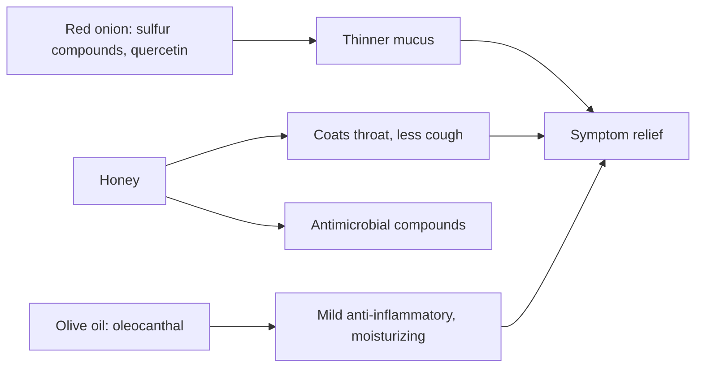

# Onion syrup

## Summary

Onion syrup is a home remedy for colds, cough and sore throat. This version is made by simmering a red onion in water, straining it, and, once it cools below 40 °C, mixing in honey and extra virgin olive oil. Honey has the best evidence: it relieves cough in children over 1 year about as well as some over-the-counter medicines. Onion contributes sulfur compounds and quercetin, and olive oil contributes oleocanthal and a coating effect. The syrup relieves symptoms but does not treat infections.

*This note is educational. It is not medical advice and does not replace a doctor, dietitian or pharmacist, especially during pregnancy, illness or when taking medicines.*

## Prerequisites

- [Natural remedies overview](natural-remedies.md)

## Core concepts

### Definition

*Onion syrup* is a home preparation of onion extract with honey (and here olive oil). *Expectorants* help bring up mucus; *demulcents* coat and soothe irritated mucosa.

### Analogy

Onion syrup works like a warm scarf for the throat: the honey coats and soothes, and the onion adds a gentle "push" to clear mucus. It does not fight the virus itself. The analogy breaks because honey also has some antimicrobial activity.

### Mechanism

**Recipe.**

*Ingredients:*

- 1 large red onion (an ordinary onion also works, but red onions contain more antioxidants, including quercetin);
- 1 glass of water (about 250 mL);
- 1 to 2 tablespoons of honey, ideally natural (linden, buckwheat or multiflower);
- 1 tablespoon of extra virgin olive oil.

*Preparation:*

1. Peel the dry outer skin and cut the onion into thick slices or wedges.
2. Put the onion in a small pot, cover with the water and bring to a boil. Lower the heat and simmer, covered, for about 10 to 15 minutes, until the onion softens and the water turns slightly straw-colored.
3. Strain the liquid through a sieve or gauze into a mug or jar; discard the onion pieces.
4. Let it cool until warm but not hot (below 40 °C), so the honey and olive oil keep their properties.
5. Add the honey and olive oil to the warm liquid and stir until the honey dissolves completely.

*How to use:* adults 1 tablespoon, 3 to 4 times a day; children over 2 years 1 teaspoon, 2 to 3 times a day. Sip slowly so it coats the throat.

*Storage:* in a closed jar in the refrigerator for 2 to 3 days; warm to room temperature before use.

**Ingredients and their properties.**

- *Red onion*: sulfur compounds and flavonoids, especially quercetin. Sulfur compounds may thin mucus and make it easier to cough up; quercetin is anti-inflammatory in laboratory studies ([Quercetin](../nutrition/phytonutrients/quercetin.md)). Onion provides vitamin C and antioxidants. Onion extracts inhibit some bacteria in the laboratory. Cooking reduces some vitamins but increases quercetin release.
- *Honey*: one of the best-studied natural remedies for cold symptoms. Clinical studies and WHO guidance support honey for cough, especially in children, with effects similar to or better than some pharmacy syrups. It coats the throat mucosa, reducing irritation and the cough reflex. It contains hydrogen peroxide and other antimicrobial compounds.
- *Extra virgin olive oil*: contains oleocanthal, which inhibits COX enzymes like ibuprofen, though in small amounts; it also coats and moisturizes a dry, irritated throat.

The flowchart shows how the ingredients act.

### Proposed effects and evidence

Each entry states the proposed effect and how strong the human evidence is, using the grades defined in the [Evidence grades](../nutrition/evidence-grades.md) note.

- **Cough relief from honey.** Cochrane: honey probably relieves cough in children more than no treatment or placebo. Evidence: moderate.
- **"Cleans the lungs".** Partly true: it does not filter the lungs, but may act as an expectorant that eases clearing of phlegm. Evidence: limited.
- **"Strengthens immunity".** Onion and honey contain vitamin C, antioxidants and antimicrobial compounds; the claim is an overstatement of these small effects. Evidence: limited.
- **"Helps clear mucus from the throat".** Plausible expectorant effect of onion; little direct research. Evidence: limited.
- **"Relieves cold symptoms".** Honey eases cough and sore throat; combined effects of the other ingredients are not studied. Evidence: limited.
- **"Supports detox".** Oversimplified: the liver and kidneys detoxify; antioxidants help these organs but the syrup is not a detox agent. Evidence: not supported.

## Worked example

A 5-year-old has a night-time cough during a cold. The parent gives 1 teaspoon of onion syrup before bed. In trials, a dose of honey before bed reduced cough frequency and improved sleep for both child and parents compared with no treatment. If the child develops high fever, difficulty breathing or symptoms lasting more than 2 to 3 weeks, a doctor should be consulted.

## Trade offs and when to use it

Onion syrup is a cheap, safe symptom reliever for mild colds. Honey must never be given to infants under 1 year because of infant botulism risk. It does not replace medical care for severe or persistent symptoms.

## Common mistakes

- **Giving honey to infants under 1 year.** Risk of infant botulism.
- **Adding honey to boiling liquid.** Cool below 40 °C first.
- **Using it for high fever or breathing difficulty.** Seek medical care.

## Practice

1. Why must the onion water cool below 40 °C before adding honey?
2. Which ingredient has the best evidence for cough?
3. What is oleocanthal?

### Answers

1. To preserve honey and olive oil properties.
2. Honey.
3. An olive oil compound that inhibits COX enzymes like ibuprofen.

## Further reading

- Oduwole, O., Udoh, E. E., Oyo-Ita, A. et al. (2018). Honey for acute cough in children. Cochrane Database of Systematic Reviews, CD007094. [DOI](https://doi.org/10.1002/14651858.CD007094.pub5). Cochrane review of honey for cough in children.
- Beauchamp, G. K., Keast, R. S. J., Morel, D. et al. (2005). Phytochemistry: ibuprofen-like activity in extra-virgin olive oil. Nature, 437, 45-46. [DOI](https://doi.org/10.1038/437045a). Discovery of oleocanthal in olive oil.
