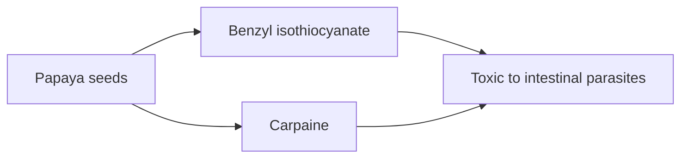

# Papaya seeds

## Summary

Papaya (Carica papaya) seeds contain carpaine, benzyl isothiocyanate and other compounds with antiparasitic activity. A small trial in Nigerian children found that a papaya seed and honey mixture cleared intestinal parasites more often than honey alone. They are eaten raw, dried or as supplements. Evidence is limited, and standard antiparasitic drugs are much better studied. Papaya seeds may reduce fertility in animal studies.

*This note is educational. It is not medical advice and does not replace a doctor, dietitian or pharmacist, especially during pregnancy, illness or when taking medicines.*

## Prerequisites

- [Natural remedies overview](natural-remedies.md)

## Core concepts

### Definition

*Carpaine* is an alkaloid of papaya leaves and seeds. *Benzyl isothiocyanate* forms from glucotropaeolin and is considered the main antiparasitic compound.

### Analogy

Papaya seeds are like a natural pesticide inside the fruit, protecting the seeds from worms. Eating them may deliver some of that pesticide to intestinal parasites. The analogy breaks because the dose and effect in humans are not well defined.

### Mechanism

Benzyl isothiocyanate is toxic to nematodes in the laboratory. Carpaine affects muscle function of parasites. In animals, high doses of papaya seed extract reduced sperm production.

The flowchart shows the proposed action.

### Proposed effects and evidence

Each entry states the proposed effect and how strong the human evidence is, using the grades defined in the [Evidence grades](../nutrition/evidence-grades.md) note.

- **Kill intestinal parasites.** One small trial in children found higher clearance than placebo. Evidence: limited.

## Worked example

In a pilot study (Okeniyi and colleagues, 2007), 60 Nigerian children with intestinal parasites received an elixir of dried papaya seeds with honey or honey alone. After 7 days, stool clearance was 71 to 77 percent with papaya seeds versus 0 to 7 percent with honey. The study was small and not compared with standard drugs.

## Trade offs and when to use it

Papaya seeds are peppery and safe in small food amounts. People planning pregnancy may wish to avoid large amounts because of animal fertility data. Suspected parasitic infection needs diagnosis and standard treatment.

## Common mistakes

- **Self-treating suspected parasites without diagnosis.** Stool tests guide effective treatment.
- **Eating large amounts.** Effects on fertility in animals warrant caution.

## Practice

1. Which compound is thought to give papaya seeds antiparasitic activity?
2. What did the pilot study in children find?
3. Why should people planning pregnancy be cautious?

### Answers

1. Benzyl isothiocyanate (also carpaine).
2. Higher parasite clearance than honey alone.
3. Animal studies show reduced fertility.

## Further reading

- Okeniyi, J. A. O., Ogunlesi, T. A., Oyelami, O. A. et al. (2007). Effectiveness of dried Carica papaya seeds against human intestinal parasitosis: a pilot study. Journal of Medicinal Food, 10(1), 194-196. [DOI](https://doi.org/10.1089/jmf.2005.065). Pilot study of papaya seeds for intestinal parasites.
