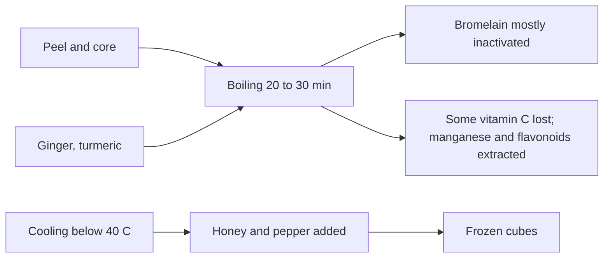

# Pineapple peel shots

## Summary

Pineapple peel shots are a home brew made by boiling pineapple peels and core with ginger and turmeric, adding black pepper and honey after cooling, and freezing the liquid as ice cubes. The peel and core contain bromelain (a protein-digesting enzyme), vitamin C, flavonoids and manganese. The idea is a "health shot" for digestion and immunity. Bromelain is largely inactivated by boiling, so most enzyme effects claimed for the shots are unlikely; ginger and turmeric add their own limited effects.

*This note is educational. It is not medical advice and does not replace a doctor, dietitian or pharmacist, especially during pregnancy, illness or when taking medicines.*

## Prerequisites

- [Natural remedies overview](natural-remedies.md)

## Core concepts

### Definition

*Pineapple peel shots* are a decoction of pineapple waste parts (peel and core) with spices. *Bromelain* is a mixture of cysteine proteases from pineapple stem and fruit.

### Analogy

Pineapple peel shots are like using vegetable scraps to make stock: nothing is wasted, and some flavor and nutrients end up in the liquid. The analogy breaks because the most famous ingredient, bromelain, is an enzyme that heat destroys, unlike the flavor of stock.

### Mechanism

**Recipe (per pineapple).**

*Ingredients:* 1 fresh pineapple; 1 liter of water; 2 to 3 cm of fresh ginger; half a teaspoon of turmeric (or a small slice of fresh root); a pinch of black pepper (piperine increases curcumin bioavailability about 20-fold); 1 to 2 teaspoons of honey (added after cooling).

*Step 1: washing.* The peel is porous, so cleaning matters. Rinse under hot water, scrub with a brush and soak for 10 to 15 minutes in 1 liter of water with 1 teaspoon of baking soda (or 2 tablespoons of apple cider vinegar), then rinse well. A study on apples found baking soda solution removed surface pesticides better than tap water, though not pesticides that had penetrated the peel.

*Step 2: preparation.* Peel the pineapple, cut the peels into smaller pieces, keep the core (it contains the most bromelain) and slice the ginger.

*Step 3: boiling.* Put peels and core in a pot, add ginger and turmeric, pour in 1 liter of water, bring to a boil, lower the heat and simmer 20 to 30 minutes. Longer boiling does not improve quality.

*Step 4: steeping.* Remove from heat and leave for 30 to 45 minutes.

*Step 5: straining and seasoning.* Strain, add a pinch of pepper (do not boil it, as it turns bitter), let cool below 40 °C and stir in the honey.

*Step 6: freezing.* Pour into silicone ice cube molds once completely cool and freeze for several hours; transfer the cubes to a bag.

*Storage.* Up to 3 months in the freezer, best quality in the first 6 weeks. Use cubes in hot tea, water or smoothies.

**About bromelain.** Bromelain is inactivated at temperatures above about 60 to 70 °C, so 20 to 30 minutes of boiling destroys most of its activity, contrary to the notes' assumption that part survives in the water. Raw pineapple core blended into a smoothie retains more bromelain. Freezing does not restore it.

The flowchart shows what happens to each ingredient.

### Proposed effects and evidence

Each entry states the proposed effect and how strong the human evidence is, using the grades defined in the [Evidence grades](../nutrition/evidence-grades.md) note.

- **Digestion: bromelain helps digest protein; ginger reduces nausea and helps gut motility.** Bromelain is largely inactivated by boiling; ginger effects are real but small. Evidence: limited.
- **Immunity: vitamin C and antioxidants, anti-inflammatory curcumin, antibacterial honey.** Small amounts; no studies of the drink. Evidence: very limited.
- **Strong anti-inflammatory synergy of bromelain, ginger and curcumin.** Not studied; bromelain is inactive after boiling. Evidence: very limited.
- **Better metabolism and thermogenesis: ginger raises energy expenditure, turmeric supports blood glucose.** Small effects in trials of the isolated spices. Evidence: limited.
- **Less swelling: bromelain improves lymph flow.** Oral bromelain supplements reduce swelling after surgery in some trials; not applicable to boiled shots. Evidence: very limited.
- **Support for athletes: better recovery from bromelain, ginger for minor inflammation.** Limited evidence for supplements; none for the drink. Evidence: very limited.

## Worked example

A person makes shots from one pineapple, yielding about 800 mL of liquid and 30 ice cubes. One cube in a cup of hot tea adds flavor, a little vitamin C and manganese, and the ginger and turmeric taste. If they want bromelain, they could instead blend raw pineapple core into a smoothie.

## Trade offs and when to use it

The shots are a tasty way to reduce food waste. Contraindications noted with good reason:

- stomach problems (ulcers, acute gastritis, severe reflux), because fruit acids may irritate;
- anticoagulant medicines (bromelain, curcumin and ginger may enhance their effect);
- diabetes medicines (turmeric may affect blood glucose);
- pineapple allergy (cross-reactions are rare but possible);
- pregnancy (large amounts of ginger and turmeric may increase contraction risk; small amounts are usually fine, but consult a doctor);
- irritable bowel syndrome or SIBO (the gut may be irritated; test small amounts).

## Common mistakes

- **Expecting active bromelain after boiling.** Heat inactivates it.
- **Adding honey to hot liquid.** Add it below 40 °C.
- **Taking with anticoagulants without advice.** Several ingredients may increase bleeding.

## Practice

1. Which part of the pineapple contains the most bromelain?
2. What happens to bromelain during boiling?
3. Why is black pepper added?

### Answers

1. The core.
2. It is mostly inactivated.
3. Piperine increases curcumin absorption.

## Further reading

- Pavan, R., Jain, S., Shraddha et al. (2012). Properties and therapeutic application of bromelain: a review. Biotechnology Research International, 2012, 976203. [DOI](https://doi.org/10.1155/2012/976203). Review of bromelain properties.
- Yang, T., Doherty, J., Zhao, B. et al. (2017). Effectiveness of commercial and homemade washing agents in removing pesticide residues on and in apples. Journal of Agricultural and Food Chemistry, 65(44), 9744-9752. [DOI](https://doi.org/10.1021/acs.jafc.7b03118). Study of washing agents for removing pesticides from apples.
- Shoba, G., Joy, D., Joseph, T. et al. (1998). Influence of piperine on the pharmacokinetics of curcumin in animals and human volunteers. Planta Medica, 64(4), 353-356. [DOI](https://doi.org/10.1055/s-2006-957450). Piperine and curcumin bioavailability.
