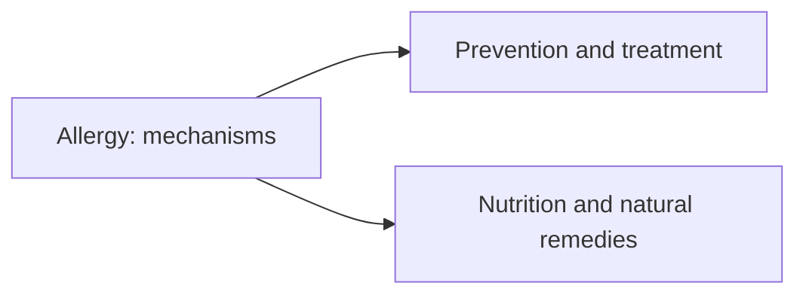

# Conditions

Notes on specific diseases and health conditions: their mechanisms, prevention, treatment and the role of nutrition and natural remedies. The field currently covers allergy, in three notes. The notes are educational; diagnosis and treatment belong to clinicians.

## Map

## Reading order

1. [Allergy](allergy.md)
2. [Allergy prevention and treatment](allergy-prevention-and-treatment.md)
3. [Allergy: nutrition and natural remedies](allergy-nutrition-and-natural-remedies.md)
